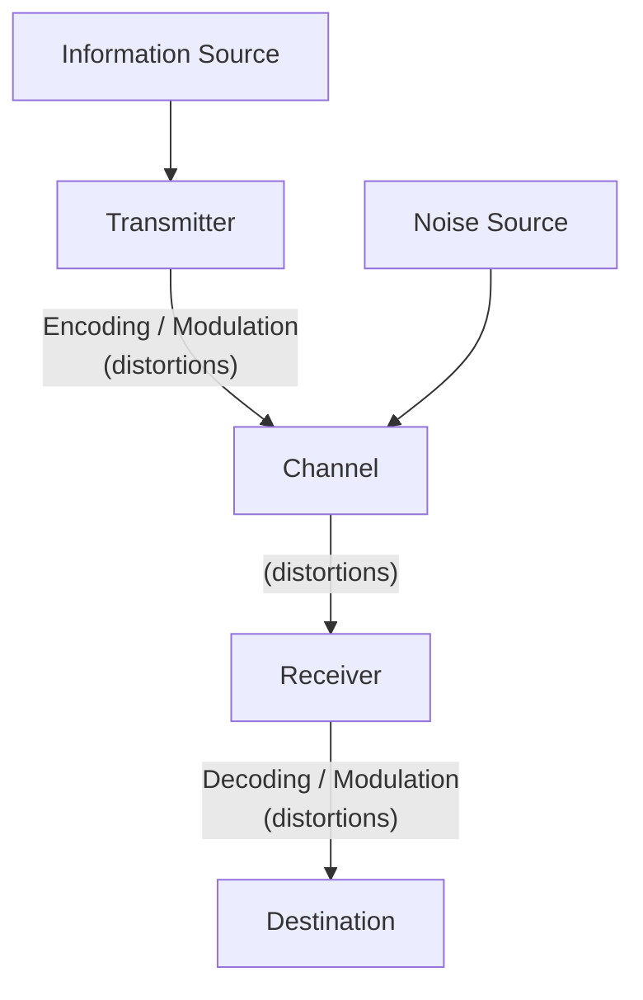
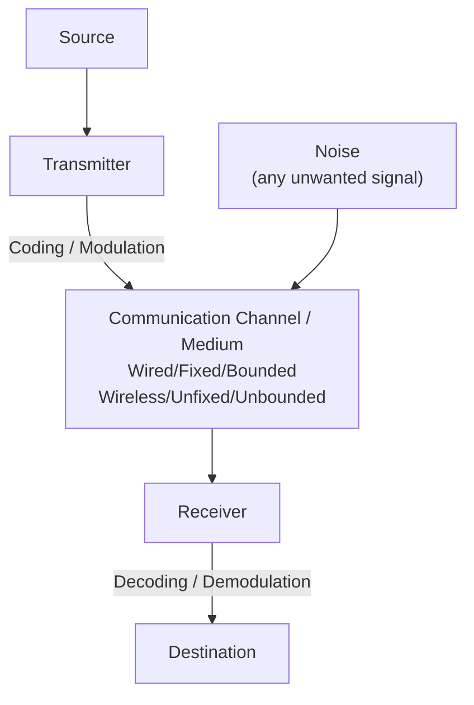

# CPE12: Data and Digital Communication

## Exam Reviewer — Lecture 1: Introduction to Electronic Communication Systems

---

## 1. Brief History of Electronic Communications

|Year|Event|
|---|---|
|1440|Gutenberg invents the printing press|
|1844|Morse patents the telegraph|
|1864|Maxwell concludes light, electricity & magnetism are related|
|1866|1st successful use of a transatlantic cable|
|1876|Bell invents & patents the telephone|
|1877|Edison invents the phonograph|
|1879|Eastman develops photographic film|
|1880|Hertz discovers electromagnetic waves|
|**1887**|**Hertz discovers radio waves**|
|1895|Marconi demonstrates wireless telegraphy|
|1897|Braun invents the 1st CRT oscilloscope|
|1901|Marconi makes the 1st transatlantic radio transmission|
|1903|The Fleming valve is invented|
|1906|De Forest invents the triode vacuum tube (audion tube); Fessenden demonstrates the 1st electronic voice communication|
|1914|Armstrong develops the superheterodyne radio receiver|
|1920|1st commercial AM radio broadcast|
|1923|Zworykin invents the iconoscope; television is invented|
|1939|1st use of two-way radio|
|1940–45|RADAR is perfected|
|1941|Commercial television broadcasting begins|
|1948|Bell Labs invents the transistor|
|1953|Color television broadcasting begins|
|1959|Integrated Circuits invented|
|1962|1st communication satellite launched|
|1969|Stereo FM broadcasting begins|
|1970|ARPA develops packet switching technology; HDTV introduced in Japan|
|1971|Microprocessor is invented|
|1976|VHS home recording format introduced|
|1977|1st commercial use of optical fiber cables|
|1981|IBM PC introduced & world's 1st cellular telephone network begins|
|1983|Cellular telephone networks introduced in the US|
|1989|World Wide Web debuts|
|1990|1st digital cellular network begins|
|1993|Pentium chip hits the market|
|1995|Global Positioning System (GPS) deployed|
|1996|1st smartphone|
|1997|1st wireless LANs|
|1998|Bluetooth formed by Ericsson, IBM, Intel, Nokia & Toshiba|
|1999|HDTV standards implemented in the US; DTV transmission begins|

**Key people to remember:**

- **Heinrich Hertz (1887)** – discovered radio waves; proved radio and light waves travel at the same velocity (both are electromagnetic radiation)
- **Guglielmo Marconi (1895/1901)** – demonstrated wireless telegraphy; achieved 1st transatlantic wireless communication in 1901

---

## 2. Elements of a Communication System

A communication system must fulfill **two basic requirements**:

1. **Accurate** communication
2. **Fast** communication

**Systems developed based on type of information sent:**

- Radio
- Telephony
- Telegraphy
- Broadcasting
- Radar
- Radio Telemetry
- Radio Aids to Navigation

**Fundamental purpose:** to transfer information from one place to another.

---

## 3. Block Diagram / General Model of a Communication System

### Basic Block Diagram

### General Model of All Communication Systems

**Flow:** Source → Transmitter (coding/modulation) → Communication Channel/Medium (wired/fixed/bounded OR wireless/unfixed/unbounded) → Receiver (decoding/demodulation) → Destination

**Noise** enters at the channel and is defined as **any unwanted signal**.

---

## 4. Key Terms and Definitions

| Term                         | Definition                                                                                                                                            |
| ---------------------------- | ----------------------------------------------------------------------------------------------------------------------------------------------------- |
| **Electronic Communication** | The transmission, reception, and processing of information between two or more locations using electronic circuits                                    |
| **Information**              | Physical manifestation of the system coming from source to destination                                                                                |
| **Source**                   | Originator of the information                                                                                                                         |
| **Transmitter**              | Collection of electronic components/circuits that convert an electrical signal into a signal suitable for transmission over a medium                  |
| **Modulation**               | Process where a baseband (voice, video, digital) signal modifies a higher-frequency carrier signal; carrier is usually a sine wave from an oscillator |
| **Encoder**                  | Device that systematically alters the form of a signal to make it suitable for transmission                                                           |
| **Communication Channel**    | Electrical/electromagnetic connection between transmitter and receiver that bridges the distance                                                      |
| **Decoder**                  | Reproduces the signal so it can be understood at the destination                                                                                      |
| **Receiver**                 | Collection of electronic components/circuits that accepts the transmitted message and converts it to a form understandable by humans                  |
| **Destination**              | End user of the electrical signal                                                                                                                     |
| **Noise**                    | Any unwanted, random, or interfering signal that disrupts clarity of the intended information                                                         |
| **Distortion**               | Any change in a signal that alters its basic waveform                                                                                                 |
| **Attenuation**              | Loss of signal strength; **proportional to the square of the distance** between transmitter and receiver                                              |

---

## 5. Communication Media / Channels

|Medium|Also Known As|Description|
|---|---|---|
|**Electrical Conductors**|Transmission Line / Line Communication|Wire pairs, coaxial cable, twisted-pair (LAN); overhead lines and buried cables; common in telephone/telex networks|
|**Optical Media**|Light Waves / Fiber Optics (FO)|Thin fibers of glass/transparent solids carrying light signals; used for long-distance calls and Internet|
|**Free Space**|Radio Waves / Wireless / Radio Communication|Propagation through the atmosphere (free space propagation); uses the electromagnetic spectrum; also includes visible/infrared light|

**Types of transmission paths (physical cables):**

- Unshielded Twisted Pairs (UTP)
- Shielded Twisted Pairs (STP)
- Coaxial Cable
- Fiber Optic Cable

---

## 6. Types of Signals

|Signal Type|Characteristics|
|---|---|
|**Analog**|Smoothly and continuously varying voltage/current (e.g., voice, video signals)|
|**Digital**|Changes in discrete steps/increments; mostly uses binary (two-state) codes|

**Digital signal representations:**

- Continuous wave transmission (e.g., Morse code — dots and dashes)
- On/off digital code (Mark = on, Space = off)
- Serial binary code (1s and 0s)

---

## 7. Transmission Modes

|Mode|Direction|Send/Receive Capability|Performance|Example|
|---|---|---|---|---|
|**Simplex**|Unidirectional (one-way only)|Sender only sends; receiver only receives (no reply)|Worst performing|Keyboard and monitor|
|**Half Duplex**|Two-directional, one at a time|Both can send & receive, but not simultaneously|Better than simplex|Walkie-talkie|
|**Full Duplex**|Two-directional, simultaneous|Both send & receive at the same time|Best performing|Telephone|

---

## 8. Components of a Transmitter (3)

1. **Oscillator** – produces the carrier wave
2. **Modulating Amplifier** – accomplishes the modulation process
3. **Transmitting Antenna** – radiates electromagnetic waves

## 9. Components of a Receiver (3)

1. **Receiving Antenna** – captures the signal in space
2. **Demodulator** – extracts the signal from the carrier wave
3. **Oscillator** – part of the internal tuning circuit

---

## 10. Electromagnetic Spectrum

- Information must be converted into **electrical signals** to radiate through space.
- These signals consist of **electric and magnetic fields** → travel long distances.
- Also called **radio frequency (RF) waves**.
- EM waves oscillate **sinusoidally**; frequency measured in **Hertz (Hz)** or cycles per second (cps).
- **Electromagnetic Spectrum** = entire range of these frequencies.

### Key Formula

$$\lambda = \frac{c}{f} \quad \text{or} \quad f = \frac{c}{\lambda}$$

Where:

- **c** = speed of light = 3 × 10⁸ m/s
- **λ** (lambda) = wavelength, in meters
- **f** = frequency, in Hertz

### Worked Examples

**Example 1:** If f = 21 MHz, find the wavelength. $$\lambda = \frac{3 \times 10^8 \text{ m/s}}{21 \times 10^6 \text{ Hz}} = 14.29 \text{ m}$$

**Example 2:** If λ = 2.4 m, find the frequency. $$f = \frac{3 \times 10^8 \text{ m/s}}{2.4 \text{ m}} = 125 \text{ MHz}$$

> **Tip:** Memorize the formula and be ready to solve for either λ or f given the other value. Watch your unit conversions (MHz → Hz, etc.)

---

## 11. Electromagnetic Spectrum Table (Memorize Ranges + Names)

|Frequency Range|Band Name|
|---|---|
|30 – 300 Hz|Extremely Low Frequency (ELF)|
|300 – 3000 Hz|Voice Frequency (VF)|
|3 – 30 kHz|Very Low Frequency (VLF)|
|30 – 300 kHz|Low Frequency (LF)|
|300 – 3000 kHz|Medium Frequency (MF)|
|3 – 30 MHz|High Frequency (HF)|
|30 – 300 MHz|Very High Frequency (VHF)|
|300 – 3000 MHz|Ultra High Frequency (UHF)|
|3 – 30 GHz|Super High Frequency (SHF)|
|30 – 300 GHz|Extremely High Frequency (EHF)|
|300 – 3000 GHz|Infrared Light|
|3 – 30 THz|Infrared Light|
|30 – 300 THz|Infrared Light|
|300 – 3000 THz|Visible Light|
|3 – 30 PHz|Ultraviolet Light|
|30 – 300 PHz|X-rays|
|300 – 3000 PHz|Gamma Rays|
|3 – 30 EHz|Cosmic Rays|

### Specific Values (memorize separately)

|Type|Range/Value|
|---|---|
|Direct Current|0 Hz|
|Power Frequency|10 – 1000 Hz|
|Audio Frequency|20 – 20,000 Hz|
|Voice Frequency|300 – 3400 Hz|
|Video Frequency|50 Hz – 4.5 MHz|
|Supersonic/Ultrasonic Frequency|25 kHz – 2 MHz|

---

## 12. Applications by Frequency Band

|Band|Applications|
|---|---|
|**ELF**|AC power distribution signals, low-frequency telemetry|
|**Voice Frequency**|Human conversation|
|**VLF**|Upper end of human hearing range; submarine communication (24 kHz)|
|**LF**|Marine & aeronautical communications, navigational beacons, LORAN navigation (100 kHz)|
|**MF**|Commercial AM Radio Broadcast, International (535 – 1605 kHz)|
|**HF**|Shortwave radio; two-way comm (136–174 MHz); Amateur & Citizen Band radio|
|**VHF**|Air Navigation (108–118 MHz), Air Communication (118–136 MHz), Marine & Aeronautical (216–220 MHz), Commercial FM Radio (88–108 MHz), Commercial TV (channels 2–13)|
|**UHF**|Mobile comm/GSM (850/900/1800/1900 MHz), GPS (1.575 GHz), RADAR & Navigation, Microwave & satellite radio, Commercial TV (channels 14–69: 470–806 MHz)|
|**SHF**|Microwave communications, Satellite communications, RADAR|
|**EHF**|Satellite communications, Specialized radars, Car Radar (76 GHz)|

**Commercial TV Broadcast VHF Channel Breakdown:**

- Channels 2–4: 54–72 MHz
- Channels 5–6: 76–88 MHz
- Channels 7–13: 174–216 MHz

---
