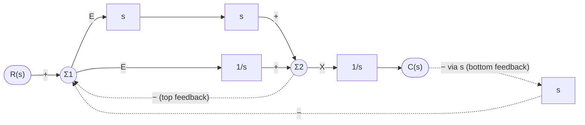
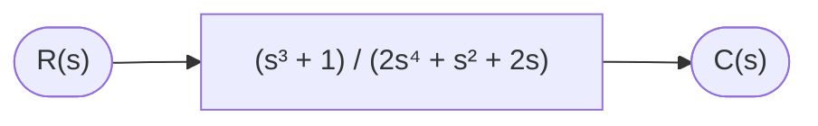
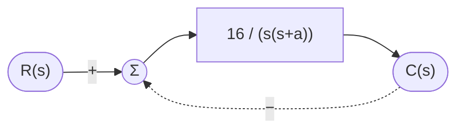
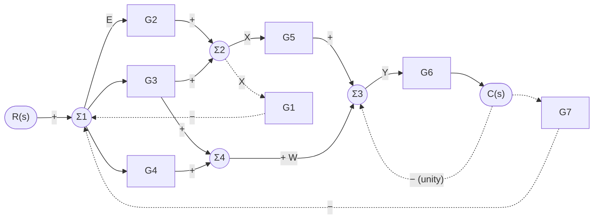
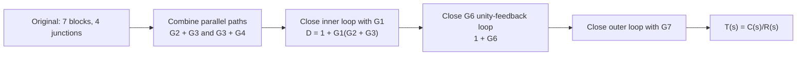
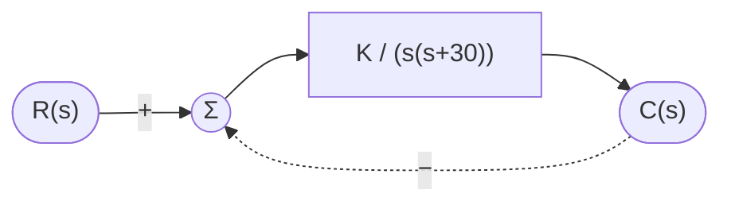

## title: Assignment 1 – Midterm Solutions tags: [control-systems, block-diagram-reduction, transient-response]

# Assignment 1 – Midterm: Solutions

> Block diagrams are drawn with Mermaid. Equations use LaTeX (`$...$`), both of which render natively in Obsidian. Summing junctions are drawn as circles `Σ`; the sign on each edge is the sign with which that signal enters the junction.

**Useful 2nd-order formulas (used in Problems 2 and 4)**

$$ \%OS = e^{-\zeta\pi/\sqrt{1-\zeta^2}}\times 100 \quad\Longrightarrow\quad \zeta = \frac{-\ln(\%OS/100)}{\sqrt{\pi^2+\ln^2(\%OS/100)}} $$

Standard form: $T(s)=\dfrac{\omega_n^2}{s^2+2\zeta\omega_n s+\omega_n^2}$

---

## Problem 1 – Equivalent transfer function (Figure 5.13)

### Given system

### Solution (write the node equations)

Let $E$ = output of $\Sigma_1$ and $X$ = output of $\Sigma_2$.

**Forward path / summing junctions**

$$ E = R - X - sC $$

$$ X = s\cdot s\cdot E + \frac{1}{s}E = \frac{s^3+1}{s},E $$

$$ C = \frac{1}{s}X ;;\Rightarrow;; X = sC $$

**Substitute $X = sC$ into $E$:**

$$ E = R - sC - sC = R - 2sC $$

**Output in terms of $E$:**

$$ C = \frac{X}{s} = \frac{s^3+1}{s^2},E = \frac{s^3+1}{s^2},(R-2sC) $$

$$ C\left[1+\frac{2(s^3+1)}{s}\right] = \frac{s^3+1}{s^2},R $$

$$ C,\frac{2s^3+s+2}{s} = \frac{s^3+1}{s^2},R $$

### Result

$$ \boxed{T(s)=\frac{C(s)}{R(s)}=\frac{s^3+1}{s,(2s^3+s+2)}=\frac{s^3+1}{2s^4+s^2+2s}} $$

### Reduced diagram

---

## Problem 2 – Design $a$ for 5 % overshoot

### Given system

$$G(s)=\frac{16}{s(s+a)},\qquad \text{unity feedback}$$

### Step 1 – Closed-loop transfer function

$$ T(s)=\frac{G}{1+G}=\frac{16}{s^2+as+16} $$

Compare with the standard form:

$$ \omega_n^2=16 \Rightarrow \omega_n = 4\ \text{rad/s}, \qquad 2\zeta\omega_n = a \Rightarrow a = 8\zeta $$

### Step 2 – Damping ratio for 5 % overshoot

$$ \zeta=\frac{-\ln(0.05)}{\sqrt{\pi^2+\ln^2(0.05)}} =\frac{2.9957}{\sqrt{9.8696+8.9744}} =\frac{2.9957}{4.3410}\approx 0.690 $$

### Step 3 – Solve for $a$

$$ a = 8\zeta = 8(0.690) $$

$$ \boxed{a \approx 5.52} $$

**Check:** $T(s)=\dfrac{16}{s^2+5.52s+16}$ → $\zeta = 5.52/(2\cdot4)=0.69$ → $\%OS\approx 5\%$ ✔

---

## Problem 3 – Block diagram reduction (Figure P5.3)

### Given system

Signal names used in the reduction:

- $E$ – output of $\Sigma_1$ (first junction)
- $X$ – output of $\Sigma_2$ (feeds $G_5$ and $G_1$)
- $Y$ – output of $\Sigma_3$ (feeds $G_6$)
- $W$ – output of $\Sigma_4$ (bottom junction)

### Step 1 – Write the equations

Define the two parallel sums:

$$ G_{23}=G_2+G_3,\qquad G_{34}=G_3+G_4 $$

Junction equations:

$$ E = R - G_1X - G_7C $$

$$ X = (G_2+G_3)E = G_{23}E $$

$$ W = (G_3+G_4)E = G_{34}E $$

$$ Y = G_5X + W - C \qquad\text{(the top line from } C \text{ enters } \Sigma_3 \text{ with a minus sign)} $$

$$ C = G_6Y $$

### Step 2 – Eliminate internal signals

From $E$:

$$ E,[1+G_1G_{23}] = R - G_7C ;;\Rightarrow;; E=\frac{R-G_7C}{1+G_1G_{23}} $$

From $Y$ and $C$:

$$ Y = \big[G_5G_{23}+G_{34}\big]E - C $$

Let $N = G_5G_{23}+G_{34}$ and $D = 1+G_1G_{23}$:

$$ C = G_6,(NE - C);\Rightarrow; C,(1+G_6) = G_6,N,E $$

Substitute $E$:

$$ C,(1+G_6),D = G_6N,(R-G_7C) $$

$$ C\big[(1+G_6)D + G_6G_7N\big] = G_6N,R $$

### Result

$$ \boxed{ T(s)=\frac{C(s)}{R(s)}= \frac{G_6\big[G_5(G_2+G_3)+G_3+G_4\big]} {(1+G_6)\big[1+G_1(G_2+G_3)\big]+G_6G_7\big[G_5(G_2+G_3)+G_3+G_4\big]} } $$

### Block-diagram reduction summary

---

## Problem 4 – Find $K$ for 10 % overshoot

### Given system

### Step 1 – Closed-loop transfer function

$$ T(s)=\frac{G}{1+G}=\frac{K}{s^2+30s+K} $$

Compare with the standard form:

$$ \omega_n^2 = K, \qquad 2\zeta\omega_n = 30 ;\Rightarrow; \omega_n=\frac{15}{\zeta} $$

### Step 2 – Damping ratio for 10 % overshoot

$$ \zeta=\frac{-\ln(0.10)}{\sqrt{\pi^2+\ln^2(0.10)}} =\frac{2.3026}{\sqrt{9.8696+5.3019}} =\frac{2.3026}{3.8951}\approx 0.591 $$

### Step 3 – Solve for $K$

$$ \omega_n=\frac{15}{0.591}\approx 25.37\ \text{rad/s} $$

$$ K=\omega_n^2=\frac{225}{\zeta^2}=\frac{225}{0.3495} $$

$$ \boxed{K\approx 644} $$

**Check:** $T(s)=\dfrac{644}{s^2+30s+644}$ → $\omega_n=25.4$, $\zeta=30/(2\cdot25.4)=0.591$ → $\%OS \approx 10 \%$ ✔

---

## Summary of answers

|#|Problem|Answer|
|---|---|---|
|1|$T(s)$ for Fig. 5.13|$\dfrac{s^3+1}{2s^4+s^2+2s}$|
|2|$a$ for 5 % overshoot|$a \approx 5.52$|
|3|$T(s)$ for Fig. P5.3|$\dfrac{G_6[G_5(G_2+G_3)+G_3+G_4]}{(1+G_6)[1+G_1(G_2+G_3)]+G_6G_7[G_5(G_2+G_3)+G_3+G_4]}$|
|4|$K$ for 10 % overshoot|$K \approx 644$|