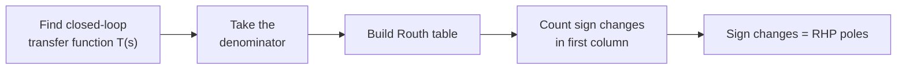

---

## title: "Example 6.1: Creating a Routh Table" date: 2026-10-23 tags: [control-systems, stability, routh-hurwitz, nise, chapter-6] aliases: [Routh table example, Nise Example 6.1]

# Example 6.1: Creating a Routh Table

> [!question] Problem Make the Routh table for the feedback system in Figure 6.4(a) and decide whether it is stable.
> 
> $$G(s)=\frac{1000}{(s+2)(s+3)(s+5)}, \qquad \text{unity negative feedback}$$

**Source:** Nise, _Control Systems Engineering_, Chapter 6, Section 6.2 (Routh-Hurwitz Criterion).

---

## 1. Big idea

Stability depends on where the **closed-loop poles** are, not the open-loop poles of $G(s)$. The Routh-Hurwitz criterion tells us **how many** poles are in the right half-plane (RHP) without solving for the roots.

> [!important] Key rule The number of RHP poles equals the number of **sign changes in the first column** of the Routh table.
> 
> - 0 sign changes: stable
> - 1 or more sign changes: unstable

---

## 2. Step 1: Find the equivalent closed-loop system

We test the **denominator of $T(s)$**, not $G(s)$ itself. For unity negative feedback:

$$T(s)=\frac{G(s)}{1+G(s)}$$

Substitute $G(s)$:

$$T(s)=\frac{\dfrac{1000}{(s+2)(s+3)(s+5)}}{1+\dfrac{1000}{(s+2)(s+3)(s+5)}}=\frac{1000}{(s+2)(s+3)(s+5)+1000}$$

Expand the product:

$$ \begin{aligned} (s+2)(s+3) &= s^2+5s+6 \ (s^2+5s+6)(s+5) &= s^3+5s^2+5s^2+25s+6s+30 \ &= s^3+10s^2+31s+30 \end{aligned} $$

Add 1000 to get the closed-loop denominator:

$$\boxed{T(s)=\frac{1000}{s^3+10s^2+31s+1030}}$$

This matches Figure 6.4(b).

> [!tip] Quick necessary check All coefficients (1, 10, 31, 1030) are positive and none is missing. That does **not** prove stability; it only means we cannot rule it out yet. We need the Routh table.

---

## 3. Step 2: Set up the table

The denominator is $a_3s^3+a_2s^2+a_1s+a_0$ with

|$a_3$|$a_2$|$a_1$|$a_0$|
|:-:|:-:|:-:|:-:|
|1|10|31|1030|

1. Label the rows with powers of $s$, from $s^3$ down to $s^0$.
2. **Row 1 ($s^3$):** the coefficients of the highest power, skipping every other one: $1,\ 31$.
3. **Row 2 ($s^2$):** the coefficients skipped in row 1: $10,\ 1030$.

|Row|Col 1|Col 2|
|:-:|:-:|:-:|
|$s^3$|1|31|
|$s^2$|10|1030|
|$s^1$|||
|$s^0$|||

### Optional simplification

> [!note] Row scaling Any row may be multiplied by a **positive** constant without changing the rows below it. Multiply the $s^2$ row by $\tfrac{1}{10}$:
> 
> $$[10,\ 1030] ;\to; [1,\ 103]$$
> 
> Never multiply a row by a **negative** number, because that flips the sign of the first-column entry and corrupts the sign-change count.

|Row|Col 1|Col 2|
|:-:|:-:|:-:|
|$s^3$|1|31|
|$s^2$|$10 \to 1$|$1030 \to 103$|

---

## 4. Step 3: Fill in the remaining rows

Each new entry is the **negative determinant** of the two rows above, divided by the **first-column entry directly above** the row being computed.

$$ \text{entry}=\frac{-\begin{vmatrix} \text{first col, row } n-2 & \text{next col, row } n-2 \ \text{first col, row } n-1 & \text{next col, row } n-1 \end{vmatrix}}{\text{first col, row } n-1} $$

### Row $s^1$

Using the scaled $s^2$ row $[1,\ 103]$:

$$ s^1:\quad \frac{-\begin{vmatrix} 1 & 31 \ 1 & 103 \end{vmatrix}}{1}=\frac{-(1\cdot103-31\cdot1)}{1}=-(103-31)=-72 $$

The remaining entries in this row are $0$ (no further columns).

> [!check] Same answer without scaling $$\frac{-\begin{vmatrix} 1 & 31 \ 10 & 1030 \end{vmatrix}}{10}=\frac{-(1030-310)}{10}=\frac{-720}{10}=-72$$

### Row $s^0$

Use the $s^2$ row $[1,\ 103]$ and the $s^1$ row $[-72,\ 0]$:

$$ s^0:\quad \frac{-\begin{vmatrix} 1 & 103 \ -72 & 0 \end{vmatrix}}{-72}=\frac{-(1\cdot0-103\cdot(-72))}{-72}=\frac{-7416}{-72}=103 $$

---

## 5. Completed Routh table

|Row|Col 1|Col 2|
|:-:|:-:|:-:|
|$s^3$|1|31|
|$s^2$|10  (scaled: 1)|1030  (scaled: 103)|
|$s^1$|**−72**|0|
|$s^0$|**103**|0|

**First column (using the scaled row):**

$$1,\quad 1,\quad -72,\quad 103$$

---

## 6. Step 4: Interpret the table

Track the signs down the first column:

|Transition|Sign change|
|:--|:-:|
|$s^3 \to s^2$: $+1 \to +1$|no|
|$s^2 \to s^1$: $+1 \to \mathbf{-72}$|**yes (1st)**|
|$s^1 \to s^0$: $\mathbf{-72} \to +103$|**yes (2nd)**|

$$\text{2 sign changes};\Rightarrow;\text{2 poles in the RHP}$$

Since the polynomial is third order, the remaining pole is in the left half-plane.

> [!success] Conclusion The system in Figure 6.4 is **unstable**: it has **2 right-half-plane poles** and **1 left-half-plane pole**. No row of zeros appeared, so there are no $j\omega$-axis poles.

### Optional numerical sanity check

Solving $s^3+10s^2+31s+1030=0$ (for example with MATLAB `roots([1 10 31 1030])`) gives approximately

$$s \approx -13.4,\qquad s \approx 1.7 \pm j,8.6$$

One real LHP pole plus a complex pair with positive real part, which agrees with the Routh result.

---

## 7. Procedure cheat sheet

> [!abstract] Routh table in 6 steps
> 
> 1. Reduce the block diagram to $T(s)$ and take the **denominator**.
> 2. Write rows labeled $s^n$ down to $s^0$.
> 3. Row 1: coefficients at positions 1, 3, 5, ... Row 2: coefficients at positions 2, 4, 6, ...
> 4. Compute each lower entry as $-\det/\text{(first-column entry above)}$.
> 5. Optionally scale a row by a **positive** constant to simplify arithmetic.
> 6. Count sign changes in the first column. That count is the number of RHP poles.

### Common mistakes

- Testing the open-loop denominator instead of the **closed-loop** denominator.
- Multiplying a row by a negative constant.
- Forgetting to add the numerator ($1000$) into the constant term when forming $1+G(s)$.
- Counting sign changes across the whole row instead of only the **first column**.

---

## 8. Related special cases (later in the chapter)

- First-column zero: replace it with $\epsilon$, or reverse the coefficient order (Examples 6.2 and 6.3).
- Entire row of zeros: form the auxiliary (even) polynomial and differentiate it (Examples 6.4, 6.5, 6.8).
- Gain design: keep $K$ symbolic and require every first-column entry positive (Example 6.9).

Related: Nise, _Control Systems Engineering_, Chapter 6 Stability, Skill-Assessment Exercise 6.1