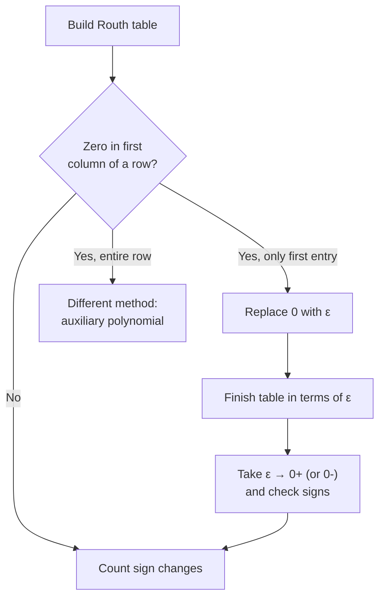

---

## title: "Example 6.2: Stability via Epsilon Method" date: 2026-10-23 tags: [control-systems, stability, routh-hurwitz, epsilon-method, special-case, nise, chapter-6] aliases: [Epsilon method, Zero in first column, Nise Example 6.2]

# Example 6.2: Stability via Epsilon Method

> [!question] Problem Determine the stability of the closed-loop transfer function
> 
> $$T(s)=\frac{10}{s^5+2s^4+3s^3+6s^2+5s+3}$$

**Source:** Nise, _Control Systems Engineering_, Chapter 6, Section 6.3 (Special Cases: zero only in the first column). Builds on [Example 6.1](https://claude.ai/chat/Example-6.1-Routh-Table.md) and [Skill-Assessment 6.1](https://claude.ai/chat/Skill-Assessment-6.1-Routh-Table.md).

---

## 1. The special case

> [!important] Zero in the first column only If a row's **first element is zero** but the row is not entirely zeros, the next row would need a division by zero. To avoid it:
> 
> 1. Replace the zero with a small number $\epsilon$.
> 2. Finish the table in terms of $\epsilon$.
> 3. Let $\epsilon \to 0^+$ (and optionally $0^-$) and read the signs in the first column.



---

## 2. Step 1: Identify the denominator

The transfer function is already closed-loop, so use the denominator directly:

$$s^5+2s^4+3s^3+6s^2+5s+3$$

|$s^5$|$s^4$|$s^3$|$s^2$|$s^1$|$s^0$|
|:-:|:-:|:-:|:-:|:-:|:-:|
|1|2|3|6|5|3|

All coefficients are positive and none is missing, so the quick test is inconclusive. Build the table.

---

## 3. Step 2: First two rows

- **Row $s^5$:** coefficients at positions 1, 3, 5: $1,\ 3,\ 5$
- **Row $s^4$:** coefficients at positions 2, 4, 6: $2,\ 6,\ 3$

|Row|Col 1|Col 2|Col 3|
|:-:|:-:|:-:|:-:|
|$s^5$|1|3|5|
|$s^4$|2|6|3|

Every lower entry uses

$$ \text{entry}=\frac{-\begin{vmatrix} a & b \ c & d \end{vmatrix}}{c}=\frac{bc-ad}{c} $$

with $a, b$ from the row two above and $c, d$ from the row directly above.

---

## 4. Step 3: Row $s^3$ (where the zero appears)

$$ \begin{aligned} \text{col 1:}&\quad \frac{-\begin{vmatrix} 1 & 3 \ 2 & 6 \end{vmatrix}}{2}=\frac{-(6-6)}{2}=\mathbf{0}\[4pt] \text{col 2:}&\quad \frac{-\begin{vmatrix} 1 & 5 \ 2 & 3 \end{vmatrix}}{2}=\frac{-(3-10)}{2}=\frac{7}{2} \end{aligned} $$

> [!warning] Problem The first entry is $0$ and the rest of the row is not zero. The next row would divide by this $0$.

**Fix:** replace the zero with $\epsilon$:

|Row|Col 1|Col 2|
|:-:|:-:|:-:|
|$s^3$|$\epsilon$|$\tfrac{7}{2}$|

> [!note] Book's version The book multiplies this row by 2 and writes $[\epsilon,\ 7]$. This note keeps the raw value $\tfrac{7}{2}$. Both give the same signs in the first column.

---

## 5. Step 4: Continue the table with $\epsilon$

### Row $s^2$ (rows $s^4$ and $s^3$, divisor $\epsilon$)

$$ \begin{aligned} \text{col 1:}&\quad \frac{-\begin{vmatrix} 2 & 6 \ \epsilon & \tfrac{7}{2} \end{vmatrix}}{\epsilon}=\frac{-(7-6\epsilon)}{\epsilon}=\frac{6\epsilon-7}{\epsilon}\[4pt] \text{col 2:}&\quad \frac{-\begin{vmatrix} 2 & 3 \ \epsilon & 0 \end{vmatrix}}{\epsilon}=\frac{-(0-3\epsilon)}{\epsilon}=3 \end{aligned} $$

### Row $s^1$ (rows $s^3$ and $s^2$, divisor $\tfrac{6\epsilon-7}{\epsilon}$)

$$ \frac{-\begin{vmatrix} \epsilon & \tfrac{7}{2} \ \tfrac{6\epsilon-7}{\epsilon} & 3 \end{vmatrix}}{\tfrac{6\epsilon-7}{\epsilon}} =\frac{-3\epsilon^2+\tfrac{7}{2}(6\epsilon-7)}{6\epsilon-7} =\frac{42\epsilon-49-6\epsilon^2}{12\epsilon-14} $$

(Multiplying numerator and denominator by $2\epsilon$ and then by $2$ cleans up the fractions.)

### Row $s^0$ (rows $s^2$ and $s^1$)

The $s^1$ row has only one entry, so

$$ \frac{-\begin{vmatrix} \tfrac{6\epsilon-7}{\epsilon} & 3 \ \text{(s}^1\text{ entry)} & 0 \end{vmatrix}}{\text{(s}^1\text{ entry)}}=3 $$

---

## 6. Completed Routh table

|Row|Col 1|Col 2|Col 3|
|:-:|:-:|:-:|:-:|
|$s^5$|1|3|5|
|$s^4$|2|6|3|
|$s^3$|$\epsilon$|$\tfrac{7}{2}$|0|
|$s^2$|$\dfrac{6\epsilon-7}{\epsilon}$|3|0|
|$s^1$|$\dfrac{42\epsilon-49-6\epsilon^2}{12\epsilon-14}$|0|0|
|$s^0$|3|0|0|

---

## 7. Step 5: Interpret by taking $\epsilon \to 0$

Evaluate each first-column entry as $\epsilon$ becomes very small.

|  Row  |                    First column                    | $\epsilon \to 0^+$ | $\epsilon \to 0^-$ |
| :---: | :------------------------------------------------: | :----------------: | :----------------: |
| $s^5$ |                         1                          |        $+$         |        $+$         |
| $s^4$ |                         2                          |        $+$         |        $+$         |
| $s^3$ |                     $\epsilon$                     |        $+$         |        $-$         |
| $s^2$ |          $\dfrac{6\epsilon-7}{\epsilon}$           |        $-$         |        $+$         |
| $s^1$ | $\dfrac{42\epsilon-49-6\epsilon^2}{12\epsilon-14}$ |        $+$         |        $+$         |
| $s^0$ |                         3                          |        $+$         |        $+$         |

Why those signs:

- **$s^2$:** the numerator $6\epsilon-7\to-7$ (negative). Dividing by a tiny positive $\epsilon$ gives a large negative number; dividing by a tiny negative $\epsilon$ gives a large positive number.
- **$s^1$:** as $\epsilon\to0$ it tends to $\dfrac{-49}{-14}=3.5$, which is positive for either sign of $\epsilon$.

### Sign changes

**Case $\epsilon>0$:** $+,\ +,\ +,\ -,\ +,\ +$

- $s^3 \to s^2$: $+ \to -$ (1)
- $s^2 \to s^1$: $- \to +$ (2)

**Case $\epsilon<0$:** $+,\ +,\ -,\ +,\ +,\ +$

- $s^4 \to s^3$: $+ \to -$ (1)
- $s^3 \to s^2$: $- \to +$ (2)

Both choices give **2 sign changes**.

> [!success] Conclusion The system is **unstable** with **2 poles in the right half-plane**. The remaining $5-2=3$ poles are in the left half-plane. No row of zeros appeared, so there are no $j\omega$-axis poles.

> [!tip] Why both signs agree The sign of $\epsilon$ is arbitrary (it stands in for an exact zero), so the answer must not depend on it. If your two cases disagree, recheck your arithmetic.

---

## 8. Check it in MATLAB

```matlab
roots([1 2 3 6 5 3])
```

Count the roots with positive real part. You should find two.

---

## 9. Takeaways

> [!abstract] Epsilon method recap
> 
> 1. Build the table normally until a row starts with $0$ (and is not entirely zeros).
> 2. Replace that $0$ with $\epsilon$ and keep going.
> 3. Simplify each first-column entry as $\epsilon \to 0$ and note its sign.
> 4. Count sign changes in the first column. That is the number of RHP poles.
> 5. Optional: repeat with $\epsilon<0$ as a self-check.

### Common mistakes

- Treating $\epsilon$ as a number and substituting a value like $0.1$ (it must tend to $0$).
- Forgetting that dividing by $\epsilon$ makes a term huge, so $\frac{6\epsilon-7}{\epsilon}$ takes the sign of $-7/\epsilon$.
- Using this method when the **whole row** is zero (that needs the auxiliary polynomial instead).

### Alternative method

Write the coefficients in **reverse order** and build a Routh table for that polynomial; its roots are the reciprocals of the originals, so they lie in the same half-planes. This is Example 6.3 in the book and is usually less algebra, though it can still produce a zero in the first column.

Related: [Example 6.1](https://claude.ai/chat/Example-6.1-Routh-Table.md), [Skill-Assessment 6.1](https://claude.ai/chat/Skill-Assessment-6.1-Routh-Table.md), Nise Chapter 6 Section 6.3