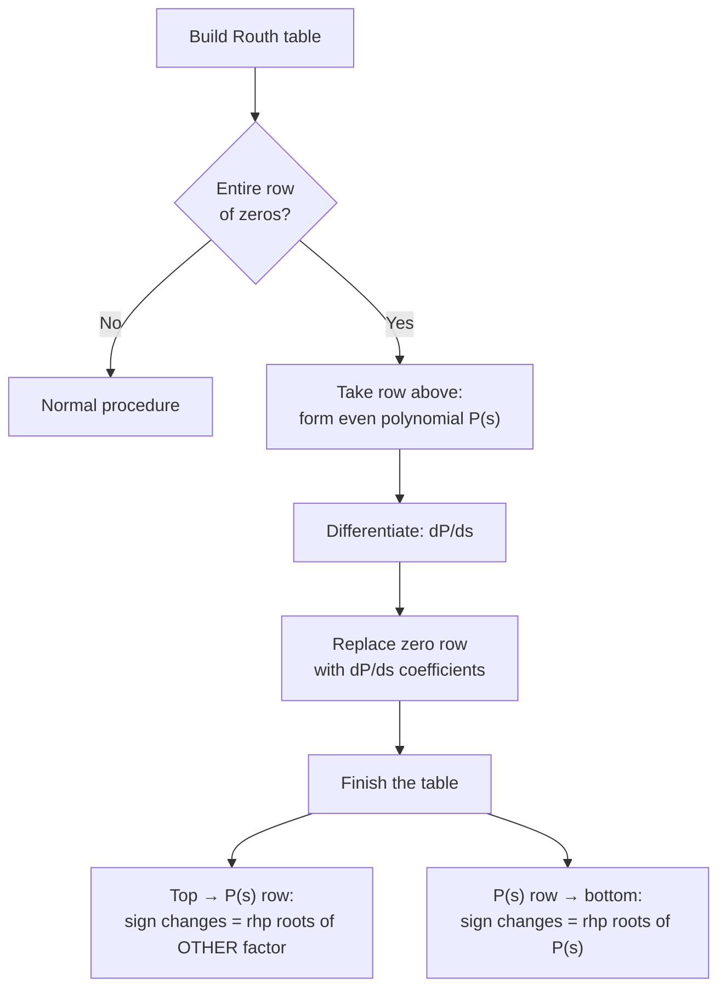

---

## title: "Example 6.5: Pole Distribution via Routh Table with Row of Zeros" date: 2026-10-23 tags: [control-systems, stability, routh-hurwitz, row-of-zeros, even-polynomial, special-case, nise, chapter-6] aliases: [Row of zeros, Auxiliary polynomial, Even polynomial, Nise Example 6.5]

# Example 6.5: Pole Distribution via Routh Table with Row of Zeros

> [!question] Problem For the transfer function
> 
> $$T(s)=\frac{20}{s^8+s^7+12s^6+22s^5+39s^4+59s^3+48s^2+38s+20}$$
> 
> tell how many poles are in the right half-plane (rhp), the left half-plane (lhp), and on the $j\omega$-axis.

**Source:** Nise, _Control Systems Engineering_, Chapter 6, Section 6.3 (Special Cases: entire row of zeros). Builds on [Example 6.1](https://claude.ai/chat/Example-6.1-Routh-Table.md), [Skill-Assessment 6.1](https://claude.ai/chat/Skill-Assessment-6.1-Routh-Table.md) and [Example 6.2](https://claude.ai/chat/Example-6.2-Epsilon-Method.md).

---

## 1. The special case

> [!important] Entire row of zeros A whole row of zeros appears when the polynomial has a purely **even** (or purely odd) polynomial as a factor. Such a polynomial has roots that are **symmetric about the origin**.
> 
> The row of zeros tells you:
> 
> - The row **directly above** it holds the coefficients of that even polynomial, $P(s)$.
> - Replace the zero row with the coefficients of $\dfrac{dP(s)}{ds}$ and keep going.
> - Everything from the $P(s)$ row **down** tests only $P(s)$.
> - Everything from the top **down to** the $P(s)$ row tests only the **other** factor.

---

## 2. Step 1: Coefficients

$$s^8+s^7+12s^6+22s^5+39s^4+59s^3+48s^2+38s+20$$

|$s^8$|$s^7$|$s^6$|$s^5$|$s^4$|$s^3$|$s^2$|$s^1$|$s^0$|
|:-:|:-:|:-:|:-:|:-:|:-:|:-:|:-:|:-:|
|1|1|12|22|39|59|48|38|20|

---

## 3. Step 2: First two rows

- **Row $s^8$:** positions 1, 3, 5, 7, 9: $1,\ 12,\ 39,\ 48,\ 20$
- **Row $s^7$:** positions 2, 4, 6, 8: $1,\ 22,\ 59,\ 38,\ 0$

|Row|Col 1|Col 2|Col 3|Col 4|Col 5|
|:-:|:-:|:-:|:-:|:-:|:-:|
|$s^8$|1|12|39|48|20|
|$s^7$|1|22|59|38|0|

Every lower entry uses

$$ \text{entry}=\frac{-\begin{vmatrix} a & b \ c & d \end{vmatrix}}{c}=\frac{bc-ad}{c} $$

with $a, b$ from the row two above and $c, d$ from the row directly above.

---

## 4. Step 3: Build the rows

### Row $s^6$ (rows $s^8$ and $s^7$, divisor $1$)

$$ \begin{aligned} \text{col 1:}&\quad -\begin{vmatrix} 1 & 12 \ 1 & 22 \end{vmatrix}=-(22-12)=-10\ \text{col 2:}&\quad -\begin{vmatrix} 1 & 39 \ 1 & 59 \end{vmatrix}=-(59-39)=-20\ \text{col 3:}&\quad -\begin{vmatrix} 1 & 48 \ 1 & 38 \end{vmatrix}=-(38-48)=10\ \text{col 4:}&\quad -\begin{vmatrix} 1 & 20 \ 1 & 0 \end{vmatrix}=-(0-20)=20 \end{aligned} $$

Raw row: $[-10,\ -20,\ 10,\ 20]$. Multiply by $\tfrac{1}{10}$ (positive) as the book does: $[-1,\ -2,\ 1,\ 2]$.

### Row $s^5$ (rows $s^7$ and $s^6$, divisor $-1$)

$$ \begin{aligned} \text{col 1:}&\quad \frac{-\begin{vmatrix} 1 & 22 \ -1 & -2 \end{vmatrix}}{-1}=\frac{-(-2+22)}{-1}=20\[4pt] \text{col 2:}&\quad \frac{-\begin{vmatrix} 1 & 59 \ -1 & 1 \end{vmatrix}}{-1}=\frac{-(1+59)}{-1}=60\[4pt] \text{col 3:}&\quad \frac{-\begin{vmatrix} 1 & 38 \ -1 & 2 \end{vmatrix}}{-1}=\frac{-(2+38)}{-1}=40 \end{aligned} $$

Row: $[20,\ 60,\ 40,\ 0]$. Multiply by $\tfrac{1}{20}$: $[1,\ 3,\ 2,\ 0]$.

### Row $s^4$ (rows $s^6$ and $s^5$, divisor $1$)

$$ \begin{aligned} \text{col 1:}&\quad -\begin{vmatrix} -1 & -2 \ 1 & 3 \end{vmatrix}=-(-3+2)=1\ \text{col 2:}&\quad -\begin{vmatrix} -1 & 1 \ 1 & 2 \end{vmatrix}=-(-2-1)=3\ \text{col 3:}&\quad -\begin{vmatrix} -1 & 2 \ 1 & 0 \end{vmatrix}=-(0-2)=2 \end{aligned} $$

Row: $[1,\ 3,\ 2,\ 0,\ 0]$.

### Row $s^3$ (rows $s^5$ and $s^4$, divisor $1$): the row of zeros

$$ \begin{aligned} \text{col 1:}&\quad -\begin{vmatrix} 1 & 3 \ 1 & 3 \end{vmatrix}=-(3-3)=0\ \text{col 2:}&\quad -\begin{vmatrix} 1 & 2 \ 1 & 2 \end{vmatrix}=-(2-2)=0 \end{aligned} $$

> [!warning] Entire row is zero The $s^5$ and $s^4$ rows are identical, so every entry in $s^3$ is $0$. Stop and use the auxiliary polynomial.

---

## 5. Step 4: Even polynomial and its derivative

Take the row **above** the zeros ($s^4$) and use its entries as coefficients of $s^4,\ s^2,\ s^0$:

$$P(s)=s^4+3s^2+2$$

Differentiate:

$$\frac{dP(s)}{ds}=4s^3+6s+0$$

Replace the zero row with $[4,\ 6,\ 0]$. Multiply by $\tfrac{1}{2}$ (positive): $[2,\ 3,\ 0]$.

> [!tip] Sanity check on $P(s)$ $P(s)=s^4+3s^2+2=(s^2+1)(s^2+2)$, with roots $\pm j1$ and $\pm j\sqrt2$. All four are on the $j\omega$-axis and distinct, so each has unit multiplicity. (The book notes the same: $P(s)$ is not a perfect square.)

---

## 6. Step 5: Finish the table

### Row $s^2$ (rows $s^4$ and $s^3$, divisor $2$)

$$ \begin{aligned} \text{col 1:}&\quad \frac{-\begin{vmatrix} 1 & 3 \ 2 & 3 \end{vmatrix}}{2}=\frac{-(3-6)}{2}=\frac{3}{2}\[4pt] \text{col 2:}&\quad \frac{-\begin{vmatrix} 1 & 2 \ 2 & 0 \end{vmatrix}}{2}=\frac{-(0-4)}{2}=2 \end{aligned} $$

Raw row: $[\tfrac{3}{2},\ 2]$. Multiply by $2$ as the book does: $[3,\ 4]$.

### Row $s^1$ (rows $s^3$ and $s^2$, divisor $3$)

$$ \frac{-\begin{vmatrix} 2 & 3 \ 3 & 4 \end{vmatrix}}{3}=\frac{-(8-9)}{3}=\frac{1}{3} $$

### Row $s^0$ (rows $s^2$ and $s^1$, divisor $\tfrac{1}{3}$)

$$ \frac{-\begin{vmatrix} 3 & 4 \ \tfrac{1}{3} & 0 \end{vmatrix}}{\tfrac{1}{3}}=\frac{-(0-\tfrac{4}{3})}{\tfrac{1}{3}}=4 $$

> [!note] About scaling Multiplying a row by a **positive** constant can rescale the rows below it, but it never changes their signs. Only the signs in the first column matter, so the sign-change count is unaffected. The values here match the book's Table 6.8 (which shows the scaled rows). Never scale by a negative constant.

---

## 7. Completed Routh table

|Row|Col 1|Col 2|Col 3|Col 4|Col 5|
|:-:|:-:|:-:|:-:|:-:|:-:|
|$s^8$|**1**|12|39|48|20|
|$s^7$|**1**|22|59|38|0|
|$s^6$|**−1**|−2|1|2|0|
|$s^5$|**1**|3|2|0|0|
|$s^4$|**1**|3|2|0|0|
|$s^3$|**2**|3|0|0|0|
|$s^2$|**3**|4|0|0|0|
|$s^1$|**1/3**|0|0|0|0|
|$s^0$|**4**|0|0|0|0|

The $s^4$ row is the even polynomial $P(s)$. The $s^3$ row came from $dP/ds$.

### Raw vs. scaled (first column)

|Row|Raw value|Scale factor|Value in table|
|:-:|:-:|:-:|:-:|
|$s^6$|$-10$|$\tfrac{1}{10}$|$-1$|
|$s^5$|$20$|$\tfrac{1}{20}$|$1$|
|$s^3$|$4$ (from $dP/ds$)|$\tfrac{1}{2}$|$2$|
|$s^2$|$\tfrac{3}{2}$|$2$|$3$|

---

## 8. Step 6: Interpret the table

First column: $1,\ 1,\ -1,\ 1,\ 1,\ 2,\ 3,\ \tfrac{1}{3},\ 4$

|Row|$s^8$|$s^7$|$s^6$|$s^5$|$s^4$|$s^3$|$s^2$|$s^1$|$s^0$|
|:--|:-:|:-:|:-:|:-:|:-:|:-:|:-:|:-:|:-:|
|Sign|$+$|$+$|$-$|$+$|$+$|$+$|$+$|$+$|$+$|

### Part A: the even polynomial $P(s)$ (row $s^4$ down to $s^0$)

Signs: $+,\ +,\ +,\ +,\ +$ gives **0 sign changes**.

- 0 rhp roots.
- By symmetry about the origin, 0 lhp roots.
- So all **4 roots are on the $j\omega$-axis**.

### Part B: the other factor (row $s^8$ down to row $s^4$)

Signs: $+,\ +,\ -,\ +,\ +$

- $s^7 \to s^6$: $+ \to -$ (1)
- $s^6 \to s^5$: $- \to +$ (2)

**2 sign changes**, so the other (fourth-order) factor has **2 rhp roots** and $4-2=2$ lhp roots. It has no $j\omega$ roots.

### Summary (Table 6.9)

|Location|Even (4th order)|Other (4th order)|Total (8th order)|
|:--|:-:|:-:|:-:|
|Right half-plane|0|2|**2**|
|Left half-plane|0|2|**2**|
|$j\omega$-axis|4|0|**4**|

> [!success] Conclusion The system has **2 poles in the right half-plane, 2 in the left half-plane, and 4 on the $j\omega$-axis**. It is **unstable** because of the right-half-plane poles.

---

## 9. Optional verification by polynomial division

Dividing the denominator by $P(s)=s^4+3s^2+2$ gives

$$ s^8+s^7+12s^6+22s^5+39s^4+59s^3+48s^2+38s+20=(s^4+3s^2+2)(s^4+s^3+9s^2+19s+10) $$

The Routh table of the second factor $s^4+s^3+9s^2+19s+10$ has first column $1,\ 1,\ -10,\ 20,\ 10$, which has 2 sign changes. That matches Part B (2 rhp, 2 lhp).

---

## 10. Takeaways

> [!abstract] Row-of-zeros recipe
> 
> 1. Build the table until a row is entirely zero.
> 2. Form $P(s)$ from the row **above** the zeros (powers step down by 2).
> 3. Differentiate $P(s)$ and put those coefficients in the zero row.
> 4. Finish the table.
> 5. **Top to $P(s)$ row:** sign changes = rhp roots of the other factor; the rest are lhp.
> 6. **$P(s)$ row to bottom:** sign changes = rhp roots of $P(s)$; the same number are lhp (symmetry); the remaining roots are on the $j\omega$-axis.
> 7. Add the two tallies for the total.

### Common mistakes

- Using the zero row itself (instead of the row above) to form $P(s)$.
- Forgetting that $P(s)$ takes **every other** power ($s^4,\ s^2,\ s^0$).
- Counting sign changes for the whole table instead of splitting it at the $P(s)$ row.
- Concluding a system with $j\omega$ poles is marginally stable without checking for **rhp** poles (here the rhp poles make it unstable).
- Multiplying a row by a negative constant.

Related: [Example 6.1](https://claude.ai/chat/Example-6.1-Routh-Table.md), [Skill-Assessment 6.1](https://claude.ai/chat/Skill-Assessment-6.1-Routh-Table.md), [Example 6.2](https://claude.ai/chat/Example-6.2-Epsilon-Method.md), Nise Chapter 6 Section 6.3