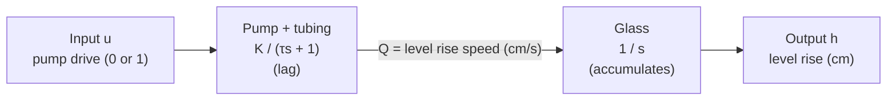
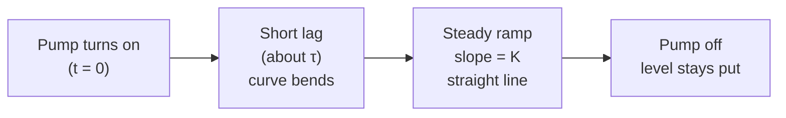

---
title: Math Model Explained
aliases: [Model, Transfer Function, Beginner Guide]
tags: [project, model, transfer-function, beginner]
status: draft
---

# Math Model Explained (for beginners)

**Notes in this project:** [[01-project-overview|Overview]] · [[02-material-requirements|Materials]] · [[03-project-procedure|Procedure]] · [[04-project-simulation|Simulation]] · [[05-component-testing|Component Testing]] · [[06-math-model-explained|Math Model Explained]]

> [!abstract] The whole model in one line
> When the pump is on, the water level rises at a steady speed of about **0.36 cm per second**, after a short **startup lag of about 0.65 s**. Written as a transfer function:
>
> $$G(s)=\frac{0.36}{s\,(0.65\,s+1)}$$
>
> The rest of this note explains what that means and where each number comes from.

This covers **PDF Step 2** (math model and transfer function). It uses only your three ruler runs, so it needs no closed-loop data.

---

## 1. Words you need first

| Term | Plain meaning | In this project |
| ---- | ------------- | --------------- |
| **Plant** | The thing being controlled | Pump + tubing + glass |
| **Input** $u$ | What we command | Pump drive: 0 = off, 1 = full power |
| **Output** $y$ or $h$ | What we want to control | Water level rise, in cm |
| **Model** | Equations that predict the output from the input | This note |
| **Open-loop** | Controller sends a command without checking the result | Timed pump run |
| **Closed-loop** | Controller measures the output and corrects | Sensor-based stop |
| **Step input** | Input jumps from 0 to a constant value and stays | Pump switched to full power |
| **Step response** | How the output reacts to a step input | Level vs time during a full-power run |
| **Transfer function** | A compact formula for "output / input" of the plant | $G(s)$ below |
| **Time constant** $\tau$ | How long a system takes to catch up after a sudden change | Pump startup lag |
| **Gain** $K$ | How much output you get per unit of input | cm/s of level rise per full drive |

> [!tip] What is the "s" in $G(s)$?
> It comes from the Laplace transform, a tool that turns differential equations into ordinary algebra. You don't need to master it. Two rules are enough for this project:
> - **Dividing by $s$** means "keep adding up over time" (integration).
> - **A factor like** $\dfrac{1}{\tau s+1}$ means "a smooth lag with time constant $\tau$".
>
> A transfer function is just a tidy way to stack these two ideas.

---

## 2. What the plant does

Think of the water level as a bathtub:

1. **The pump** pushes water in. It doesn't reach full speed instantly, so the flow ramps up smoothly. This is a **lag**.
2. **The glass** collects the water. The level at any moment is the **total** of all water added so far. This is an **accumulator** (called an *integrator*).

The plant is the **two blocks together**. The sensor and the Arduino are *not* part of the plant. They are separate blocks in the feedback loop.

---

## 3. Assumptions

Every model is a simplification. These are the ones this model makes, and why each is reasonable.

| # | Assumption | Why it is acceptable |
| - | ---------- | -------------------- |
| 1 | **Constant supply voltage** during a run | You used a bench supply, so flow does not fade like it would with batteries. *(Write down the voltage you used.)* |
| 2 | **The pump is either off or at full power** | Both open-loop and closed-loop use it this way, so we ignore the pump's weak behavior at low PWM |
| 3 | **Pump + tubing behave as a first-order lag** | The simplest shape that matches "ramps up smoothly to a steady flow". Any delay from water traveling down the tube is lumped into $\tau$ |
| 4 | **The glass has straight sides** | Then the same flow always raises the level at the same speed, so $K$ is constant. This is why you never need the glass area |
| 5 | **The water surface is calm enough to read** | Ripples and drips are ignored |
| 6 | **The sensor reports the level rise** | The code converts distance to level: $y = 1.125\,(d_0 - d) + 0.7$. This was calibrated against the ruler, and the small filtering delay is ignored in $G(s)$ |
| 7 | **$K$ and $\tau$ come from ruler readings** | The ruler is treated as the true level |

---

## 4. Derivation, step by step

### Step A. Pump and tubing (first-order lag)

Let $Q$ be how fast the level is rising (cm/s). If the pump were instant, we would have $Q = K u$. A first-order lag says $Q$ moves toward $Ku$ at a rate proportional to the gap:

$$\tau\,\frac{dQ}{dt} + Q = K\,u$$

Meaning: if $u$ suddenly becomes 1, then $Q$ climbs smoothly toward $K$. Solving for a step to $u=1$:

$$Q(t)=K\left(1-e^{-t/\tau}\right)$$

At $t=\tau$ the rise speed has reached about **63%** of its final value $K$. That is the definition of the time constant.

Now apply the Laplace rule (replace $d/dt$ by $s$, assuming zero start):

$$\tau s\,Q(s) + Q(s) = K\,U(s) \quad\Longrightarrow\quad \frac{Q(s)}{U(s)}=\frac{K}{\tau s+1}$$

### Step B. Glass (integrator)

The level is the running total of the rise speed:

$$\frac{dh}{dt}=Q(t) \quad\Longrightarrow\quad \frac{H(s)}{Q(s)}=\frac{1}{s}$$

Meaning: while water flows, the level keeps rising. When the pump stops ($Q=0$), the level **stays where it is**. It never drifts back down by itself.

### Step C. Join the two blocks

When blocks are connected in a chain, their transfer functions multiply:

$$G(s)=\frac{H(s)}{U(s)}=\frac{Q(s)}{U(s)}\cdot\frac{H(s)}{Q(s)}=\frac{K}{\tau s+1}\cdot\frac{1}{s}$$

$$\boxed{G(s)=\frac{K}{s\,(\tau s+1)}}$$

### Step D. Predict the step response (what the level does over time)

For a step to full power, $U(s)=1/s$, so

$$H(s)=\frac{K}{s^{2}(\tau s+1)}$$

Splitting this into simple pieces (partial fractions):

$$H(s)=K\left[\frac{1}{s^{2}}-\frac{\tau}{s}+\frac{\tau^{2}}{\tau s+1}\right]$$

Each piece converts back to time easily, giving

$$\boxed{h(t)=K\left[\,t-\tau\left(1-e^{-t/\tau}\right)\right]}$$

Reading it:
- The **$t$** term is a steady ramp. The level rises at speed $K$.
- The **$\tau(1-e^{-t/\tau})$** term is the startup lag. It fades away after a few $\tau$.
- After about $3\tau$ (about 2 s here), the exponential is almost gone and

$$h(t)\approx K\,(t-\tau)$$

This is a straight line with slope $K$ that crosses zero level at $t=\tau$. **That fact is how $\tau$ gets measured below.**

---

## 5. Where $K$ and $\tau$ come from (your data)

### The data

Three full-power runs. A ruler was read about once per second, so the readings are the real level rise in cm. Level at the end of each run and the average rise per second:

| Trial | Readings | Level at start of log | Level at end | Average rise (cm/s) |
| ----- | -------- | --------------------- | ------------ | ------------------- |
| 1 | 18 | 1.0 (at 1 s) | 7.3 | 0.371 |
| 2 | 21 | 0.2 | 7.2 | 0.350 |
| 3 | 21 | 0.1 | 7.2 | 0.355 |

### Finding $K$ (the slope)

From the ramp formula, the slope of level vs time **is** $K$. A straight-line fit of each trial gives

| Trial | Fitted slope (cm/s) |
| ----- | ------------------- |
| 1 | 0.371 |
| 2 | 0.364 |
| 3 | 0.366 |

All three agree within a few percent, so

$$K \approx 0.36\ \text{cm/s}$$

This is the reliable number.

### Finding $\tau$ (where the line crosses zero)

Since $h \approx K(t-\tau)$ in the ramp region, extend the fitted line back until it hits $h=0$. The time where it crosses is $\tau$.

| Trial | Zero-level crossing |
| ----- | ------------------- |
| 2 | 0.61 s |
| 3 | 0.72 s |
| 2 and 3 together | 0.66 s |

So $\tau \approx 0.65\ \text{s}$.

> [!warning] Be honest about how good $\tau$ is
> - **Trial 1 is not used for $\tau$.** Its first reading was already 1.0 cm, so its line crosses zero at about -1.9 s, which makes no physical sense. It was probably timed differently. It is still fine for $K$.
> - **It assumes reading number $n$ was taken at $t = n$ seconds,** with the timer started when the pump started. If the first reading was really at $t=0$, the answer changes.
> - **One reading per second is coarse** for a lag of about half a second.
>
> So call $\tau$ an **estimated effective lag of about 0.6 to 0.7 s**. The PDF explicitly allows an estimated model. It may also include a little water travel time down the tube, not only the pump's own lag.

### Checking the model against the data

Predictions from $h(t)=0.36\left[t-0.65\left(1-e^{-t/0.65}\right)\right]$:

| Time | Model (cm) | Trial 2 (cm) | Trial 3 (cm) |
| ---- | ---------- | ------------ | ------------ |
| 10 s | 3.4 | 3.5 | 3.4 |
| 17 s | 5.9 | 6.1 | 6.0 |

The model is within about 0.1 to 0.2 cm of the ruler, which is about the size of the ruler reading error. That is good enough to say **the model is consistent with the measurements**, which the PDF asks you to state.

---

## 6. What the final model tells you

$$G(s)=\frac{0.36}{s\,(0.65\,s+1)}$$

- **"0.36"**: at full power the level rises about 0.36 cm every second.
- **"$s$" in the denominator**: the level has no final resting value. It keeps rising while the pump runs and stays put when the pump stops.
- **"$0.65\,s+1$"**: the pump takes about 0.65 s to get up to speed.

Two simple predictions follow from it:

| Prediction | Formula | Example |
| ---------- | ------- | ------- |
| Run time needed to rise $r$ cm | $t \approx \dfrac{r}{K}+\tau$ | 3 cm: about 9.0 s. 6 cm: about 17.3 s |
| Level after the pump stops overshoots a little because of the lag | $\Delta h \approx K\,\tau \approx 0.23$ cm | The level keeps creeping up for a moment |

> [!note] Why there is no closed-loop transfer function
> $G(s)$ describes the **plant only**. The on-off controller is not linear (it just switches between 0 and 1), so it cannot be written as a transfer function. Describe the closed loop with the rule instead:
>
> $$u(t)=\begin{cases}1 & r-y(t)>0\\[2pt] 0 & r-y(t)\le 0\end{cases}$$
>
> This matches your overview note. See [[01-project-overview#3. Block diagrams]].

---

## 7. Limits of the model

- Battery sag is not an issue because of the bench supply, but the supply voltage should be stated.
- Tube delay is hidden inside $\tau$.
- Ripples, drips, and the sensor's small filtering delay are ignored.
- The glass must stay straight-sided, or $K$ would change with level.
- $\tau$ is an estimate from coarse data.

---

## 8. Checklist for the report

- [ ] Plant, input, and output stated, with the symbol table
- [ ] Assumptions list (section 3), with the supply voltage written in
- [ ] Derivation: pump lag, glass integrator, joined $G(s)$ (section 4)
- [ ] Boxed $G(s)$ and step response $h(t)$
- [ ] Sensor equation $y = 1.125\,(d_0-d)+0.7$, noted as calibrated against the ruler
- [ ] How $K$ and $\tau$ were found, and that $\tau$ is an estimate (section 5)
- [ ] The open-loop plot with $K=0.36$ and $\tau=0.65$ ([[04-project-simulation#B. Open-loop step response plot]]), ideally with the ruler data as dots
- [ ] One sentence on agreement: the model matches the measured data to within about 0.1 to 0.2 cm

> [!success] Key idea to remember
> The glass accumulates water and the pump lags. Those two facts give $G(s)=\dfrac{K}{s(\tau s+1)}$, and your ruler runs gave the numbers.