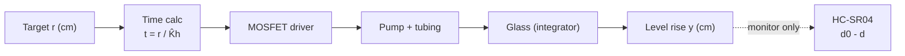
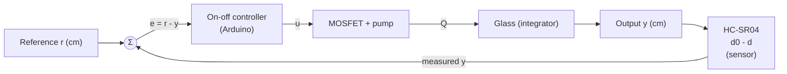
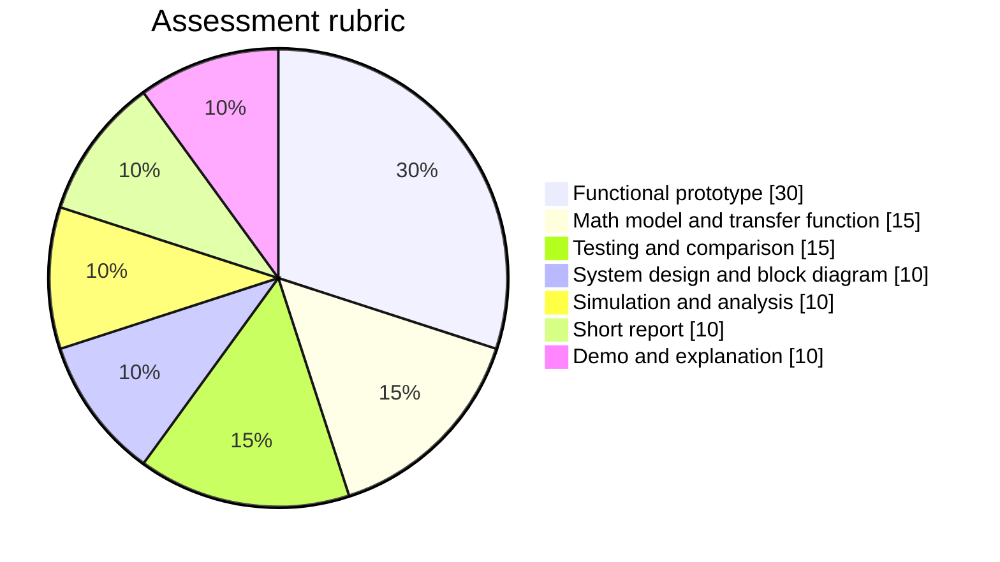

# Automatic Water Level Control: Open-Loop vs Closed-Loop

> [!abstract] Summary
> An Arduino Nano system that raises the water level in a glass by a selected height (the target rise, in cm). It runs in two modes, **open-loop** (timed) and **closed-loop** (water level measured by an HC-SR04 ultrasonic sensor), so the effect of feedback can be compared directly. Only the water **level** matters: no glass volume or area is calculated.

**Notes in this project:** [[01-project-overview|Overview]] · [[02-material-requirements|Materials]] · [[03-project-procedure|Procedure]] · [[04-project-simulation|Simulation]] · [[05-component-testing|Component Testing]]

---

## 1. Operating modes

| Mode            | How it works                                                  | Sensor used for control?         |
| --------------- | ------------------------------------------------------------- | -------------------------------- |
| **Open-loop**   | Pump runs for a pre-calculated time $t_{run} = \dfrac{r}{\hat{K}_h}$ | No (Serial log only)    |
| **Closed-loop** | Pump runs until the measured level rise reaches the target        | Yes                              |

Here $r$ is the target level rise (cm) and $\hat{K}_h$ is the *estimated* level rise rate at full drive (cm/s).

> [!info] Distance to level
> The HC-SR04 sits above the glass and measures the distance $d$ down to the water surface. The controlled output is the **level rise**:
>
> $$y = d_0 - d$$
>
> where $d_0$ is the empty-glass distance, measured automatically at the start of every run (the "tare"). The sensor is a unity gain (1 cm of level change reads as 1 cm). The glass area is never needed: with a straight-sided glass, a constant pump flow gives a constant level rise rate, and that rate is measured directly as $K_h$ (cm/s).

---

### Progress and result over Serial

There is no display. Every run prints a CSV log (`time_ms,level_cm`) and a final `RESULT` line that includes the percentage of the target reached:

$$p = \frac{y_{final}}{r} \times 100\%$$

> [!note] Logging only
> The Serial output reads the same measured value $y$ that the closed-loop controller uses, but it is **not** part of the control law, so it does not change the open-loop vs closed-loop comparison. In open-loop mode it simply shows the truth the controller ignores: the percentage ends near $\alpha \times 100\%$ when the real flow is a fraction $\alpha$ of the estimate. In closed-loop mode it stops at about 100% and may read slightly above it because of dripping overshoot.

---

## 2. System identification

| Element                      | In this project                                                                                          |
| ---------------------------- | -------------------------------------------------------------------------------------------------------- |
| **Plant**                    | Pump + tubing + glass (accumulating level)                                                              |
| **Reference input** $r$      | Target level rise (cm), set in the code (`TARGET_CM`)                                                        |
| **Output** $y$               | Rise of the water level in the glass (cm)                                                               |
| **Sensor**                   | HC-SR04 ultrasonic distance sensor, converted to level rise with $y = d_0 - d$                          |
| **Actuator**                 | DC submersible pump, switched by an optocoupler-isolated MOSFET module (LR7843)                          |
| **Controller**               | Arduino Nano, on-off comparison                                                                          |
| **Feedback path**            | HC-SR04 → Arduino (median filter, tare subtraction) → MOSFET → pump                                       |
| **Disturbances**             | Tube height change, pinched tube, residual dripping, surface ripples (avoid weak batteries, see [[02-material-requirements]]) |

---

## 3. Block diagrams

### Open-loop

### Closed-loop

### On-off control law

$$
u(t) =
\begin{cases}
1 & \text{if } e(t) = r - y(t) > 0 \\
0 & \text{if } e(t) \le 0
\end{cases}
$$

---

## 4. Features

- [ ] Two modes selected with a slide switch (open-loop / closed-loop)
- [ ] Target level rise set by one constant in the code (`TARGET_CM`, for example 3 or 6 cm)
- [ ] Single **Start** button
- [ ] Automatic empty-level reference (tare) before each run (place the empty glass first)
- [ ] Median-of-3 filtering of the ultrasonic readings
- [ ] CSV logging over Serial (`time_ms,level_cm`)
- [ ] Result summary after each run: target, final value, error, % of target
- [ ] 60 s safety timeout
- [ ] Optional stop-early margin and PWM slowdown near the target
- [ ] Built-in simulation mode (`SIMULATE 1`), see [[04-project-simulation]]

---

## 5. Mapping to the PDF requirements

| PDF requirement                                   | Covered in                                                                                          |
| ------------------------------------------------- | --------------------------------------------------------------------------------------------------- |
| Plant, input, output, sensor, actuator            | Section 2 above                                                                                     |
| Block diagram and component list                  | Section 3 above, [[02-material-requirements]]                                                       |
| Mathematical model and transfer function          | [[03-project-procedure#Phase 2 Mathematical model]]                                                 |
| One open-loop simulation plot                     | [[04-project-simulation#B. Open-loop step response plot]]                                           |
| Functional prototype and source code              | [[03-project-procedure#Phase 5 Main Arduino code]]                                                  |
| Open vs closed-loop comparison table              | [[03-project-procedure#Phase 6 Testing and data collection]]                                        |
| Disturbance response                              | [[03-project-procedure#Disturbance test]]                                                           |
| Short report, live demo                           | [[03-project-procedure#Phase 7 Report and demonstration]]                                           |

### Rubric weights (100 pts)

---

## 6. Expected results

> [!success] What to show in the report
> - **Open-loop:** accurate only when conditions match the calibration run. Error grows with a pinched tube or a different tube height.
> - **Closed-loop:** lands near the target regardless of those changes. Small errors remain from residual dripping and the sensor resolution.
> - **Serial result:** open-loop ends well away from 100% when conditions change (for example about 80% with a pump 20% weaker than estimated). Closed-loop ends at about 100% to 102%. Copy the `RESULT` lines for the report.

Overshoot after the pump stops is roughly the level rise rate at shutoff multiplied by the pump time constant plus the sensor filter delay $T_f$:

$$\Delta h_{overshoot} \approx Q_{h,stop}\,(\tau + T_f)$$

With $Q_{h,stop} \approx 0.2\ \text{cm/s}$ and $T_f \approx 0.1$ to $0.2\ \text{s}$, the filter adds only about 0.04 cm.

### Sensor resolution

The HC-SR04 is good to about $\pm 3\ \text{mm}$, and since the output is the level itself, this is the level uncertainty directly:

$$\Delta h_{sensor} \approx \pm 0.3\ \text{cm}$$

That is about $\pm 10\%$ of a 3 cm target and $\pm 5\%$ of a 6 cm target. An open-loop pump that is 20% weaker is off by 0.6 cm (3 cm target) or 1.2 cm (6 cm target), so feedback still wins, most clearly at the 6 cm target. A stronger disturbance (a pinched tube) makes the difference even clearer.

> [!tip] Report limitation and improvement
> **Limitation:** sensor resolution (about 3 mm) and residual dripping limit closed-loop accuracy.
> **Improvement:** PWM slowdown near the target, a stop-early margin, or a drain pump or valve.

---

## 7. Scope notes

> [!warning] Keep it simple
> - The PDF emphasizes basic control concepts over a sophisticated system.
> - Get the topic approved by your instructor first (one approved topic per group). Mention that this is **PDF topic D** (automatic water-level control), using an on-off controller, with the level rise as the controlled output (no volume calculation).
> - A drain pump for removing excess water is deliberately **out of scope** to save cost and reduce failure risk.
