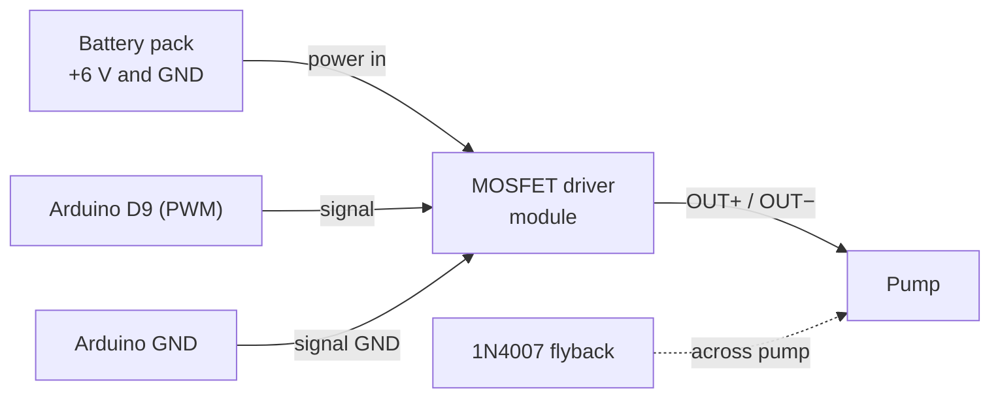

# Material Requirements

**Notes in this project:** [[01-project-overview|Overview]] · [[02-material-requirements|Materials]] · [[03-project-procedure|Procedure]] · [[04-project-simulation|Simulation]]

## 1. Electronics

| #   | Item                                  | Qty   | Specs / notes                                                                                           |
| --- | ------------------------------------- | ----- | ------------------------------------------------------------------------------------------------------- |
| 1   | Arduino Nano + USB cable              | 1     | ATmega328P. Cable type depends on the board (Mini-B, Micro-B, USB-C)                                    |
| 2   | Breadboard                            | 1     | Full or half size                                                                                       |
| 3   | HC-SR04 ultrasonic sensor             | 1     | 5 V, 4 pins: VCC, Trig, Echo, GND. Measures the distance to the water surface                           |
| 4   | Submersible DC pump + silicone tubing | 1     | 3–6 V mini pump. Tubing must fit the pump outlet                                                        |
| 5   | Logic-level MOSFET driver module | 1 | PWM input (3.3 to 20 V trigger), power in (+/−), load out (+/−). D4184 type. Match terminals by the silkscreen |
| 6   | Flyback diode | 1 | 1N4007 or 1N5819, across the pump terminals (skip only if the module documents its own) |
| 7   | Pushbutton                            | 1     | Start                                                                                                   |
| 8   | Slide switch (SPDT)                   | 1     | Mode select                                                                                             |
| 9   | I2C LCD 16×2 (PCF8574 backpack)       | 1     | 4 pins: GND, VCC, SDA, SCL. 5 V version. Address is usually `0x27` or `0x3F`                            |
| 10  | LED + 220 Ω (optional)                | 1     | Status indicator                                                                                        |
| 11  | Battery holder + 4 × AA               | 1     | About 6 V for the pump, **separate from USB power**                                                     |
| 12  | Jumper wires                          | 1 set | HC-SR04 and LCD headers need male pins (female-to-male wires if the module pins are male)               |

> [!tip] Alternatives
> A relay module can replace the driver module, but it clicks, wears out, and **cannot do PWM slowdown**. Avoid IRF520 modules (not logic-level, so a 5 V signal only half-turns them on) and L298N boards (about 1.5 to 2 V drop, which weakens a 6 V pump).

---

## 2. Mechanical setup

- [ ] **Straight-sided glass or jar**, about 5 to 6 cm wide and at least 10 cm tall. A tapered glass breaks the $V = A\,\Delta d$ relationship. A narrower glass gives finer resolution in ml per mm
- [ ] Sensor bracket (cardboard, wood, or a small stand) that holds the HC-SR04 **pointing straight down, centered over the glass**
- [ ] Sensor height: **5 to 10 cm above the water level at full** (the HC-SR04 is unreliable below about 2 to 3 cm)
- [ ] Small flat base or tray for the glass so it cannot shift between runs
- [ ] Water reservoir for the pump
- [ ] Tape, zip ties, or hot glue to hold the tube outlet so the water **runs down the inner glass wall** (this reduces splashing and ripples) and the tube stays **outside the sensor beam**
- [ ] Small splash guard (card or plastic) between the water stream and the sensor
- [ ] Tray or towel for spills

---

## 3. Measurement and testing tools

| Item                                        | Why                                                                         |
| ------------------------------------------- | --------------------------------------------------------------------------- |
| Graduated cylinder or measuring cup         | **Ground truth** volume (do not trust only the Arduino reading)             |
| Ruler or calipers                           | Measure the glass inner diameter for a first estimate of $A$                |
| Stopwatch (phone)                           | Measuring pump flow rate                                                    |
| Laptop with Arduino IDE                     | Programming and Serial logging                                              |

---

## 4. Software

| Software                                       | Purpose                                                                       |
| ---------------------------------------------- | ----------------------------------------------------------------------------- |
| Arduino IDE                                    | Board: Arduino Nano. If upload fails, use processor "ATmega328P (Old Bootloader)" |
| **LiquidCrystal I2C** (Frank de Brabander)     | Install from Library Manager. Drives the I2C LCD                              |
| Wokwi (free, online)                           | Simulation, see [[04-project-simulation]]                                     |
| Python + matplotlib, MATLAB, or Scilab         | Open-loop step response plot                                                  |
| Excel / Google Sheets                          | Data tables and comparison graphs                                             |

> [!note] No sensor library
> The HC-SR04 is read directly with `pulseIn()`, so no library is needed for it.

---

## 5. Pin assignments (Arduino Nano)

| Nano pin  | Connected to                                    | Purpose                    |
| --------- | ----------------------------------------------- | -------------------------- |
| D5        | HC-SR04 **Trig**                                | Trigger pulse (output)     |
| D6        | HC-SR04 **Echo**                                | Echo pulse (input)         |
| D9 (PWM)  | Driver module PWM / signal input                | Pump control               |
| D2        | Start button (other side to GND)                | Begin dispensing           |
| D4        | Slide switch middle pin (outer pin to GND)      | LOW = closed-loop, HIGH = open-loop |
| A4 (SDA)  | LCD SDA                                         | I2C data (display)         |
| A5 (SCL)  | LCD SCL                                         | I2C clock (display)        |
| 5V        | HC-SR04 VCC, LCD VCC                            | Power                      |
| GND       | HC-SR04 GND, LCD GND, driver module GND, battery − | **Common ground**       |

---

## 6. Wiring

> [!TLDR]- System overview
> ```mermaid
> flowchart LR
>     HC["HC-SR04<br/>ultrasonic sensor"] -->|"Trig → D5<br/>Echo → D6"| NANO["Arduino Nano"]
>     BTN1["Start button"] -->|"D2"| NANO
>     SW["Mode switch"] -->|"D4"| NANO
>     NANO -->|"D9 PWM"| DRV["MOSFET driver<br/>module"]
>     BAT["6 V battery pack"] --> DRV
>     DRV -->|"OUT+ / OUT−"| PUMP["Pump"]
>     DRV --- GND["Common GND"]
>     NANO -->|"A4 SDA<br/>A5 SCL"| LCD["I2C LCD 16×2"]
>     NANO --- GND
> ```

### HC-SR04 → Nano

| HC-SR04 pin | Nano pin |
| ----------- | -------- |
| VCC         | 5V       |
| Trig        | D5       |
| Echo        | D6       |
| GND         | GND      |

> [!tip] Sensor not reading?
> - The Nano is 5 V logic, so the Echo pin needs **no level shifter**.
> - Reading is always 0 or the same value: check that Trig and Echo are not swapped.
> - Readings jump around: make sure the sensor points straight down, the tube is outside the beam, and nothing sits within about 5 cm of the sensor.

### I2C LCD → Nano

| LCD pin | Nano pin |
| ------- | -------- |
| GND     | GND      |
| VCC     | 5V       |
| SDA     | A4       |
| SCL     | A5       |

> [!tip] LCD shows nothing?
> - **Backlight on but no text:** turn the small blue **contrast trimmer** on the back of the I2C backpack with a screwdriver.
> - **Still blank:** the address may be `0x3F` instead of `0x27`. Run the I2C scanner in [[03-project-procedure#Check the LCD]] to find it.
> - Power the LCD from the Nano **5V** pin (not 3.3 V). The backlight draws roughly 20 to 40 mA, which USB power handles fine.

### Pump driver (MOSFET module)

The module does the low-side switching, so the gate resistor, the pull-down and the MOSFET pin order are already handled on its board.

| Module terminal                | Connect to                               |
| ------------------------------ | ---------------------------------------- |
| Signal **PWM** (or TRIG / SIG) | Nano **D9**                              |
| Signal **GND**                 | Nano **GND**                             |
| Power in **+** (VIN+)          | Battery pack **+** (about 6 V)           |
| Power in **−** (VIN−)          | Battery pack **−**                       |
| Load out **+** (OUT+)          | Pump **(+)** wire                        |
| Load out **−** (OUT−)          | Pump **(−)** wire                        |



> [!important] Check your module's labels
> Terminal names vary between boards (VIN/VOUT, IN/OUT, PWM/TRIG/SIG). Match them by function using the silkscreen or datasheet. Some modules tie signal GND and power IN− together, but connecting the Nano GND to the battery − is still required.

> [!important] Flyback diode
> Place the diode **across the pump terminals**: cathode (striped end) to the pump (+) side, anode to the pump (−) side. Skip it only if the module's datasheet says it already has one.

> [!tip] Pump runs at boot or will not switch off?
> If the PWM input floats while the Nano boots, add a **10 kΩ resistor from the PWM input to GND**.

---

## 7. Safety checklist

> [!danger] Read before powering up
> - [ ] **Never power the pump from an Arduino pin.** Use the driver module and the separate battery pack.
> - [ ] Connect **all grounds together** (Arduino, driver module, battery −).
> - [ ] Keep the breadboard, **HC-SR04** and **LCD** away from water; use a tray and mount electronics higher than the glass. The HC-SR04 is **not waterproof**, so use a splash guard.
> - [ ] Do not let the tube outlet point into the sensor beam or toward the sensor.
> - [ ] Double-check polarity before connecting the battery.
> - [ ] Do not run the pump dry for long.
> - [ ] Low voltage only (about 6 V). No mains electricity anywhere in this project.
