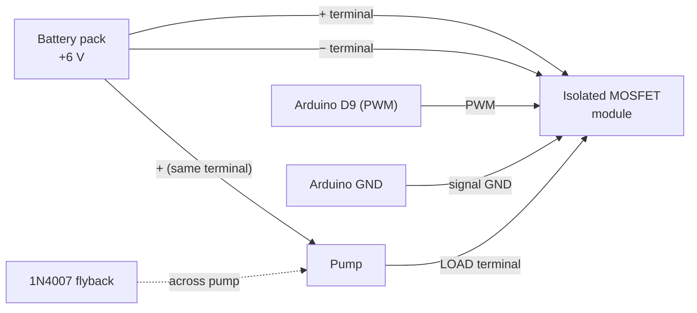

# Material Requirements

**Notes in this project:** [[01-project-overview|Overview]] · [[02-material-requirements|Materials]] · [[03-project-procedure|Procedure]] · [[04-project-simulation|Simulation]] · [[05-component-testing|Component Testing]]

## 1. Electronics

| #   | Item                                  | Qty   | Specs / notes                                                                                                  |
| --- | ------------------------------------- | ----- | -------------------------------------------------------------------------------------------------------------- |
| 1   | Arduino Nano + USB cable              | 1     | ATmega328P. Cable type depends on the board (Mini-B, Micro-B, USB-C)                                           |
| 2   | Breadboard                            | 1     | Full or half size                                                                                              |
| 3   | HC-SR04 ultrasonic sensor             | 1     | 5 V, 4 pins: VCC, Trig, Echo, GND. Measures the distance to the water surface                                  |
| 4   | Submersible DC pump + silicone tubing | 1     | 3–6 V mini pump. Tubing must fit the pump outlet                                                               |
| 5   | Optocoupler-isolated MOSFET control module (LR7843) | 1 | Signal side: PWM, GND (3 V or 5 V signal, high = on). Load side: three pads marked +, LOAD, −. Ships with a 2-pin header and screw terminals that must be soldered on |
| 6   | Flyback diode                         | 1     | 1N4007 or 1N5819, across the pump (the module's own diode is not confirmed, so fit this one)                    |
| 7   | Pushbutton                            | 1     | Start                                                                                                          |
| 8   | Slide switch (SPDT)                   | 1     | Mode select                                                                                                    |
| 9   | LED + 220 Ω (optional)                | 1     | Status indicator                                                                                               |
| 10  | 6 V DC supply for the pump            | 1     | 4 × AA battery holder, **or** your LM317 supply set to about 6.0 V. Separate from USB power (see the note below) |
| 11  | Jumper wires                          | 1 set | HC-SR04 header needs male pins (female-to-male wires if the module pins are male)                      |
| 12  | Soldering iron and solder             | 1     | To fit the 2-pin header (signal side) and the 3-pin screw terminal (load side) to the module                    |

> [!tip] Alternatives
> A relay module can replace the driver module, but it clicks, wears out, and **cannot do PWM slowdown**. Avoid IRF520 modules (not logic-level, so a 5 V signal only half-turns them on) and L298N boards (about 1.5 to 2 V drop, which weakens a 6 V pump).

> [!note] Using the LM317 supply instead of batteries
> Set the output to about **6.0 V** with a multimeter and no pump connected, then re-check it at the module's **+** and **−** terminals while the pump runs. With a 24 V transformer the LM317 drops about 24 V as heat (about 7 W at 0.3 A), so it needs a large heatsink: measure the pump current first, run it for 60 s, and check the heatsink temperature. Wait a minute or two between runs.

> [!warning] Supply voltage limit of this module
> One retailer lists a **6 to 28 V** load supply for the LR7843 version of this module, and your seller states no minimum. A fresh 4 × AA pack is right at that edge and falls below it as the batteries weaken. Test the pump on the module early (see [[05-component-testing#7. MOSFET driver module and pump (with Arduino PWM)]]). If it switches poorly at 6 V, a non-isolated logic-level MOSFET module is the fallback.

---

## 2. Mechanical setup

- [ ] **Straight-sided glass or jar**, about 5 to 6 cm wide and at least 10 cm tall. A tapered glass breaks the $V = A\,\Delta d$ relationship. A narrower glass gives finer resolution in ml per mm
- [ ] Sensor bracket (cardboard, wood, or a small stand) that holds the HC-SR04 **pointing straight down, centered over the glass**
- [ ] Sensor height: **5 to 10 cm above the water level at full** (the HC-SR04 is unreliable below about 2 to 3 cm)
- [ ] Small flat base or tray for the glass so it cannot shift between runs
- [ ] Water reservoir for the pump
- [ ] Tape, zip ties, or hot glue to hold the tube outlet so the water **runs down the inner glass wall** (this reduces splashing and ripples) and the tube stays **outside the sensor beam**
- [ ] Small splash guard (card or plastic) between the water stream and the sensor
- [ ] Tray or towel for spills

---

## 3. Measurement and testing tools

| Item                                        | Why                                                                         |
| ------------------------------------------- | --------------------------------------------------------------------------- |
| Graduated cylinder or measuring cup         | **Ground truth** volume (do not trust only the Arduino reading)             |
| Ruler or calipers                           | Measure the glass inner diameter for a first estimate of $A$                |
| Stopwatch (phone)                           | Measuring pump flow rate                                                    |
| Laptop with Arduino IDE                     | Programming and Serial logging                                              |

---

## 4. Software

| Software                                       | Purpose                                                                       |
| ---------------------------------------------- | ----------------------------------------------------------------------------- |
| Arduino IDE                                    | Board: Arduino Nano. If upload fails, use processor "ATmega328P (Old Bootloader)" |
| Wokwi (free, online)                           | Simulation, see [[04-project-simulation]]                                     |
| Python + matplotlib, MATLAB, or Scilab         | Open-loop step response plot                                                  |
| Excel / Google Sheets                          | Data tables and comparison graphs                                             |

> [!note] No libraries
> The HC-SR04 is read directly with `pulseIn()` and the project has no display, so no library needs to be installed.

---

## 5. Pin assignments (Arduino Nano)

| Nano pin  | Connected to                                    | Purpose                    |
| --------- | ----------------------------------------------- | -------------------------- |
| D5        | HC-SR04 **Trig**                                | Trigger pulse (output)     |
| D6        | HC-SR04 **Echo**                                | Echo pulse (input)         |
| D9 (PWM)  | Driver module PWM / signal input                | Pump control               |
| D2        | Start button (other side to GND)                | Begin dispensing           |
| D4        | Slide switch middle pin (outer pin to GND)      | LOW = closed-loop, HIGH = open-loop |
| 5V        | HC-SR04 VCC                                     | Power                      |
| GND       | HC-SR04 GND, button and switch GND, driver module signal **GND** | Nano-side ground (the battery − is **not** joined here, see section 6) |

---

## 6. Wiring

> [!TLDR]- System overview
> ```mermaid
> flowchart LR
>     HC["HC-SR04<br/>ultrasonic sensor"] -->|"Trig → D5<br/>Echo → D6"| NANO["Arduino Nano"]
>     BTN1["Start button"] -->|"D2"| NANO
>     SW["Mode switch"] -->|"D4"| NANO
>     NANO -->|"D9 PWM<br/>+ signal GND"| DRV["Isolated MOSFET<br/>module (optocoupler)"]
>     BAT["6 V battery pack"] -->|"+ and −"| DRV
>     DRV -->|"+ and LOAD"| PUMP["Pump"]
> ```

### HC-SR04 → Nano

| HC-SR04 pin | Nano pin |
| ----------- | -------- |
| VCC         | 5V       |
| Trig        | D5       |
| Echo        | D6       |
| GND         | GND      |

> [!tip] Sensor not reading?
> - The Nano is 5 V logic, so the Echo pin needs **no level shifter**.
> - Reading is always 0 or the same value: check that Trig and Echo are not swapped.
> - Readings jump around: make sure the sensor points straight down, the tube is outside the beam, and nothing sits within about 5 cm of the sensor.

### Pump driver (isolated MOSFET module)

The module is a **low-side switch**: it connects the pump's negative side to the battery − when the PWM signal is high. An **optocoupler** (PC817 on the LR7843 version) separates the signal side (PWM, GND) from the load side (+, LOAD, −), and the two grounds are not connected on the board. The gate resistor and MOSFET pin order are already handled on the board.

| Module pad / terminal | Connect to                                                                 |
| --------------------- | -------------------------------------------------------------------------- |
| Signal **PWM**        | Nano **D9**                                                                |
| Signal **GND**        | Nano **GND**                                                               |
| **+** (load side)     | Battery pack **+** (about 6 V) **and** the pump **(+)** wire, in the same terminal |
| **LOAD** (middle)     | Pump **(−)** wire                                                          |
| **−** (load side)     | Battery pack **−**                                                         |

Current path: battery + → module **+** → pump → module **LOAD** → MOSFET → module **−** → battery −.

> [!note] Pad order
> Retailer pinouts for this module family describe the three load terminals as **+ / LOAD / −**, with LOAD being the negative lead of the load. Always confirm on your own board by the silkscreen, and run the test in [[05-component-testing#7. MOSFET driver module and pump (with Arduino PWM)]] before using water.



> [!important] Grounds: no common ground needed
> Because of the optocoupler, the Nano ground and the battery − are **separate on purpose**. Do **not** wire them together: it is not needed, and it removes the isolation that keeps pump noise away from the Nano and HC-SR04. (This differs from a plain MOSFET module, which needs a common ground.)

> [!important] Mounting the module
> The pads are bare holes. Solder the **2-pin header** into PWM/GND (it then plugs into the breadboard or takes female jumper wires) and the **3-pin screw terminal** into the three load pads. Do not push the pump and battery wires into a breadboard: loose contacts make the pump cut out and would look like a model error in your results. The board has two 2 mm screw holes (8 mm apart) for fixing it down.

> [!important] Flyback diode
> Place the diode **across the pump**: cathode (striped end) to the **+** terminal (the pump (+) side), anode to the **LOAD** terminal (the pump (−) side). The small diode on the module is not confirmed to do this job, so fit your own.

> [!tip] Pump runs at boot or will not switch off?
> The optocoupler input normally prevents this. If the pump still runs at boot, add a **10 kΩ resistor from the PWM pad to the signal GND pad**.

---

## 7. Safety checklist

> [!danger] Read before powering up
> - [ ] **Never power the pump from an Arduino pin.** Use the driver module and the separate battery pack.
> - [ ] Join the **Nano-side** grounds (Nano, HC-SR04, button, switch, module signal GND). Keep the **battery −** on the module's **−** terminal only, not on the Nano GND.
> - [ ] Check the battery pack reads at least about 6 V before relying on the module (see the supply limit in section 1).
> - [ ] Keep the breadboard and **HC-SR04** away from water; use a tray and mount electronics higher than the glass. The HC-SR04 is **not waterproof**, so use a splash guard.
> - [ ] Do not let the tube outlet point into the sensor beam or toward the sensor.
> - [ ] Double-check polarity before connecting the battery.
> - [ ] Do not run the pump dry for long.
> - [ ] The project itself runs at low voltage (about 6 V). If you use the LM317 supply, the only mains is its transformer input: keep the supply well away from the water, tray and spills, keep the mains wiring enclosed and fused, and unplug it before changing wires.
