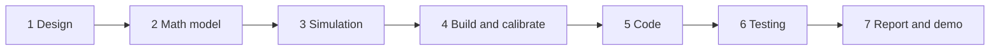

# Project Procedure (with Arduino Code)

**Notes in this project:** [[01-project-overview|Overview]] · [[02-material-requirements|Materials]] · [[03-project-procedure|Procedure]] · [[04-project-simulation|Simulation]] · [[05-component-testing|Component Testing]]

> [!info] Revision (v5): continuous closed-loop
> - **Closed-loop never finishes.** It fills like open-loop, then keeps measuring forever. If the level drops at any time (a valve, a spill, a sample taken out), the pump restarts and restores the target level.
> - **Mode is chosen with a MODE button** (D4) instead of the slide switch.
> - **A status LED** (D7) shows whether closed-loop is running with a working sensor.
> - Open-loop is unchanged: one timed fill per **Start** press.

## Roadmap



---

## Phase 1 Design

*(PDF Step 1)*

- [ ] Get the topic approved by your instructor (PDF topic D, automatic water-level control, with an on-off controller). Mention the revision: the closed-loop mode is a **continuous** on-off controller with a hysteresis band, so it keeps holding the level
- [ ] Draw the block diagram (see [[01-project-overview#3. Block diagrams]])
- [ ] Choose a straight-sided glass and sketch the sensor mounting (sensor 5 to 10 cm above the highest water level you will use)
- [ ] Tape a ruler vertically on the outside of the glass, 0 mark level with the inside floor (ground truth for the real level)
- [ ] Finalize the component list ([[02-material-requirements]]): **two pushbuttons** (Start and Mode) and the **status LED with 220 Ω**, which is now part of the build
- [ ] Choose two target level rises: **3 cm and 6 cm** minimum (PDF requires at least two reference settings). The target is set by `TARGET_CM` in the code, so each target is one upload
- [ ] Decide how you will create the **disturbances**: a pinch clip on the tube, and a small adjustable drain (a tap, or a thin drain tube with a clip) or a syringe to remove water

**Output:** block diagram + component list.

---

## Phase 2 Mathematical model

*(PDF Step 2)*

### Assumptions

1. Constant supply voltage during a run.
2. Tubing delay is negligible.
3. Pump flow responds as a first-order system to the on/off drive.
4. The glass has **straight sides**, so the cross-section is constant and a given flow always raises the level at the same rate. The glass area is absorbed into $K_h$ and is never measured.
5. The ultrasonic beam hits the water surface directly, and the surface is nearly still when read.
6. The sensor adds only a small sampling and filtering delay $T_f$ (about 0.2 to 0.4 s with the 5-ping median and the median of the last 3 readings), neglected in $G(s)$.
7. Any water leaving the glass during operation (an open valve, a sample taken out) is a **level drop rate** $q_d$ (cm/s) acting on the output. The system cannot drain, so it can only add water.

### Derivation

**Pump and tubing** (drive to level rise rate), first-order. $Q_h$ is how fast the water level rises:

$$\tau\,\dot{Q}_h(t) + Q_h(t) = K_h\,u(t) \quad\Longrightarrow\quad \frac{Q_h(s)}{U(s)} = \frac{K_h}{\tau s + 1}$$

**Glass** (level rise rate to accumulated level rise), integrator. With a leak $q_d$ the level obeys

$$\frac{dh}{dt} = Q_h(t) - q_d(t) \quad\Longrightarrow\quad H(s) = \frac{1}{s}\left[Q_h(s) - Q_d(s)\right]$$

With no leak ($q_d = 0$) this reduces to $H(s)/Q_h(s) = 1/s$.

**Plant transfer function** (drive to level):

$$\boxed{G(s) = \frac{H(s)}{U(s)} = \frac{K_h}{s\,(\tau s + 1)}}$$

**Sensor** (distance to level): the HC-SR04 measures the distance $d$ to the surface, and the Arduino computes

$$y = d_0 - d$$

where $d_0$ is the empty-glass distance (taken by the tare). The sketch then applies the calibration line from the ruler check, $y_{ruler} = a\,y + b$ (`LEVEL_SCALE` $a$, `LEVEL_OFFSET_CM` $b$). The sensor is therefore a unity gain (after calibration) on the level change, plus the small delay $T_f$.

| Symbol | Meaning                                           | Unit |
| ------ | ------------------------------------------------- | ---- |
| $u$    | Pump drive (0 = off, 1 = full)                    | –    |
| $Q_h$  | Level rise rate                                   | cm/s |
| $K_h$  | Steady level rise rate at full drive              | cm/s |
| $\tau$ | Pump time constant                                | s    |
| $q_d$  | Level drop rate from a leak or valve (disturbance) | cm/s |
| $h$    | Level rise (the output $y$)                       | cm   |
| $d_0$  | Empty-glass distance from sensor to the glass floor | cm |
| $d$    | Current distance from sensor to the water surface | cm   |
| $r$    | Target level rise                                 | cm   |
| $b$    | Refill band (`REFILL_BAND_CM`)                    | cm   |
| $s$    | Stop-early margin (`STOP_EARLY_CM`)               | cm   |

### Time-domain step response

For a unit step in $u$:

$$h(t) = K_h\left[\,t - \tau\left(1 - e^{-t/\tau}\right)\right]$$

After the short transient, $h(t)$ is a ramp with slope $K_h$.

### Closed-loop view (continuous on-off with hysteresis)

The error is $e(t) = r - y(t)$. The controller never stops running. It switches the pump with a **hysteresis band** so that it does not chatter around the target:

$$
u(t) =
\begin{cases}
1 & y(t) < r - b \quad \text{(start or restart the pump)} \\
0 & y(t) \ge r - s \quad \text{(stop the pump)} \\
u(t^-) & \text{otherwise (keep the present state)}
\end{cases}
$$

The values used are $b = 0.4$ cm and $s = 0$. In the code, $y$ is the median of the last 3 readings, and after every shutoff the controller waits 3 s before it can restart the pump.

What this gives:

- **Fill:** starting empty, $u = 1$ until $y \ge r$, the same ramp as open-loop. If a valve drains water meanwhile, the level rises at $K_h - q_d$ and the pump simply stays on longer. This works only if $K_h > q_d$.
- **Holding:** once at the target, the level drifts down only if there is a leak. When it falls below $r - b$, the pump restarts and brings it back. With a constant leak the pump runs a fraction of the time of about

$$\text{duty} \approx \frac{q_d}{K_h}$$

- **Where the level sits:** because the plant has an integrator and the system cannot drain, the level stays roughly between $r - b$ (minus a small dip while the loop reacts) and $r + \Delta h_{overshoot}$, with $\Delta h_{overshoot} \approx Q_{h,stop}(\tau + T_f)$. The accuracy is limited by this band, the post-shutoff overshoot, and the sensor resolution (about $\pm 0.3$ cm).
- **Why the band must not be too small:** readings taken while the pump runs can read slightly high (ripples). The pump may stop a little early, the settled reading then comes out lower, and a short top-up follows. A band $b$ of about the sensor resolution (0.3 to 0.4 cm), larger than $s$, prevents endless on-off cycling.
- **Over-target water stays:** if the level ends above $r$ (overshoot, or water added by hand), the pump just stays off. Without a drain, the system cannot remove it.

### Estimating $K_h$ and $\tau$

- **$K_h$:** run the pump at full drive for a known time $T$ and read the real level rise $h_m$ on the ruler:

  $$K_h = \frac{h_m}{T}$$

  The procedure is in "Measure the level rise rate" below.

- **$\tau$:** from the logged data, find the time for the level rise rate to reach about $63\%$ of its steady value after the pump starts. If this is hard to measure, estimate it and **state it as an estimate** (the PDF allows this).

**Output:** equations + transfer function + stated assumptions.

---

## Phase 3 Simulation

*(PDF Step 3)* Make **one open-loop step response plot** from $G(s)$ using your measured $K_h$ and $\tau$. See [[04-project-simulation#B. Open-loop step response plot]].

The Wokwi controller simulation also needs the new parts: a second pushbutton on D4 (Mode) and the LED on D7. Set `SIM_LEAK_CM_PER_S = 0.05` in the code to imitate an open valve and watch the closed-loop pump restart. See [[04-project-simulation]].

---

## Phase 4 Build and calibrate

### Assemble

- [ ] Solder the 2-pin header and the 3-pin screw terminal onto the MOSFET module, then build the pump driver **first** and test it with a fixed PWM before adding anything else (see [[05-component-testing]])
- [ ] Tape the ruler on the glass (0 mark at the inside floor)
- [ ] Mount the HC-SR04 on its bracket, pointing straight down, centered over the glass, 5 to 10 cm above the highest water level you will use
- [ ] Wire HC-SR04 → Nano (see [[02-material-requirements#6. Wiring]])
- [ ] Wire the isolated MOSFET module: signal side (PWM, GND) to the Nano, load side (+, LOAD, −) to the **separate battery pack** and the pump
- [ ] Wire the **Start** button (D2) and the **Mode** button (D4)
- [ ] Wire the **status LED** (D7 through 220 Ω)
- [ ] Place the pump in the reservoir and fix the tube so the water runs down the **inner glass wall**, outside the sensor beam
- [ ] Set up the **disturbance** hardware (pinch clip, small drain or syringe) so the drain water goes into the tray, away from the electronics

### Connection table

Every wire needed for the final build. Tick each row as you connect it.

| #   | Group          | From                            | To                                            | Notes                                                                              |
| --- | -------------- | ------------------------------- | --------------------------------------------- | ---------------------------------------------------------------------------------- |
| 1   | HC-SR04 → Nano | HC-SR04 **VCC**                 | Nano **5V**                                   |                                                                                    |
| 2   | HC-SR04 → Nano | HC-SR04 **GND**                 | Nano **GND**                                  |                                                                                    |
| 3   | HC-SR04 → Nano | HC-SR04 **Trig**                | Nano **D5**                                   | Output from the Nano                                                               |
| 4   | HC-SR04 → Nano | HC-SR04 **Echo**                | Nano **D6**                                   | Input to the Nano (5 V logic, no level shifter)                                    |
| 5   | Start button   | Button, one side                | Nano **D2**                                   |                                                                                    |
| 6   | Start button   | Button, other side              | Nano **GND**                                  | Uses the internal pull-up, no resistor needed                                      |
| 7   | Mode button    | Button, one side                | Nano **D4**                                   | **New.** Replaces the slide switch on the same pin                                 |
| 8   | Mode button    | Button, other side              | Nano **GND**                                  | Internal pull-up, no resistor needed. Press = toggle open-loop / closed-loop       |
| 9   | Status LED     | Nano **D7**                     | **220 Ω** resistor, one end                   | **New.** The resistor can be on either side of the LED                             |
| 10  | Status LED     | 220 Ω resistor, other end       | LED **anode** (long leg)                      |                                                                                    |
| 11  | Status LED     | LED **cathode** (short leg, flat side) | Nano **GND**                           |                                                                                    |
| 12  | Pump driver    | Nano **D9**                     | Module **PWM** pad                            | PWM output. No external resistor needed (module takes a 3 V or 5 V signal)         |
| 13  | Pump driver    | Nano **GND**                    | Module signal **GND** pad                     | Signal reference only (isolated from the load side)                                |
| 14  | Pump driver    | Battery pack **+** (about 6 V)  | Module **+** terminal                         | Separate from USB power                                                            |
| 15  | Pump driver    | Battery pack **−**              | Module **−** terminal                         | Do **not** connect this to the Nano GND                                            |
| 16  | Pump           | Pump **(+)** wire               | Module **+** terminal                         | Same terminal as the battery +: twist the two wires together first                 |
| 17  | Pump           | Pump **(−)** wire               | Module **LOAD** terminal                      | The middle terminal. The MOSFET switches this side                                 |
| 18  | Flyback diode  | Diode **cathode** (striped end) | Module **+** terminal (pump **(+)** side)     | Across the pump                                                                    |
| 19  | Flyback diode  | Diode **anode**                 | Module **LOAD** terminal (pump **(−)** side)  |                                                                                    |

### Updated Nano pin assignment

| Nano pin | Connected to                                   | Purpose                                      |
| -------- | ---------------------------------------------- | -------------------------------------------- |
| D2       | Start button (other side to GND)               | Start / stop                                 |
| D4       | **Mode button** (other side to GND)            | Toggle open-loop / closed-loop               |
| D5       | HC-SR04 Trig                                   | Trigger pulse (output)                       |
| D6       | HC-SR04 Echo                                   | Echo pulse (input)                           |
| D7       | **Status LED** (through 220 Ω, cathode to GND) | Closed-loop status                           |
| D9 (PWM) | Driver module PWM pad                          | Pump control                                 |

> [!important] Two separate grounds
> **Nano side:** Nano GND, HC-SR04 GND, the Start and Mode buttons, the **LED cathode**, and the module's signal GND pad share one ground rail.
> **Load side:** the battery −, the module's **−** terminal and nothing else. The optocoupler isolates the two sides, so do **not** join them.

> [!tip] Check the terminal order on your board
> Retailer pinouts for this module family list the load terminals as **+ / LOAD / −**, with LOAD as the negative lead of the load. Confirm with the silkscreen on your own board, and run the test in [[05-component-testing#7. MOSFET driver module and pump (with Arduino PWM)]] before using water.

> [!warning] Battery voltage
> One retailer lists a 6 to 28 V load supply for the LR7843 version of this module. A 4 × AA pack is right at that edge, so check the pack voltage under load and replace weak batteries.

### What the status LED means

| LED               | State                                                                 |
| ----------------- | --------------------------------------------------------------------- |
| **Off**           | **Open-loop** mode (the sensor is only logged, not used for control)  |
| **Slow blink**    | Closed-loop selected, **waiting for Start** (pump is off)             |
| **Solid on**      | Closed-loop **running**, sensor working                               |
| **Fast blink**    | Closed-loop **fault**, pump is off (see below)                        |

Fast blink causes: no echo from the HC-SR04 (clears by itself when the echoes return), the pump ran more than 60 s without reaching the target (reservoir empty or leak too big), or the tare failed. The last two need a **Start** press to clear.

### Calibrate the HC-SR04

**Step 1: check the readings.** Upload this sketch with the empty glass in place. The distance should be stable to within about $\pm 0.3$ cm:

```cpp
const uint8_t PIN_TRIG = 5, PIN_ECHO = 6;

void setup() {
  Serial.begin(9600);
  pinMode(PIN_TRIG, OUTPUT);
  pinMode(PIN_ECHO, INPUT);
}

void loop() {
  digitalWrite(PIN_TRIG, LOW);  delayMicroseconds(2);
  digitalWrite(PIN_TRIG, HIGH); delayMicroseconds(10);
  digitalWrite(PIN_TRIG, LOW);
  long us = pulseIn(PIN_ECHO, HIGH, 30000UL);   // 30 ms timeout
  Serial.print("Distance (cm): ");
  Serial.println(us * 0.01715, 2);              // 0 means no echo
  delay(300);
}
```

The conversion uses the speed of sound ($343\ \text{m/s}$) and the fact that the pulse travels to the water and back:

$$d = \frac{t_{echo} \times 0.0343\ \text{cm/}\mu\text{s}}{2} = t_{echo} \times 0.01715\ \text{cm/}\mu\text{s}$$

**Step 2: check the level reading against the ruler.** Note the empty distance $d_0$. Pour water slowly until the ruler on the glass reads **3.0 cm** (read at eye level) and note the new distance $d_3$. The computed level rise is

$$y = d_0 - d_3$$

and should be within about $\pm 0.3$ cm of 3.0 cm.

**Step 3: verify at the second target.** Continue pouring until the ruler reads **6.0 cm**. Again $d_0 - d_6$ should be within about $\pm 0.3$ cm of 6.0 cm.

**Step 4 (if the readings are consistently off): fit the correction line with the sketch's calibration mode.** First make sure the sensor points straight down and the glass is straight-sided. If the error remains, the main sketch has a built-in calibration mode that fits the sensor to the ruler:

1. Hold **Start**, power up (or reset) the Nano, then release. The Serial Monitor prints `CALIBRATION MODE`. Keep the empty glass in place.
2. Press **Start** once. The sketch stores the empty reference ($d_0$).
3. Pour to a ruler mark (for example 1 cm), wait about 5 s, and press **Start**. It prints `CAL raw_rise_cm=...`. Write it next to the ruler value.
4. Repeat for 1 to 8 cm.
5. Fit a straight line $\text{ruler} = a \cdot \text{raw} + b$ (Excel `SLOPE` and `INTERCEPT`), then enter $a$ as `LEVEL_SCALE` and $b$ as `LEVEL_OFFSET_CM` in the code and re-upload.

> [!example] Example
> $d_0 = 14.0\ \text{cm}$ and $d_3 = 11.1\ \text{cm}$ give a rise of $2.9\ \text{cm}$, which is within $\pm 0.3$ cm of the ruler's $3.0\ \text{cm}$.

> [!note] The empty glass does not read exactly 0
> The sketch reports $y_{ruler} = a \cdot \text{raw} + b$. With `LEVEL_OFFSET_CM` different from 0, the empty glass reads about $b$ (for example 0.7 cm) in the log. This is expected, not a fault.

### Measure the level rise rate (open-loop estimate)

1. Upload the main code with `TARGET_CM = 3.0` and the current `RISE_CM_PER_S` (the sketch ships with 0.3585 from earlier runs; use 0.20 if you start from scratch). The open-loop run time is then $3.0 / \hat{K}_h$.
2. With the empty glass in place, switch to **open-loop** (LED off) and press **Start**. After the 3 s settle, read the real level rise $h_m$ on the ruler.
3. Compute $\hat{K}_h = h_m / T$ with $T$ the pump run time. Repeat 3 times (empty and dry the glass between runs) and average.
4. Update `RISE_CM_PER_S`. The open-loop run time is then:

$$t_{run} = \frac{r}{\hat{K}_h}$$

---

## Phase 5 Main Arduino code

> [!note]
> Set `#define SIMULATE 0` for real hardware and `1` for the Wokwi simulation ([[04-project-simulation]]).

### How to operate it

| Action                                      | Open-loop (LED off)                                   | Closed-loop (LED slow blink / solid / fast blink) |
| ------------------------------------------- | ----------------------------------------------------- | ------------------------------------------------- |
| **Mode** button                             | Switch to closed-loop (also stops the pump)           | Switch to open-loop (also stops the pump)         |
| **Start** button                            | One timed fill, then the `RESULT` line                | Tare (empty glass!), then regulate until stopped  |
| **Start** again while running               | Aborts the fill                                       | Stops the regulation (pump off, back to armed)    |

At power-up the system is in **open-loop**. Closed-loop prints CSV rows (`time_ms,level_cm,raw_cm,pump`) and event lines that start with `#` (`# PUMP ON`, `# PUMP OFF`, faults). It has **no `RESULT` line**, because it never ends: take the final reading from the last rows of the log after the pump has stopped and the level has settled, and from the ruler.

> [!INFO]- Controller flow
> ```mermaid
> flowchart TD
>     A(["Mode button toggles the mode"]) --> B{"Closed-loop?"}
>     B -- "No (open-loop)" --> O1["Start: tare, pump ON for t = target / rise rate<br/>(sensor logged only)"]
>     O1 --> O2["Pump OFF, settle 3 s, print RESULT line"]
>     B -- "Yes" --> C["Start: tare the empty glass"]
>     C --> D["Read level y (5-ping median)<br/>take median of the last 3 readings"]
>     D --> E{"Sensor answering?"}
>     E -- "No, 3 misses" --> F["Pump OFF, LED fast blink<br/>resume when echoes return"]
>     F --> D
>     E -- "Yes" --> G{"Pump ON?"}
>     G -- "Yes" --> H{"y >= target?"}
>     H -- "Yes" --> I["Pump OFF<br/>hold off 3 s"]
>     H -- "No" --> J{"Pumping > 60 s?"}
>     J -- "No" --> K["Keep pumping"]
>     J -- "Yes" --> L["FAULT: pump OFF<br/>LED fast blink"]
>     G -- "No" --> M{"3 s since stop and<br/>y < target - band?"}
>     M -- "Yes" --> N["Pump ON"]
>     M -- "No" --> D
>     I --> D
>     K --> D
>     N --> D
> ```
> Start again, or Mode, stops the loop at any time.

### Code

```cpp
/*
  Water Level Control: Open-Loop vs CONTINUOUS Closed-Loop (On-Off with hysteresis)   -- v5

  WHAT CHANGED IN v5
    - Closed-loop no longer ends after one fill. It keeps measuring forever:
        * Fills at full power like open-loop, until the level reaches the target.
        * Keeps the pump ON while the level is below target, even if water is leaking out
          (valve open) while pumping.
        * After the target is reached the loop keeps running. If the level drops by more than
          REFILL_BAND_CM at ANY time, the pump restarts and brings it back to the target.
    - Mode is no longer a slide switch. A MODE BUTTON toggles open-loop <-> closed-loop.
    - A STATUS LED shows whether closed-loop is active and the sensor is working.
    - The v4 top-up (trim) pulses are removed: the hysteresis band does that job continuously.

  WIRING CHANGES (everything else is the same as before)
    - Mode button : one leg to D4, other leg to GND (replaces the slide switch, same pin)
    - Status LED  : D7 -> 220 ohm -> LED anode, LED cathode -> GND
    - Start button stays on D2 (to GND)

  BUTTONS
    MODE  : toggles OPEN-LOOP <-> CLOSED-LOOP. Always stops the pump and any running loop.
    START : OPEN-LOOP   -> one timed fill (t = target / RISE_CM_PER_S), as before.
                           Pressing START or MODE during the fill aborts it.
            CLOSED-LOOP -> measures the empty glass (TARE), then regulates until you press START
                           again (stop) or MODE. EMPTY GLASS MUST BE IN PLACE when you press START.

  STATUS LED
    OFF            : open-loop mode (sensor is only logged, not used for control)
    slow blink     : closed-loop selected, waiting for START
    SOLID ON       : closed-loop running, sensor working
    fast blink     : closed-loop fault, pump is OFF (sensor lost, pump ran too long, or tare failed)
                     sensor loss clears by itself when echoes return; other faults need START

  SERIAL (9600 baud)
    CSV rows : time_ms,level_cm,raw_cm,pump        (pump: 1 = ON, 0 = OFF)
    Lines starting with '#' are events (PUMP ON / PUMP OFF / faults). Ignore them when plotting.

  Board: Arduino Nano
  Sensor: HC-SR04 (Trig = D5, Echo = D6)   Pump: isolated MOSFET module, PWM on D9

  HOLD Start while powering/resetting = CALIBRATION MODE (unchanged from v4, see bottom of this comment)
    1. Hold Start, power up / reset, release. Empty glass in place.
    2. Press Start once: stores the empty reference.
    3. Pour to a ruler mark, wait ~5 s, press Start: prints CAL raw_rise_cm=...
    4. Repeat for 1..8 cm. Fit ruler = a*raw + b, then set LEVEL_SCALE = a, LEVEL_OFFSET_CM = b.
*/

#define SIMULATE 0        // 0 = real hardware, 1 = software plant model (Wokwi)

// ---------- Pins ----------
const uint8_t PIN_TRIG  = 5;
const uint8_t PIN_ECHO  = 6;
const uint8_t PIN_PUMP  = 9;
const uint8_t PIN_START = 2;
const uint8_t PIN_MODE  = 4;   // MODE pushbutton to GND (was the slide switch)
const uint8_t PIN_LED   = 7;   // status LED through 220 ohm

// ---------- Target ----------
const float TARGET_CM = 6;     // level rise to hold, in cm (the glass is straight-sided, sensor 5-10 cm above it)

// ---------- Calibration and tuning (carried over from v4) ----------
const float RISE_CM_PER_S = 0.3585;   // ruler cm/s at full drive (used by open-loop timing)
const int   PWM_FULL = 255;
const int   PWM_SLOW = 180;           // only used if SLOW_ZONE_CM > 0
const float STOP_EARLY_CM = 0.0;      // pump turns OFF at target - this
const float SLOW_ZONE_CM  = 0.0;      // slow pump in the last N cm (0 = off; keep 0 if a valve may out-leak a slow pump)
const unsigned long TIMEOUT_MS = 60000UL;   // open-loop: max pump time
const unsigned long SETTLE_MS  = 3000UL;    // open-loop: wait before the final reading

// ---------- Sensor correction (carried over from v4) ----------
const float LEVEL_SCALE     = 1.125;  // ruler rise / sensor rise
const float LEVEL_OFFSET_CM = 0.7;    // from the calibration fit

// ---------- Filtering ----------
const uint8_t N_PINGS = 5;
const unsigned long PING_GAP_MS = 40;
const uint8_t TARE_SAMPLES  = 12;
const uint8_t FINAL_SAMPLES = 8;

// ---------- Continuous closed-loop settings ----------
const float REFILL_BAND_CM = 0.4;     // pump restarts when settled level < target - this (hysteresis).
                                      // Keep it larger than STOP_EARLY_CM and about the sensor resolution (0.3 cm)
                                      // or the pump will chatter.
const unsigned long RESTART_HOLDOFF_MS = 3000UL;  // after the pump stops, wait for drips/ripples before judging
const unsigned long MAX_PUMP_RUN_MS    = 60000UL; // dry-run protection: one pump-on period longer than this = FAULT
                                                  // (raise it if your valve leaks so fast that refilling takes longer)
const uint8_t SENSOR_FAIL_LIMIT = 3;  // consecutive readings with no echo before the pump is stopped

// ---------- Buttons / LED timing ----------
const unsigned long DEBOUNCE_MS     = 40;
const unsigned long BLINK_SLOW_MS   = 500;
const unsigned long BLINK_FAST_MS   = 100;

// ---------- Simulation plant model (only if SIMULATE = 1) ----------
const float SIM_TAU_S = 0.5;
const float SIM_GAIN  = 0.8;
const float SIM_LEAK_CM_PER_S = 0.0;  // set to e.g. 0.05 to emulate an open valve draining the container
const unsigned long SIM_SAMPLE_MS = 50;

// ---------- State ----------
enum ClState : uint8_t { CL_IDLE, CL_REGULATING, CL_FAULT };

int   pumpPwm = 0;
float simRate = 0.0, simLevel = 0.0;
unsigned long simLast = 0;
float emptyCm = 0.0;
bool  tareOk = false;
float lastRaw = 0.0;

bool  closedMode = false;             // false = OPEN-LOOP at power-up
ClState cState = CL_IDLE;
bool  calMode = false;
bool  calTared = false;

volatile bool evStart = false;        // latched button events (set in pollButtons)
volatile bool evMode  = false;

// closed-loop run state
unsigned long regT0 = 0;
float h3[3] = {0, 0, 0};
uint8_t h3i = 0;
unsigned long pumpOnSince = 0;
unsigned long pumpOffAt = 0;
uint8_t failCount = 0;
bool sensorBad = false;

// ---------- Pump ----------
void setPump(int pwm) {
  pumpPwm = pwm;
  analogWrite(PIN_PUMP, pwm);
}

// ---------- Buttons and LED (called from inside every wait so nothing is missed) ----------
bool edgeDown(uint8_t pin, bool &state, unsigned long &tChange) {
  bool down = (digitalRead(pin) == LOW);
  if (down != state && millis() - tChange > DEBOUNCE_MS) {
    state = down;
    tChange = millis();
    return down;                      // true only on the press edge
  }
  return false;
}

void pollButtons() {
  static bool sState = false, mState = false;
  static unsigned long sT = 0, mT = 0;
  if (edgeDown(PIN_START, sState, sT)) evStart = true;
  if (edgeDown(PIN_MODE,  mState, mT)) evMode  = true;
}

void updateLed() {
  bool on = false;
  if (closedMode) {
    unsigned long ms = millis();
    if (cState == CL_REGULATING && !sensorBad) on = true;                       // solid: working
    else if (cState == CL_IDLE)                on = ((ms / BLINK_SLOW_MS) % 2) == 0;  // slow blink: armed
    else                                       on = ((ms / BLINK_FAST_MS) % 2) == 0;  // fast blink: fault
  }
  digitalWrite(PIN_LED, on ? HIGH : LOW);
}

// delay() replacement that keeps polling the buttons and driving the LED
void pollWait(unsigned long ms) {
  unsigned long t = millis();
  do {
    pollButtons();
    updateLed();
  } while (millis() - t < ms);
}

// ---------- HC-SR04 ----------
#if !SIMULATE
float rawPing() {
  digitalWrite(PIN_TRIG, LOW);  delayMicroseconds(2);
  digitalWrite(PIN_TRIG, HIGH); delayMicroseconds(10);
  digitalWrite(PIN_TRIG, LOW);
  long us = pulseIn(PIN_ECHO, HIGH, 30000UL);
  return us * 0.01715;                          // 0 = no echo
}

// Median of N_PINGS valid pings. Returns -1 if NO ping got an echo (sensor not working).
float medianDistance() {
  float a[N_PINGS];
  uint8_t n = 0;
  for (uint8_t i = 0; i < N_PINGS; i++) {
    float d = rawPing();
    if (d > 2.0) a[n++] = d;
    pollWait(PING_GAP_MS);
  }
  if (n == 0) return -1.0;
  for (uint8_t i = 1; i < n; i++) {             // insertion sort
    float k = a[i];
    int8_t j = i - 1;
    while (j >= 0 && a[j] > k) { a[j + 1] = a[j]; j--; }
    a[j + 1] = k;
  }
  return a[n / 2];
}
#endif

// Level rise in ruler cm (corrected). Returns false if the sensor gave no valid reading.
bool readLevel(float &out) {
#if SIMULATE
  pollWait(SIM_SAMPLE_MS);
  unsigned long now = millis();
  float dt = (now - simLast) / 1000.0;
  simLast = now;
  float u = pumpPwm / 255.0;
  float rateTarget = RISE_CM_PER_S * SIM_GAIN * u;
  simRate  += (rateTarget - simRate) * dt / SIM_TAU_S;
  simLevel += (simRate - SIM_LEAK_CM_PER_S) * dt;
  if (simLevel < 0) simLevel = 0;
  lastRaw = simLevel;
  out = simLevel;
  return true;
#else
  if (!tareOk) return false;
  float d = medianDistance();
  if (d < 0) return false;
  lastRaw = emptyCm - d;
  out = lastRaw * LEVEL_SCALE + LEVEL_OFFSET_CM;
  return true;
#endif
}

// Empty-glass reference, taken BEFORE the pump starts. Returns false if the sensor does not answer.
bool tareLevel() {
#if SIMULATE
  simRate = 0.0; simLevel = 0.0; simLast = millis();
  tareOk = true;
  return true;
#else
  float s = 0;
  uint8_t n = 0;
  for (uint8_t i = 0; i < TARE_SAMPLES; i++) {
    float d = medianDistance();
    if (d > 0) { s += d; n++; }
  }
  tareOk = (n >= TARE_SAMPLES / 2);
  if (tareOk) emptyCm = s / n;
  return tareOk;
#endif
}

void logRow(unsigned long t0, float v) {
  Serial.print(millis() - t0);
  Serial.print(',');
  Serial.print(v, 2);
  Serial.print(',');
  Serial.print(lastRaw, 2);
  Serial.print(',');
  Serial.println(pumpPwm > 0 ? 1 : 0);
}

float sampleAndLog(unsigned long t0) {
  float v;
  if (!readLevel(v)) v = NAN;
  logRow(t0, v);
  return v;
}

float median3(float a, float b, float c) {
  float lo = a < b ? a : b;
  float hi = a < b ? b : a;
  return c < lo ? lo : (c > hi ? hi : c);
}

// =====================================================================
//                         CLOSED-LOOP (continuous)
// =====================================================================
void startRegulation() {
  Serial.println();
  Serial.println("# MODE: CLOSED-LOOP (continuous). Measuring empty level... keep the empty glass in place.");
  setPump(0);
  cState = CL_IDLE;                                 // LED slow-blinks while taring
  if (!tareLevel()) {
    Serial.println("# FAULT: no echo from the HC-SR04 during tare. Check wiring, then press START.");
    cState = CL_FAULT;
    return;
  }
  Serial.print("# TARGET_CM: ");    Serial.println(TARGET_CM, 1);
  Serial.print("# REFILL below: "); Serial.print(TARGET_CM - REFILL_BAND_CM, 2); Serial.println(" cm");
  Serial.println("# Press START or MODE to stop.");
  Serial.println("time_ms,level_cm,raw_cm,pump");

  for (uint8_t i = 0; i < 3; i++) h3[i] = 0;
  h3i = 0;
  failCount = 0;
  sensorBad = false;
  regT0 = millis();
  pumpOffAt = millis() - RESTART_HOLDOFF_MS;        // allow the first fill to begin immediately
  cState = CL_REGULATING;
  evStart = false;                                  // ignore presses made while taring
}

void stopRegulation() {
  setPump(0);
  cState = CL_IDLE;
  sensorBad = false;
  Serial.println("# CLOSED-LOOP stopped. Press START to run again (empty glass in place).");
}

// One control iteration (~200 ms on hardware: one 5-ping median).
void regulateStep() {
  float level;
  if (!readLevel(level)) {
    if (failCount < 255) failCount++;
    if (failCount >= SENSOR_FAIL_LIMIT && !sensorBad) {
      sensorBad = true;
      setPump(0);                                   // never pump blind
      Serial.println("# SENSOR LOST: pump stopped. Will resume when echoes return.");
    }
    return;
  }
  failCount = 0;
  if (sensorBad) {
    sensorBad = false;
    pumpOffAt = millis();                           // fresh holdoff before judging the level
    Serial.println("# SENSOR OK again.");
  }

  logRow(regT0, level);

  h3[h3i] = level;
  h3i = (h3i + 1) % 3;
  float med = median3(h3[0], h3[1], h3[2]);         // one splash spike cannot flip the pump

  float stopAt = TARGET_CM - STOP_EARLY_CM;

  if (pumpPwm > 0) {
    // ---- pump is ON: keep going until the MEASURED level reaches the target ----
    if (med >= stopAt) {
      setPump(0);
      pumpOffAt = millis();
      Serial.print("# PUMP OFF, level="); Serial.println(med, 2);
    } else if (millis() - pumpOnSince > MAX_PUMP_RUN_MS) {
      setPump(0);
      cState = CL_FAULT;
      Serial.println("# FAULT: pump ran too long without reaching the target (reservoir empty? leak too big?).");
      Serial.println("# Pump stopped. Fix it, then press START.");
    } else {
      setPump((SLOW_ZONE_CM > 0 && stopAt - med < SLOW_ZONE_CM) ? PWM_SLOW : PWM_FULL);
    }
  } else {
    // ---- pump is OFF: keep watching. Any drop below the band restarts it. ----
    if (millis() - pumpOffAt >= RESTART_HOLDOFF_MS && med < TARGET_CM - REFILL_BAND_CM) {
      setPump(PWM_FULL);
      pumpOnSince = millis();
      Serial.print("# PUMP ON, level="); Serial.println(med, 2);
    }
  }
}

// =====================================================================
//                              OPEN-LOOP
// =====================================================================
float settleAndMeasure(unsigned long t0) {
  unsigned long ts = millis();
  while (millis() - ts < SETTLE_MS) sampleAndLog(t0);
  float s = 0, mn = 1e9, mx = -1e9;
  for (uint8_t i = 0; i < FINAL_SAMPLES; i++) {
    float v = sampleAndLog(t0);
    s += v;
    if (v < mn) mn = v;
    if (v > mx) mx = v;
  }
  return (s - mn - mx) / (FINAL_SAMPLES - 2);
}

void runOpenCycle() {
  float target = TARGET_CM;

  Serial.println();
  Serial.println("MODE: OPEN-LOOP");
  Serial.print("TARGET_CM: "); Serial.println(target, 1);
  Serial.println("Measuring empty level... keep the empty glass in place.");
  if (!tareLevel()) Serial.println("# WARNING: sensor not answering. The fill still runs, level logging will read nan.");
  evStart = false;
  Serial.println("time_ms,level_cm,raw_cm,pump");

  unsigned long t0 = millis();
  unsigned long runMs = (unsigned long)(target / RISE_CM_PER_S * 1000.0);
  bool aborted = false;

  // OPEN-LOOP: fixed pre-calculated time. Sensor is read ONLY for logging.
  setPump(PWM_FULL);
  while (millis() - t0 < runMs && millis() - t0 < TIMEOUT_MS) {
    sampleAndLog(t0);
    if (evStart) { evStart = false; aborted = true; break; }
    if (evMode)  { aborted = true; break; }          // evMode stays latched: loop() will toggle the mode
  }
  setPump(0);
  if (aborted) Serial.println("# ABORTED by button");

  float v = settleAndMeasure(t0);

  Serial.print("RESULT,open");
  Serial.print(",target=");  Serial.print(target, 1);
  Serial.print(",final=");   Serial.print(v, 2);
  Serial.print(",error=");   Serial.print(v - target, 2);
  Serial.print(",percent="); Serial.println(v / target * 100.0, 1);
  Serial.println("Record the REAL level with the ruler on the glass too.");
  evStart = false;                                  // ignore presses made during the settle
}

// =====================================================================
//                         MODE HANDLING / CALIBRATION
// =====================================================================
void toggleMode() {
  setPump(0);
  cState = CL_IDLE;
  sensorBad = false;
  closedMode = !closedMode;
  Serial.println();
  if (closedMode) {
    Serial.println("MODE selected: CLOSED-LOOP. Put the EMPTY glass in place and press START (LED slow-blinks = armed).");
  } else {
    Serial.println("MODE selected: OPEN-LOOP. Press START for one timed fill (LED off).");
  }
}

#if !SIMULATE
bool pressed(uint8_t pin) {                         // blocking press, used only in calibration mode
  if (digitalRead(pin) == LOW) {
    delay(30);
    if (digitalRead(pin) == LOW) {
      while (digitalRead(pin) == LOW) { }
      return true;
    }
  }
  return false;
}

void calStep() {
  if (!calTared) {
    if (!tareLevel()) { Serial.println("CAL: no echo, check the sensor wiring."); return; }
    calTared = true;
    Serial.print("CAL empty stored, d0 = "); Serial.print(emptyCm, 2); Serial.println(" cm");
    Serial.println("Pour to a ruler mark, wait ~5 s, press Start.");
    return;
  }
  delay(2000);
  const uint8_t N = 15;
  float s = 0;
  uint8_t k = 0;
  for (uint8_t i = 0; i < N; i++) {
    float d = medianDistance();
    if (d > 0) { s += emptyCm - d; k++; }
  }
  if (k == 0) { Serial.println("CAL: no echo."); return; }
  Serial.print("CAL raw_rise_cm="); Serial.println(s / k, 2);
  Serial.println("Write down the ruler value next to this number.");
}
#endif

void setup() {
  Serial.begin(9600);
  pinMode(PIN_PUMP, OUTPUT);
  setPump(0);                                       // pump OFF at boot
  pinMode(PIN_START, INPUT_PULLUP);
  pinMode(PIN_MODE,  INPUT_PULLUP);
  pinMode(PIN_LED,   OUTPUT);
  digitalWrite(PIN_LED, LOW);
  pinMode(PIN_TRIG, OUTPUT);
  pinMode(PIN_ECHO, INPUT);
  digitalWrite(PIN_TRIG, LOW);

#if !SIMULATE
  calMode = (digitalRead(PIN_START) == LOW);
#endif
  if (calMode) {
    Serial.println("CALIBRATION MODE. Release Start, empty glass in place, press Start to store the empty reference.");
    return;
  }
  Serial.println("Water Level Control v5 ready.");
  Serial.println("START (D2) = run, MODE (D4) = toggle open/closed loop, LED (D7) = closed-loop status.");
  Serial.print("Target: "); Serial.print(TARGET_CM, 1); Serial.println(" cm rise (set TARGET_CM in the code)");
  Serial.println("MODE selected: OPEN-LOOP");
}

void loop() {
#if !SIMULATE
  if (calMode) {
    if (pressed(PIN_START)) calStep();
    return;
  }
#endif
  pollButtons();

  if (evMode) {
    evMode = false;
    evStart = false;
    toggleMode();
  }

  if (!closedMode) {
    if (evStart) { evStart = false; runOpenCycle(); }
  } else {
    if (evStart) {
      evStart = false;
      if (cState == CL_IDLE) startRegulation();
      else                   stopRegulation();      // START again stops, or clears a fault
    }
    if (cState == CL_REGULATING) regulateStep();
  }
  updateLed();
}
```

### Code to control-theory map

| Code                                              | Control concept                                                                       |
| ------------------------------------------------- | ------------------------------------------------------------------------------------- |
| `TARGET_CM`                                       | Reference input $r$ (fixed in the code)                                               |
| `readLevel()`                                     | Sensor output $y = d_0 - d$, with the ruler correction (feedback)                     |
| `medianDistance()`, `median3()`                   | Sensor filtering (adds a small delay $T_f$)                                           |
| `med >= TARGET_CM - STOP_EARLY_CM` (pump ON)      | Switch-off side of the on-off law ($y \ge r - s$)                                     |
| `med < TARGET_CM - REFILL_BAND_CM` (pump OFF)     | Switch-on side of the on-off law ($y < r - b$). The gap $b - s$ is the hysteresis     |
| `regulateStep()` called from `loop()` forever     | The loop never ends, so a drop in level at any time is corrected                      |
| `RESTART_HOLDOFF_MS`                              | Waits for drips and ripples after a shutoff before judging the level                  |
| `setPump(...)`                                    | Actuator command $u$                                                                  |
| `MAX_PUMP_RUN_MS`, `SENSOR_FAIL_LIMIT`            | Safety: dry-run protection and loss-of-sensor shutdown                                |
| Fixed `runMs` in open-loop                        | No feedback, time from the model only                                                 |
| `percent` in the open-loop `RESULT` line          | Reports $p = y/r \times 100\%$. Reads $y$ but **never feeds the controller**          |
| Mode button, status LED                           | Operator interface: selects the loop structure, shows if feedback is active           |

---

## Phase 6 Testing and data collection

*(PDF Steps 4 and 5)*

### Test procedure (for each target: 3 cm and 6 cm)

1. Place the **empty glass** under the sensor. Check that the pump has water, the tube runs down the inner wall, and the ruler is readable.
2. Set `TARGET_CM` in the code (3.0 or 6.0) and upload it.
3. Press **Mode** until the LED is **off** (open-loop). Record the battery voltage, press **Start**, then record the Arduino reading, the `percent` from the `RESULT` line, and the real level rise (read the ruler at eye level after the 3 s settle).
4. Repeat **3 times**. Empty the glass and dry the walls between trials.
5. Press **Mode** once so the LED **slow-blinks** (closed-loop armed). With the **empty** glass in place, press **Start**. The LED turns solid and the pump fills the glass.
6. Wait until the pump has stopped (`# PUMP OFF` in the log) and about 10 s have passed so the level settles. Read the **real level on the ruler** and the Arduino reading from the last rows of the log (rows with `pump = 0`). Then press **Start** to stop the loop.
7. Repeat steps 5 and 6 **3 times**, emptying and drying the glass in between.
8. Compute the error for each trial.

**Absolute error and percent error:**

$$e_{abs} = \lvert h_{real} - r \rvert, \qquad e_{\%} = \frac{e_{abs}}{r} \times 100\%$$

### Data table template

| Mode   | Target (cm) | Trial | Arduino reading (cm) | Real level rise (cm, ruler) | Abs. error (cm) |
| ------ | ----------- | ----- | -------------------- | --------------------------- | --------------- |
| Open   | 3           | 1     |                      |                             |                 |
| Open   | 3           | 2     |                      |                             |                 |
| Open   | 3           | 3     |                      |                             |                 |
| Closed | 3           | 1     |                      |                             |                 |
| Closed | 3           | 2     |                      |                             |                 |
| Closed | 3           | 3     |                      |                             |                 |
| Open   | 6           | 1     |                      |                             |                 |
| Open   | 6           | 2     |                      |                             |                 |
| Open   | 6           | 3     |                      |                             |                 |
| Closed | 6           | 1     |                      |                             |                 |
| Closed | 6           | 2     |                      |                             |                 |
| Closed | 6           | 3     |                      |                             |                 |

Add an **average error** row for each mode and target.

### Closed-loop recovery test (new)

This test shows the "infinitely correcting" behavior. Run it at the 6 cm target with the closed-loop mode running and the level settled at the target (LED solid, pump off):

1. Note the real level on the ruler (about 6 cm).
2. **Remove water** from the glass with a syringe or small cup, about 1 cm (to about 5 cm on the ruler). Keep the water away from the sensor and electronics.
3. Start a stopwatch. The pump should restart (`# PUMP ON` in the log) within a few seconds and stop again at the target.
4. When the pump has stopped and the level has settled (about 10 s), read the ruler.
5. Repeat **3 times**, then once with a **larger** removal (about 2 cm) and once removing water **while the pump is running**.

| Trial | Level before (cm, ruler) | Water removed (cm) | Time until pump restarted (s) | Level after settle (cm, ruler) | Error vs target (cm) |
| ----- | ------------------------ | ------------------ | ----------------------------- | ------------------------------ | -------------------- |
| 1     |                          |                    |                               |                                |                      |
| 2     |                          |                    |                               |                                |                      |
| 3     |                          |                    |                               |                                |                      |

> [!note] Why the pump waits a moment
> A removal smaller than the refill band (0.4 cm) is deliberately ignored, and after any shutoff the loop waits 3 s before it judges the level. So expect a delay of a few seconds, not an instant response.

### Required comparison (PDF Section 4)

| Test condition                                                        | Open-loop | Closed-loop |
| --------------------------------------------------------------------- | --------- | ----------- |
| Reference / target setting                                            | Record    | Record      |
| Measured output                                                       | Record    | Record      |
| Absolute steady-state error                                           | Calculate | Calculate   |
| Response to a change in target (`TARGET_CM` 3 → 6 cm, re-upload)      | Observe   | Observe     |
| Response to a disturbance (pinched tube)                              | Observe   | Observe     |
| Response to a **continuous disturbance** (water removed or a valve open) | Observe | Observe     |

### Disturbance test

Pick the ones you can do and apply each to **both** modes:

- **Pinched tube (easiest):** slightly pinch the tube with a clip before pressing **Start**. The true level rise rate drops to $\alpha \hat{K}_h$.
- **Drain during the fill (new):** open a small valve or drain tube on the glass (a few tenths of a cm per second at most, clearly less than $K_h$) *while* the pump runs. Closed-loop keeps pumping until the level reaches the target. Open-loop stops on time and ends short.
- **Drain after the fill (new):** after the fill is finished, open the valve (or use the syringe). Open-loop cannot react and the level keeps falling. Closed-loop restarts the pump whenever the level falls below the band and **holds the level**, with the pump cycling on and off.
- **Reservoir or glass height:** raise or lower it by a few centimeters (re-check that the sensor is still 5 to 10 cm above the highest water level).
- **Weaker batteries (avoid with this module):** if the pack falls below the module's supply minimum (about 6 V is listed by one retailer), the pump may switch erratically instead of just running slower, which does not match the model.

> [!warning] Keep the leak smaller than the pump
> The leak must be well below $K_h$ (about 0.36 cm/s). If it is bigger, the level can never reach the target, and after 60 s of continuous pumping the controller stops the pump and the LED blinks fast. This is the dry-run protection working as designed.

> [!success] Expected result
> **Pinched tube.** If the true level rise rate is a fraction $\alpha$ of the estimate ($K_{h,true} = \alpha\hat{K}_h$), open-loop gives a steady-state error of
>
> $$e_{ss,open} = r\,(1 - \alpha)$$
>
> For example, $\alpha = 0.8$ gives 0.6 cm at the 3 cm target and 1.2 cm at the 6 cm target. Closed-loop does not depend on $\alpha$, because it measures the real output. Its error is only the post-shutoff overshoot plus the sensor resolution (about $\pm 0.3$ cm).
>
> **Drain.** With a constant leak $q_d$, open-loop ends about $q_d\,t_{run}$ short and then keeps falling, because it never looks at the level again. Closed-loop restores the level every time it falls below $r - b$ and keeps it between about $r - b$ and $r$ plus the overshoot, with the pump running a fraction of about $q_d/K_h$ of the time.
>
> This is your clearest proof that feedback helps.

### Optional bonus: reduce overshoot

Try one at a time and record the effect:

1. `STOP_EARLY_CM = 0.3` (tune from test runs). Keep it **smaller than** `REFILL_BAND_CM`, or the pump will chatter
2. `SLOW_ZONE_CM = 1.5` with `PWM_SLOW = 180` (a simple P-like slowdown). Do **not** use this during the drain tests: a slowed pump may not keep up with a valve
3. `REFILL_BAND_CM`: a smaller band holds the level more tightly but cycles the pump more often. Do not go below about 0.3 cm (the sensor resolution)

---

## Phase 7 Report and demonstration

*(PDF Step 6)*

### Report outline (about 4–6 pages, excluding code and appendices)

1. **Introduction and objectives:** the application, control problem, objectives.
2. **System design and mathematical model:** block diagram, components, assumptions, $G(s) = \dfrac{K_h}{s(\tau s + 1)}$, the sensor equation $y = d_0 - d$, and the hysteresis control law.
3. **Prototype development and procedure:** circuit (with the Mode button and status LED), controller logic, testing procedure.
4. **Results and discussion:** simulation plot, data table, open vs closed-loop comparison, recovery and drain tests, consistency with the model.
5. **Conclusion:** were the objectives achieved? State **one limitation** (sensor resolution, dripping overshoot, and no way to drain excess water) and **one improvement** (PWM slowdown, stop-early margin, or drain pump).

**Appendices:** wiring diagram and source code only.

### Live demo checklist

- [ ] Dry run beforehand (spill tray ready, splash guard in place)
- [ ] Demo at least two targets (change `TARGET_CM` and re-upload; rehearse this so it is quick, or keep two builds ready)
- [ ] Show the **Mode** button and explain the LED (off = open-loop, solid = closed-loop running, fast blink = fault)
- [ ] Show the open-loop run and its `RESULT` line (it may stop short of 100%)
- [ ] Show the closed-loop run: it fills, stops, and the LED stays on because the loop keeps watching
- [ ] **Remove water by hand** (syringe) or open the valve: the pump restarts by itself and restores the level
- [ ] Show a disturbance (pinched tube or valve) in both modes
- [ ] Ruler on the glass ready to confirm the real level
- [ ] Be ready to explain the sensor, the hysteresis band, and the feedback path
- [ ] Record a backup video (the PDF's recommended arrangement mentions a recorded video demonstration)

> [!TLDR]- Timeline (3 weeks)
> ```mermaid
> flowchart LR
>     W1["Week 1<br/>Topic approval<br/>Block diagram<br/>Model and transfer function<br/>Initial simulation"] --> W2["Week 2<br/>Build and calibrate<br/>Implement controller<br/>Test open and closed loop<br/>Record data"]
>     W2 --> W3["Week 3<br/>Disturbance and recovery tests<br/>Final comparison<br/>Report<br/>Demo and video"]
> ```

---

## Troubleshooting

| Problem                                           | Likely cause / fix                                                                                              |
| ------------------------------------------------- | --------------------------------------------------------------------------------------------------------------- |
| Distance always 0 or never changes                | Trig and Echo swapped, no 5 V on VCC, or nothing in front of the sensor                                         |
| Readings jump around with still water             | Sensor not pointing straight down, tube or glass rim inside the beam, or sensor too close (under about 5 cm)    |
| Level rise reads negative or too low              | Tare taken with water already in the glass, or the sensor moved after the tare. Empty the glass and press Start again |
| Empty glass reads about 0.7 cm instead of 0       | Normal: it equals `LEVEL_OFFSET_CM` from the calibration fit                                                    |
| Level rise wrong by a constant factor             | Sensor not pointing straight down, or the glass is not straight-sided. Redo the ruler check at 3 cm and 6 cm, then the calibration mode |
| Mode button does nothing                          | Wired to the wrong pin (must be D4 and GND), or a 4-pin button with both wires on the same internal pair: rotate it 90° |
| LED never lights in closed-loop                   | LED backwards (long leg must go to the resistor / D7), no 220 Ω path, or the cathode is not on Nano GND        |
| LED blinks fast right after pressing Start        | Tare failed (no echo): check the HC-SR04 wiring and that nothing blocks the beam                                |
| LED blinks fast during a run                      | Sensor lost its echo (it recovers by itself), or the 60 s pump limit was hit. Read the `#` line in the Serial Monitor |
| Closed-loop pump stops but never restarts         | Level is above `TARGET_CM − REFILL_BAND_CM`, or less than 3 s have passed since shutoff. Remove more water or wait |
| Closed-loop pump cycles on and off too often      | `REFILL_BAND_CM` too small, or `STOP_EARLY_CM` too close to it. Use a band of at least 0.3 to 0.4 cm and a stop-early margin smaller than the band |
| Pump restarts right after every stop              | Readings while pumping read high and the settled level is lower than the band. Increase `REFILL_BAND_CM` slightly or use `STOP_EARLY_CM` |
| Level ends above the target in closed-loop        | Post-shutoff overshoot. The system cannot drain. Try `STOP_EARLY_CM` (bonus section) or a drain pump (future work) |
| Closed-loop stops too early                       | Splash or ripples read as a high level: aim the tube at the inner glass wall and keep the median filters on     |
| Level reading is noisy only while filling         | Normal ripples. The 3 s holdoff after each shutoff handles this                                                 |
| Pump never turns on                               | Pump (−) not on the **LOAD** terminal, reversed battery polarity, dead or weak battery (below about 6 V), PWM or signal GND wires loose, or terminal screws not clamping the wires |
| Pump runs at boot or will not stop                | Rare with an optocoupler input. Add a 10 kΩ resistor from the PWM pad to the signal GND pad, and check the pump (−) is on LOAD, not on the − terminal |
| Pump stalls at `PWM_SLOW`                         | Raise `PWM_SLOW` (try 180 to 200), or set `SLOW_ZONE_CM = 0`                                                    |
| Upload fails on Nano                              | Tools → Processor → "ATmega328P (Old Bootloader)"                                                              |
| Large open-loop errors                            | Re-measure `RISE_CM_PER_S` with the same battery and tube setup                                                 |

