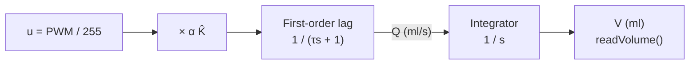

# Project Simulation

**Notes in this project:** [[01-project-overview|Overview]] · [[02-material-requirements|Materials]] · [[03-project-procedure|Procedure]] · [[04-project-simulation|Simulation]]

| Simulation                      | Tool                      | Purpose                                                                                           |
| ------------------------------- | ------------------------- | ------------------------------------------------------------------------------------------------- |
| **A. Controller simulation**    | Wokwi (free, browser)     | Test the Arduino logic, buttons, mode switch, and open vs closed-loop behavior without hardware   |
| **B. Open-loop step response plot** | Python / MATLAB / Scilab | The **one required open-loop plot** from $G(s)$ (PDF Step 3)                                   |

---

## A. Wokwi simulation (Arduino Nano)

> [!warning] Limitation
> Wokwi has no water pump or water-filled glass. The simulation uses the **software plant model** built into the code (`SIMULATE 1`), which replaces the HC-SR04 reading with the computed volume:
>
> - The pump is shown as an **LED on D9** (brightness follows the PWM).
> - The LCD is simulated with Wokwi's I2C 16×2 LCD part (address `0x27`, same as the code). It shows the progress bar and the % of target.
> - The glass volume is calculated in code with the same model as the transfer function.
> - `SIM_GAIN = 0.8` makes the "real" pump 20% weaker than the estimate, acting as a disturbance.

### Simulated plant model

The code integrates these equations every sample, where $\alpha$ = `SIM_GAIN`, $\hat{K}$ = `FLOW_ML_PER_S`, and $u$ = PWM / 255:

$$\dot{Q} = \frac{\alpha\,\hat{K}\,u - Q}{\tau}, \qquad \dot{V} = Q$$



### Steps

1. Go to **wokwi.com** and create a new **Arduino Nano** project.
2. Build the circuit (table below), or paste the JSON from the next section into `diagram.json`.
3. Copy the full code from [[03-project-procedure#Phase 5 Main Arduino code]] into `sketch.ino` and change the first define to:

   ```cpp
   #define SIMULATE 1
   ```

4. Add the library. The LCD needs **LiquidCrystal I2C**: in Wokwi, open the Library Manager (the **+** tab above the file list) and add it. No sensor library is needed. To simulate without the LCD, set `#define USE_LCD 0` instead.
5. Press **Start Simulation** and open the Serial Monitor (115200 baud).
6. Test both modes:
   - Slide switch to the **open-loop** side, then press **Start** (the target is `TARGET_ML` in the code, 200 ml by default; change it to 100 to test the other reference).
   - Switch to **closed-loop** and repeat.
   - Compare the `RESULT` lines.

> [!note] The HC-SR04 is not wired in the simulation
> With `SIMULATE 1` the code never pings the sensor, so the circuit below has no ultrasonic part. The ping and median code only runs on real hardware (`SIMULATE 0`).

### Connections

| Component              | Pin / connection                                                        |
| ---------------------- | ----------------------------------------------------------------------- |
| Start pushbutton       | One side to **D2**, other side to **GND**                               |
| Slide switch           | Middle pin to **D4**, one outer pin to **GND**, other outer pin unconnected |
| LED (pump indicator)   | Anode through **220 Ω** to **D9**, cathode to **GND**                   |
| I2C LCD 16×2           | **GND** to GND, **VCC** to 5V, **SDA** to **A4**, **SCL** to **A5**     |

> [!note]
> The switch must connect the middle pin to GND in the **closed-loop** position (the code reads LOW as closed-loop).

### Optional `diagram.json`

> [!tip]
> If Wokwi reports a wiring error on import (pin names can differ slightly between versions), wire the parts by hand using the table above.

```json
{
  "version": 1,
  "author": "Group",
  "editor": "wokwi",
  "parts": [
    { "type": "wokwi-arduino-nano", "id": "nano", "top": 0, "left": 0, "attrs": {} },
    { "type": "wokwi-pushbutton", "id": "btnStart", "top": -90, "left": 20, "attrs": { "color": "green" } },
    { "type": "wokwi-slide-switch", "id": "sw1", "top": -90, "left": 200, "attrs": {} },
    { "type": "wokwi-led", "id": "ledPump", "top": 150, "left": 40, "attrs": { "color": "cyan" } },
    { "type": "wokwi-resistor", "id": "r1", "top": 200, "left": 40, "attrs": { "value": "220" } },
    { "type": "wokwi-lcd1602", "id": "lcd1", "top": -240, "left": 100, "attrs": { "pins": "i2c" } }
  ],
  "connections": [
    [ "btnStart:1.l", "nano:D2", "green", [] ],
    [ "btnStart:2.l", "nano:GND.1", "black", [] ],
    [ "sw1:2", "nano:D4", "orange", [] ],
    [ "sw1:1", "nano:GND.1", "black", [] ],
    [ "nano:D9", "r1:1", "cyan", [] ],
    [ "r1:2", "ledPump:A", "cyan", [] ],
    [ "ledPump:C", "nano:GND.1", "black", [] ],
    [ "lcd1:GND", "nano:GND.2", "black", [] ],
    [ "lcd1:VCC", "nano:5V", "red", [] ],
    [ "lcd1:SDA", "nano:A4", "green", [] ],
    [ "lcd1:SCL", "nano:A5", "purple", [] ]
  ],
  "dependencies": {}
}
```

### Expected behavior

Defaults: $\hat{K} = 5\ \text{ml/s}$, $\alpha = 0.8$, $\tau = 0.5\ \text{s}$, target $r = 200\ \text{ml}$. The true flow is

$$K_{true} = \alpha\hat{K} = 4\ \text{ml/s}$$

| Mode            | Calculation                                                                                        | Result                                          |
| --------------- | -------------------------------------------------------------------------------------------------- | ----------------------------------------------- |
| **Open-loop**   | Runs $t_{run} = \dfrac{200}{5} = 40\ \text{s}$, delivering about $4 \times 40 = 160\ \text{ml}$    | Final ≈ **160 ml**, error ≈ **−40 ml** (20%)    |
| **Closed-loop** | Runs until $V \ge 200$, about $\dfrac{200}{4} = 50\ \text{s}$                                      | Final ≈ **202 ml**, error ≈ **+2 ml**           |

**On the LCD** (target 200 ml), the progress bar fills and the percentage rises with the volume. The final screen is held until the next Start press or until the mode switch is moved:

| Mode            | Last screen                                    |
| --------------- | ---------------------------------------------- |
| **Open-loop**   | `DONE    T=200ml` / `Final 160ml  80%`        |
| **Closed-loop** | `DONE    T=200ml` / `Final 202ml 101%`        |

The same 20% pump weakness that costs open-loop 40 ml shows up directly as 80% on the display.

The closed-loop overshoot comes from the pump lag (the simulated "dripping"):

$$\Delta V \approx Q_{stop}\,\tau = 4 \times 0.5 = 2\ \text{ml}$$

> [!success] Key lesson
> **Open-loop trusts the model. Closed-loop trusts the measurement.**

> [!TLDR]- Sequence of a closed-loop run
> ```mermaid
> sequenceDiagram
>     participant U as User
>     participant A as Arduino
>     participant P as Pump (sim)
>     participant S as Sensor (sim)
>     U->>A: Press Start (closed-loop)
>     A->>S: Tare
>     loop until volume reaches target
>         A->>S: readVolume()
>         S-->>A: volume
>         A->>P: PWM = full
>     end
>     A->>P: PWM = 0
>     A->>S: Settle 3 s, final read
>     A-->>U: RESULT line (target, final, error)
> ```

### Experiments to try

- [ ] Watch the LCD in both modes and note the final percentage (about 80% open-loop, about 101% closed-loop with the defaults).
- [ ] Set `SIM_GAIN = 1.0` (perfect model): open-loop becomes accurate. Then try `0.6`: open-loop error grows, closed-loop stays accurate.
- [ ] Set `STOP_EARLY_ML = 3.0` and compare the closed-loop overshoot.
- [ ] Set `SLOW_ZONE_ML = 20.0` (slowdown near target) and compare again.

> [!tip] Plotting
> Copy the `time_ms,volume_ml` lines from the Serial Monitor into Excel or Python to plot both modes together.

---

## B. Open-loop step response plot

Plots the plant model for a full-drive step input. Use your **measured** $K$ and $\tau$ from [[03-project-procedure#Phase 2 Mathematical model]] (the values below are examples).

$$G(s) = \frac{K}{s(\tau s + 1)} \qquad\Longrightarrow\qquad V(t) = K\left[\,t - \tau\left(1 - e^{-t/\tau}\right)\right]$$

For $t \gg \tau$, this becomes a ramp:

$$V(t) \approx K\,(t - \tau)$$

### Python

```python
# pip install numpy matplotlib
import numpy as np
import matplotlib.pyplot as plt

K = 5.0      # ml/s at full drive (use your measured value)
tau = 0.5    # s (use your measured/estimated value)

t = np.linspace(0, 45, 1000)
V = K * (t - tau * (1 - np.exp(-t / tau)))   # open-loop volume response

plt.figure(figsize=(8, 4.5))
plt.plot(t, V, label=f"Model: K={K} ml/s, tau={tau} s")
plt.axhline(200, linestyle="--", label="Target = 200 ml")
plt.xlabel("Time (s)")
plt.ylabel("Dispensed volume (ml)")
plt.title("Open-loop step response: pump drive to water volume")
plt.grid(True)
plt.legend()
plt.tight_layout()
plt.savefig("open_loop_step_response.png", dpi=200)
plt.show()
```

### Overlay measured data (optional)

Save a real open-loop run as `data.csv` (columns `time_ms,volume_ml`) and add this **before** `plt.legend()`:

```python
import pandas as pd
d = pd.read_csv("data.csv")
plt.plot(d["time_ms"] / 1000.0, d["volume_ml"], "o", markersize=3, label="Measured")
```

This lets you answer the PDF's question: *is the result consistent with your model and simulation?*

### MATLAB

```matlab
K = 5; tau = 0.5;
G = tf(K, [tau 1 0]);        % K / (tau*s^2 + s)
step(G, 45); grid on;
title('Open-loop step response');
```

### Scilab

```scilab
K = 5; tau = 0.5; s = poly(0, "s");
G = syslin("c", K / (s*(tau*s + 1)));
t = 0:0.05:45;
y = csim("step", t, G);
plot(t, y); xgrid();
```

---

## What to include in the report

- [ ] Screenshot of the Wokwi circuit, the LCD final screen, and the Serial Monitor output (optional but helpful)
- [ ] The open-loop step response plot (**required**)
- [ ] A short comment: the response is a ramp after a brief lag, so volume grows steadily with run time. Open-loop is accurate only when the real flow $K_{true}$ matches the estimate $\hat{K}$.
