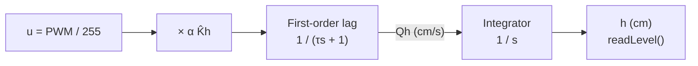

# Project Simulation

**Notes in this project:** [[01-project-overview|Overview]] · [[02-material-requirements|Materials]] · [[03-project-procedure|Procedure]] · [[04-project-simulation|Simulation]] · [[05-component-testing|Component Testing]]

| Simulation                      | Tool                      | Purpose                                                                                           |
| ------------------------------- | ------------------------- | ------------------------------------------------------------------------------------------------- |
| **A. Controller simulation**    | Wokwi (free, browser)     | Test the Arduino logic, buttons, mode switch, and open vs closed-loop behavior without hardware   |
| **B. Open-loop step response plot** | Python / MATLAB / Scilab | The **one required open-loop plot** from $G(s)$ (PDF Step 3)                                   |

---

## A. Wokwi simulation (Arduino Nano)

> [!warning] Limitation
> Wokwi has no water pump or water-filled glass. The simulation uses the **software plant model** built into the code (`SIMULATE 1`), which replaces the HC-SR04 reading with the computed level rise:
>
> - The pump is shown as an **LED on D9** (brightness follows the PWM).
> - The glass level rise is calculated in code with the same model as the transfer function.
> - `SIM_GAIN = 0.8` makes the "real" pump 20% weaker than the estimate, acting as a disturbance.

### Simulated plant model

The code integrates these equations every sample, where $\alpha$ = `SIM_GAIN`, $\hat{K}_h$ = `RISE_CM_PER_S`, and $u$ = PWM / 255:

$$\dot{Q}_h = \frac{\alpha\,\hat{K}_h\,u - Q_h}{\tau}, \qquad \dot{h} = Q_h$$



### Steps

1. Go to **wokwi.com** and create a new **Arduino Nano** project.
2. Build the circuit (table below), or paste the JSON from the next section into `diagram.json`.
3. Copy the full code from [[03-project-procedure#Phase 5 Main Arduino code]] into `sketch.ino` and change the first define to:

   ```cpp
   #define SIMULATE 1
   ```

4. Press **Start Simulation** and open the Serial Monitor (9600 baud).
5. Test both modes:
   - Slide switch to the **open-loop** side, then press **Start** (the target is `TARGET_CM` in the code, 6.0 cm by default; change it to 3.0 to test the other reference).
   - Switch to **closed-loop** and repeat.
   - Compare the `RESULT` lines.

> [!note] The HC-SR04 is not wired in the simulation
> With `SIMULATE 1` the code never pings the sensor, so the circuit below has no ultrasonic part. The ping and median code only runs on real hardware (`SIMULATE 0`).

### Connections

| Component              | Pin / connection                                                        |
| ---------------------- | ----------------------------------------------------------------------- |
| Start pushbutton       | One side to **D2**, other side to **GND**                               |
| Slide switch           | Middle pin to **D4**, one outer pin to **GND**, other outer pin unconnected |
| LED (pump indicator)   | Anode through **220 Ω** to **D9**, cathode to **GND**                   |

> [!note]
> The switch must connect the middle pin to GND in the **closed-loop** position (the code reads LOW as closed-loop).

### Optional `diagram.json`

> [!tip]
> If Wokwi reports a wiring error on import (pin names can differ slightly between versions), wire the parts by hand using the table above.

```json
{
  "version": 1,
  "author": "Group",
  "editor": "wokwi",
  "parts": [
    { "type": "wokwi-arduino-nano", "id": "nano", "top": 0, "left": 0, "attrs": {} },
    { "type": "wokwi-pushbutton", "id": "btnStart", "top": -90, "left": 20, "attrs": { "color": "green" } },
    { "type": "wokwi-slide-switch", "id": "sw1", "top": -90, "left": 200, "attrs": {} },
    { "type": "wokwi-led", "id": "ledPump", "top": 150, "left": 40, "attrs": { "color": "cyan" } },
    { "type": "wokwi-resistor", "id": "r1", "top": 200, "left": 40, "attrs": { "value": "220" } }
  ],
  "connections": [
    [ "btnStart:1.l", "nano:D2", "green", [] ],
    [ "btnStart:2.l", "nano:GND.1", "black", [] ],
    [ "sw1:2", "nano:D4", "orange", [] ],
    [ "sw1:1", "nano:GND.1", "black", [] ],
    [ "nano:D9", "r1:1", "cyan", [] ],
    [ "r1:2", "ledPump:A", "cyan", [] ],
    [ "ledPump:C", "nano:GND.1", "black", [] ]
  ],
  "dependencies": {}
}
```

### Expected behavior

Defaults: $\hat{K}_h = 0.20\ \text{cm/s}$, $\alpha = 0.8$, $\tau = 0.5\ \text{s}$, target $r = 6.0\ \text{cm}$. The true level rise rate is

$$K_{h,true} = \alpha\hat{K}_h = 0.16\ \text{cm/s}$$

| Mode            | Calculation                                                                                              | Result                                            |
| --------------- | -------------------------------------------------------------------------------------------------------- | ------------------------------------------------- |
| **Open-loop**   | Runs $t_{run} = \dfrac{6.0}{0.20} = 30\ \text{s}$, raising the level by about $0.16 \times 30 = 4.8\ \text{cm}$ | Final ≈ **4.80 cm**, error ≈ **−1.20 cm** (20%)   |
| **Closed-loop** | Runs until $h \ge 6.0$, about $\dfrac{6.0}{0.16} = 37.5\ \text{s}$                                       | Final ≈ **6.08 cm**, error ≈ **+0.08 cm**         |

**On the Serial Monitor** (target 6.0 cm), each run ends with a `RESULT` line. Values are approximate:

| Mode            | RESULT line                                                              |
| --------------- | ------------------------------------------------------------------------ |
| **Open-loop**   | `RESULT,open,target=6.0,final=4.80,error=-1.20,percent=80.0`             |
| **Closed-loop** | `RESULT,closed,target=6.0,final=6.08,error=0.08,percent=101.3`           |

The same 20% pump weakness that costs open-loop 1.2 cm shows up directly as `percent` of about 80.

The closed-loop overshoot comes from the pump lag (the simulated "dripping"):

$$\Delta h \approx Q_{h,stop}\,\tau = 0.16 \times 0.5 = 0.08\ \text{cm}$$

> [!success] Key lesson
> **Open-loop trusts the model. Closed-loop trusts the measurement.**

> [!TLDR]- Sequence of a closed-loop run
> ```mermaid
> sequenceDiagram
>     participant U as User
>     participant A as Arduino
>     participant P as Pump (sim)
>     participant S as Sensor (sim)
>     U->>A: Press Start (closed-loop)
>     A->>S: Tare
>     loop until level rise reaches target
>         A->>S: readLevel()
>         S-->>A: level rise
>         A->>P: PWM = full
>     end
>     A->>P: PWM = 0
>     A->>S: Settle 3 s, final read
>     A-->>U: RESULT line (target, final, error)
> ```

### Experiments to try

- [ ] Check the `percent` in the `RESULT` line in both modes (about 80% open-loop, about 101% closed-loop with the defaults).
- [ ] Set `SIM_GAIN = 1.0` (perfect model): open-loop becomes accurate. Then try `0.6`: open-loop error grows, closed-loop stays accurate.
- [ ] Set `STOP_EARLY_CM = 0.1` and compare the closed-loop overshoot.
- [ ] Set `SLOW_ZONE_CM = 1.5` (slowdown near target) and compare again.

> [!tip] Plotting
> Copy the `time_ms,level_cm` lines from the Serial Monitor into Excel or Python to plot both modes together.

---

## B. Open-loop step response plot

Plots the plant model for a full-drive step input. Use your **measured** $K_h$ and $\tau$ from [[03-project-procedure#Phase 2 Mathematical model]] (the values below are examples).

$$G(s) = \frac{K_h}{s(\tau s + 1)} \qquad\Longrightarrow\qquad h(t) = K_h\left[\,t - \tau\left(1 - e^{-t/\tau}\right)\right]$$

For $t \gg \tau$, this becomes a ramp:

$$h(t) \approx K_h\,(t - \tau)$$

### Python

```python
# pip install numpy matplotlib
import numpy as np
import matplotlib.pyplot as plt

K = 0.20     # cm/s at full drive (use your measured K_h)
tau = 0.5    # s (use your measured/estimated value)

t = np.linspace(0, 45, 1000)
h = K * (t - tau * (1 - np.exp(-t / tau)))   # open-loop level rise response

plt.figure(figsize=(8, 4.5))
plt.plot(t, h, label=f"Model: K_h={K} cm/s, tau={tau} s")
plt.axhline(6.0, linestyle="--", label="Target = 6 cm")
plt.xlabel("Time (s)")
plt.ylabel("Water level rise (cm)")
plt.title("Open-loop step response: pump drive to water level")
plt.grid(True)
plt.legend()
plt.tight_layout()
plt.savefig("open_loop_step_response.png", dpi=200)
plt.show()
```

### Overlay measured data (optional)

Save a real open-loop run as `data.csv` (columns `time_ms,level_cm`) and add this **before** `plt.legend()`:

```python
import pandas as pd
d = pd.read_csv("data.csv")
plt.plot(d["time_ms"] / 1000.0, d["level_cm"], "o", markersize=3, label="Measured")
```

This lets you answer the PDF's question: *is the result consistent with your model and simulation?*

### MATLAB

```matlab
K = 0.20; tau = 0.5;
G = tf(K, [tau 1 0]);        % K / (tau*s^2 + s)
step(G, 45); grid on;
title('Open-loop step response');
```

### Scilab

```scilab
K = 0.20; tau = 0.5; s = poly(0, "s");
G = syslin("c", K / (s*(tau*s + 1)));
t = 0:0.05:45;
y = csim("step", t, G);
plot(t, y); xgrid();
```

---

## What to include in the report

- [ ] Screenshot of the Wokwi circuit and the Serial Monitor output (with the `RESULT` lines) (optional but helpful)
- [ ] The open-loop step response plot (**required**)
- [ ] A short comment: the response is a ramp after a brief lag, so the water level rises steadily with run time. Open-loop is accurate only when the real level rise rate $K_{h,true}$ matches the estimate $\hat{K}_h$.
