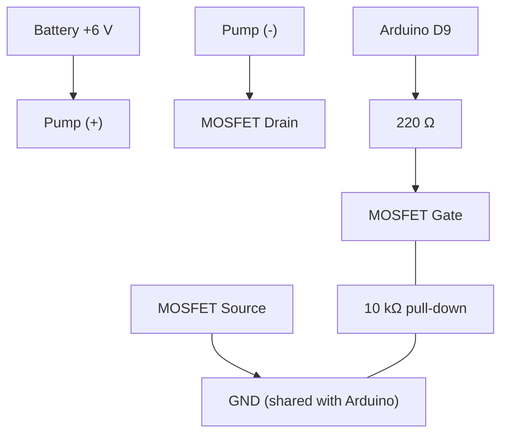

## 1. Electronics

| #   | Item                                  | Qty   | Specs / notes                                                                 |
| --- | ------------------------------------- | ----- | ----------------------------------------------------------------------------- |
| 1   | Arduino Nano + USB cable              | 1     | ATmega328P. Cable type depends on the board (Mini-B, Micro-B, USB-C)          |
| 2   | Breadboard                            | 1     | Full or half size                                                             |
| 3   | HX711 load cell amplifier             | 1     | 24-bit ADC for load cells                                                     |
| 4   | Load cell (bar type)                  | 1     | **1 kg** is ideal (glass + 300 ml ≈ 0.5 kg). 5 kg works but is less sensitive |
| 5   | Submersible DC pump + silicone tubing | 1     | 3–6 V mini pump. Tubing must fit the pump outlet                              |
| 6   | Logic-level N-MOSFET                  | 1     | **IRLZ44N** or similar. Avoid IRFZ44N (needs more gate voltage)               |
| 7   | Flyback diode                         | 1     | 1N4007 or 1N5819, across the pump terminals                                   |
| 8   | Resistor 220 Ω                        | 1     | MOSFET gate resistor                                                          |
| 9   | Resistor 10 kΩ                        | 1     | Gate pull-down (pump stays off at boot)                                       |
| 10  | Pushbuttons                           | 2     | Start and Target-select                                                       |
| 11  | Slide switch (SPDT)                   | 1     | Mode select                                                                   |
| 12  | I2C LCD 16×2 (PCF8574 backpack)       | 1     | 4 pins: GND, VCC, SDA, SCL. 5 V version. Address is usually `0x27` or `0x3F`  |
| 13  | LED + 220 Ω (optional)                | 1     | Status indicator                                                              |
| 14  | Battery holder + 4 × AA               | 1     | About 6 V for the pump, **separate from USB power**                           |
| 15  | Jumper wires                          | 1 set | HX711 and LCD headers need male pins (4 female-to-male wires for the LCD if the LCD pins are male) |

> [!tip] Alternatives A relay module can replace the MOSFET, but it clicks, wears out, and **cannot do PWM slowdown**. A TIP120 transistor also works.

---

## 2. Mechanical setup

- [ ] Load cell mounting plates (acrylic, wood, or thick cardboard)
- [ ] Screws, nuts, and spacers matching the load cell thread (usually M5 or M6); spacers lift the cell so it can flex
- [ ] Small flat platform for the glass
- [ ] Water reservoir for the pump
- [ ] Small, light, straight-sided glass
- [ ] Tape, zip ties, or hot glue to hold the tube outlet over the glass **without touching the platform**
- [ ] Tray or towel for spills

---

## 3. Measurement and testing tools

|Item|Why|
|---|---|
|Graduated cylinder, measuring cup, or kitchen scale|**Ground truth** volume (do not trust only the Arduino reading)|
|Known weight (coins, 100 g reference)|Load cell calibration|
|Stopwatch (phone)|Measuring pump flow rate|
|Laptop with Arduino IDE|Programming and Serial logging|

---

## 4. Software

|Software|Purpose|
|---|---|
|Arduino IDE|Board: Arduino Nano. If upload fails, use processor "ATmega328P (Old Bootloader)"|
|**HX711 library** (Bogdan Necula, `bogde`)|Install from Library Manager|
|**LiquidCrystal I2C** (Frank de Brabander)|Install from Library Manager. Drives the I2C LCD|
|Wokwi (free, online)|Simulation, see [[04-project-simulation]]|
|Python + matplotlib, MATLAB, or Scilab|Open-loop step response plot|
|Excel / Google Sheets|Data tables and comparison graphs|

---

## 5. Pin assignments (Arduino Nano)

|Nano pin|Connected to|Purpose|
|---|---|---|
|D5|HX711 DT|Load cell data|
|D6|HX711 SCK|Load cell clock|
|D9 (PWM)|MOSFET gate via 220 Ω|Pump control|
|D2|Start button (other side to GND)|Begin dispensing|
|D3|Target button (other side to GND)|Cycle 100 / 200 / 300 ml|
|D4|Slide switch middle pin (outer pin to GND)|LOW = closed-loop, HIGH = open-loop|
|A4 (SDA)|LCD SDA|I2C data (display)|
|A5 (SCL)|LCD SCL|I2C clock (display)|
|5V|HX711 VCC, LCD VCC|Power|
|GND|HX711 GND, LCD GND, MOSFET source, battery −|**Common ground**|

---

## 6. Wiring

> [!TLDR]- System overview
> 
> ```mermaid
> flowchart LR
>     LC["Load cell"] -->|"E+ E- A+ A-"| HX["HX711"]
>     HX -->|"DT → D5<br/>SCK → D6"| NANO["Arduino Nano"]
>     BTN1["Start button"] -->|"D2"| NANO
>     BTN2["Target button"] -->|"D3"| NANO
>     SW["Mode switch"] -->|"D4"| NANO
>     NANO -->|"D9 via 220 Ω"| MOS["IRLZ44N MOSFET"]
>     BAT["6 V battery pack"] --> PUMP["Pump"]
>     PUMP --> MOS
>     MOS --> GND["Common GND"]
>     NANO -->|"A4 SDA<br/>A5 SCL"| LCD["I2C LCD 16×2"]
>     NANO --- GND
> ```
> 
### Load cell → HX711

Wire colors vary by manufacturer. Typical:

|Load cell wire|HX711 terminal|
|---|---|
|Red|E+|
|Black|E−|
|White|A−|
|Green|A+|

> [!tip] If the reading goes **negative** when you add water, swap the A+ and A− wires.

### I2C LCD → Nano

|LCD pin|Nano pin|
|---|---|
|GND|GND|
|VCC|5V|
|SDA|A4|
|SCL|A5|

> [!tip] LCD shows nothing?
> - **Backlight on but no text:** turn the small blue **contrast trimmer** on the back of the I2C backpack with a screwdriver.
> - **Still blank:** the address may be `0x3F` instead of `0x27`. Run the I2C scanner in [[03-project-procedure#Check the LCD]] to find it.
> - Power the LCD from the Nano **5V** pin (not 3.3 V). The backlight draws roughly 20 to 40 mA, which USB power handles fine.

### Pump driver (low-side switching)



> [!important] Flyback diode Place the diode **across the pump terminals**: cathode (striped end) to the pump (+) side, anode to the pump (−) side.

---

## 7. Safety checklist

> [!danger] Read before powering up
> 
> - [ ] **Never power the pump from an Arduino pin.** Use the MOSFET and the separate battery pack.
> - [ ] Connect **all grounds together** (Arduino, MOSFET source, battery −).
> - [ ] Keep the breadboard, HX711 and **LCD** **away from water**; use a tray and mount electronics higher than the glass.
> - [ ] Do not let tubing rest on the load cell platform.
> - [ ] Double-check polarity before connecting the battery.
> - [ ] Do not run the pump dry for long.
> - [ ] Low voltage only (about 6 V). No mains electricity anywhere in this project.