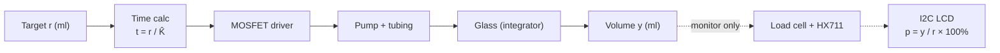
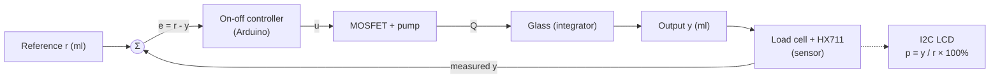
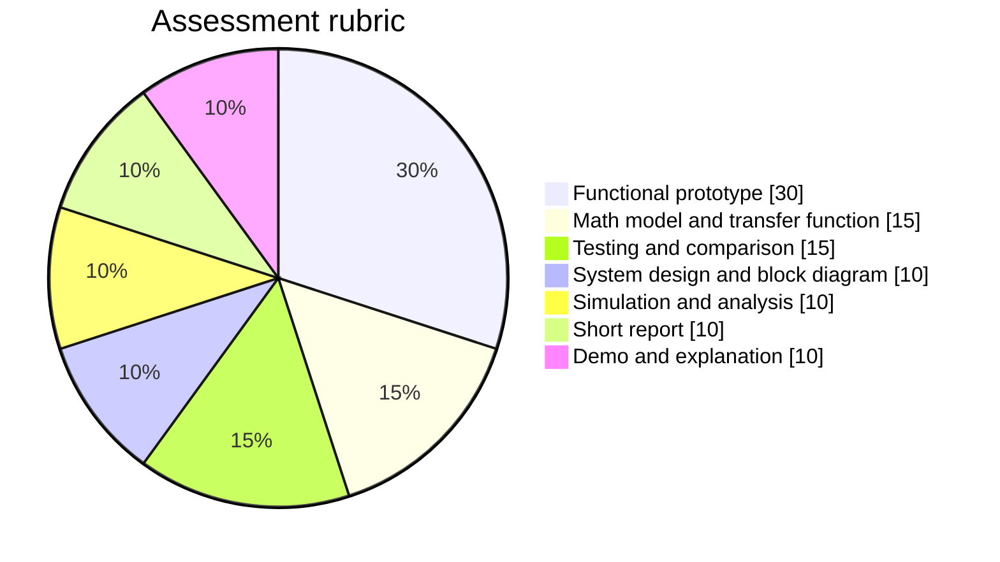

---
# Automatic Water Dispenser: Open-Loop vs Closed-Loop

> [!abstract] Summary An Arduino Nano system that pumps a selected volume of water into a glass. It runs in two modes, **open-loop** (timed) and **closed-loop** (weighed by a load cell), so the effect of feedback can be compared directly.

**Notes in this project:** [[01-project-overview|Overview]] · [[02-material-requirements|Materials]] · [[03-project-procedure|Procedure]] · [[04-project-simulation|Simulation]]

---

## 1. Operating modes

| Mode            | How it works                                                       | Sensor used for control? |
| --------------- | ------------------------------------------------------------------ | ------------------------ |
| **Open-loop**   | Pump runs for a pre-calculated time $t_{run} = \dfrac{r}{\hat{K}}$ | No (log and LCD display only) |
| **Closed-loop** | Pump runs until the measured volume reaches the target             | Yes                      |

Here $r$ is the target volume (ml) and $\hat{K}$ is the _estimated_ flow rate (ml/s).

> [!info] Weight to volume With water density $\rho \approx 1\ \text{g/ml}$, the load cell reading in grams equals the volume in millilitres: $$V = \frac{m}{\rho} \approx m$$

---

### Progress shown on the LCD

An I2C 16×2 LCD shows how far the dispensing has progressed, as a percentage of the selected target:

$$ p(t) = \frac{y(t)}{r} \times 100\% $$

> [!note] Display only
> The LCD reads the same measured value $y$ that is logged over Serial. It is **not** part of the control law, so it does not change the open-loop vs closed-loop comparison. In open-loop mode it simply shows the truth the controller ignores: the percentage ends near $\alpha \times 100\%$ when the real flow is a fraction $\alpha$ of the estimate. In closed-loop mode it stops at about 100% and may read slightly above it because of dripping overshoot.

---

## 2. System identification

| Element                 | In this project                                                   |
| ----------------------- | ----------------------------------------------------------------- |
| **Plant**               | Pump + tubing + glass (accumulating volume)                       |
| **Reference input** $r$ | Target volume (ml), chosen by button                              |
| **Output** $y$          | Volume of water actually in the glass (ml)                        |
| **Sensor**              | Load cell + HX711 amplifier                                       |
| **Actuator**            | DC submersible pump, switched by a logic-level MOSFET             |
| **Controller**          | Arduino Nano, on-off comparison                                   |
| **Feedback path**       | Load cell → HX711 → Arduino → MOSFET → pump                       |
| **Disturbances**        | Weak battery, tube height change, pinched tube, residual dripping |
| **Display**             | I2C 16×2 LCD (SDA = A4, SCL = A5): progress bar and % of target. Outside the control loop |

---

## 3. Block diagrams

### Open-loop

### Closed-loop

### On-off control law

$$ u(t) = \begin{cases} 1 & \text{if } e(t) = r - y(t) > 0 \ 0 & \text{if } e(t) \le 0 \end{cases} $$

---

## 4. Features

- [ ] Two modes selected with a slide switch (open-loop / closed-loop)
- [ ] Three targets (100 / 200 / 300 ml) cycled by one button
- [ ] Single **Start** button
- [ ] I2C LCD with live progress (bar + % of target), then the final volume and % held on screen
- [ ] Automatic tare before each run (place the empty glass first)
- [ ] CSV logging over Serial (`time_ms,weight_g`)
- [ ] Result summary after each run: target, final value, error
- [ ] 60 s safety timeout
- [ ] Optional stop-early margin and PWM slowdown near the target
- [ ] Built-in simulation mode (`SIMULATE 1`), see [[04-project-simulation]]

---

## 5. Mapping to the PDF requirements

|PDF requirement|Covered in|
|---|---|
|Plant, input, output, sensor, actuator|Section 2 above|
|Block diagram and component list|Section 3 above, [[02-material-requirements]]|
|Mathematical model and transfer function|[[03-project-procedure#Phase 2 Mathematical model]]|
|One open-loop simulation plot|[[04-project-simulation#B. Open-loop step response plot]]|
|Functional prototype and source code|[[03-project-procedure#Phase 5 Main Arduino code]]|
|Open vs closed-loop comparison table|[[03-project-procedure#Phase 6 Testing and data collection]]|
|Disturbance response|[[03-project-procedure#Disturbance test]]|
|Extra (not in the PDF): live progress display|[[02-material-requirements#I2C LCD → Nano]], [[03-project-procedure#Phase 5 Main Arduino code]]|
|Short report, live demo|[[03-project-procedure#Phase 7 Report and demonstration]]|

### Rubric weights (100 pts)

---

## 6. Expected results

> [!success] What to show in the report
> 
> - **Open-loop:** accurate only when conditions match the calibration run. Error grows with a weaker battery or a different tube height.
> - **Closed-loop:** lands near the target regardless of those changes. A small overshoot remains from residual dripping.
> - **LCD:** open-loop ends well away from 100% when conditions change (for example about 80% with a pump 20% weaker than estimated). Closed-loop ends at about 100% to 102%. Photograph the LCD in each case for the report.

Overshoot after the pump stops is roughly the flow at shutoff multiplied by the pump time constant:

$$ \Delta V_{overshoot} \approx Q_{stop},\tau $$

> [!tip] Report limitation and improvement **Limitation:** residual dripping causes overshoot. **Improvement:** a drain pump or valve, or PWM slowdown near the target.

---

## 7. Scope notes

> [!warning] Keep it simple
> 
> - The PDF emphasizes basic control concepts over a sophisticated system.
> - Get the topic approved by your instructor first (one approved topic per group).
> - A drain pump for removing excess water is deliberately **out of scope** to save cost and reduce failure risk.
> - The LCD is a convenience for the demo. If it causes trouble, set `USE_LCD 0` in the code and the control behaviour is unchanged.