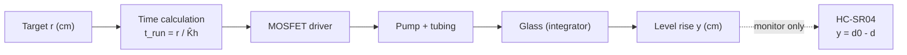
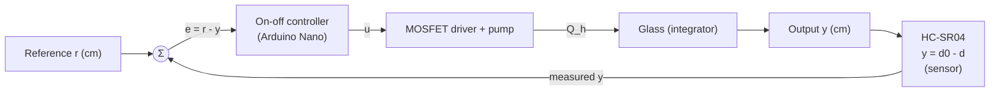
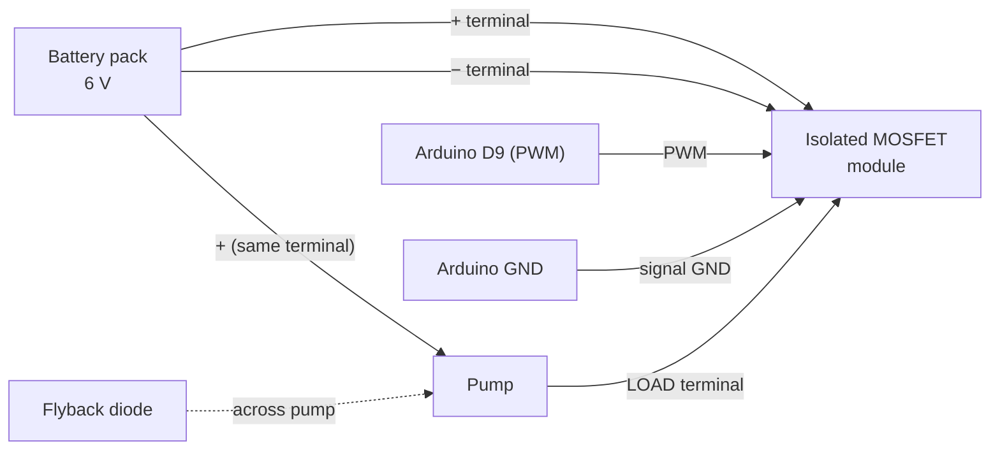

# Chapter 2. System Design and Mathematical Model

Automatic Water-Level Control: Open-Loop versus Closed-Loop Operation
Feedback and Control Systems Performance Task · BS Computer Engineering, Third Year

---

## 2.1 System Identification

The system raises the water level in a straight-sided glass by a selected height r. Table 2.1 identifies each element of the control loop.

**Table 2.1. Elements of the control system**

| Element | In this project |
| --- | --- |
| Plant | Submersible pump, silicone tubing, and glass (accumulating water level) |
| Reference input, r | Target level rise in cm (3 cm and 6 cm), set by `TARGET_CM` in the code |
| Controlled output, y | Rise of the water level in the glass, y = d₀ − d (cm) |
| Sensor | HC-SR04 ultrasonic distance sensor, read with a median-of-3 filter |
| Actuator | DC submersible pump, switched by an optocoupler-isolated MOSFET module (LR7843) |
| Controller | Arduino Nano. Timed run (open-loop) or on-off comparison (closed-loop) |
| Feedback path | HC-SR04 → Arduino (median filter, tare subtraction) → MOSFET driver → pump |
| Disturbances | Pinched tube, change in tube or reservoir height, residual dripping, surface ripples |

---

## 2.2 Block Diagrams

### 2.2.1 Open-loop configuration

The controller converts the target into a pump run time using the estimated level rise rate K̂ₕ. The sensor is read for logging only and does not affect the pump.

*Figure 2.1. Open-loop block diagram.*

### 2.2.2 Closed-loop configuration

The sensor measures y continuously. The summing junction forms the error e = r − y, and the on-off controller switches the pump accordingly.

*Figure 2.2. Closed-loop block diagram with unity feedback through the sensor.*

---

## 2.3 Components and Circuit

**Table 2.2. Component list**

| # | Component | Qty | Role and key specification |
| --- | --- | --- | --- |
| 1 | Arduino Nano (ATmega328P) | 1 | Controller. Reads sensor and inputs, outputs PWM to the pump driver |
| 2 | HC-SR04 ultrasonic sensor | 1 | Sensor. 5 V, measures distance to the water surface (about ±3 mm) |
| 3 | Submersible DC pump (3–6 V) with silicone tubing | 1 | Actuator. Delivers water to the glass |
| 4 | Optocoupler-isolated MOSFET module (LR7843) | 1 | Pump driver. Low-side switch, PWM input, isolated from the load side |
| 5 | Flyback diode (1N4007 or 1N5819) | 1 | Across the pump, protects the MOSFET from inductive spikes |
| 6 | Pushbutton | 1 | Start (D2, internal pull-up) |
| 7 | SPDT slide switch | 1 | Mode select (D4). LOW = closed-loop, HIGH = open-loop |
| 8 | 6 V supply (4 × AA pack) | 1 | Pump power, separate from USB |
| 9 | Straight-sided glass, ruler, sensor bracket, splash guard | 1 set | Mechanical setup. The ruler gives the true level (ground truth) |
| 10 | Breadboard and jumper wires | 1 set | Signal-side connections |

**Table 2.3. Arduino Nano pin assignment**

| Nano pin | Connected to | Purpose |
| --- | --- | --- |
| D5 | HC-SR04 Trig | Trigger pulse (output) |
| D6 | HC-SR04 Echo | Echo pulse (input) |
| D9 (PWM) | Driver module PWM pad | Pump control |
| D2 | Start button (other side to GND) | Begin a run |
| D4 | Mode switch middle pin (outer pin to GND) | Mode select |
| 5V / GND | HC-SR04 VCC / GND | Sensor power |

The pump is wired as shown in Figure 2.3. The driver's signal side (PWM, GND) connects to the Nano, and its load side (+, LOAD, −) connects to the separate battery pack and the pump. The optocoupler isolates the two sides, so the battery negative is **not** joined to the Nano ground. This keeps pump switching noise away from the Nano and the ultrasonic sensor.

*Figure 2.3. Pump driver wiring (current path: battery + → module + → pump → LOAD → MOSFET → module − → battery −). The complete wiring diagram is in the appendix.*

---

## 2.4 Modeling Assumptions

1. The supply voltage is constant during a run.
2. Tubing delay is negligible.
3. The pump flow responds to the on/off drive as a first-order system.
4. The glass has straight sides, so its cross-section is constant and a given flow always raises the level at the same rate. The glass area is absorbed into K_h and is never measured.
5. The ultrasonic beam hits the water surface directly, and the surface is nearly still when read.
6. The sensor adds only a small sampling and filtering delay T_f (about 0.1 to 0.2 s), which is neglected in G(s).

---

## 2.5 Mathematical Model

The plant is modeled as two blocks in series: the pump and tubing (a first-order lag) and the glass (an integrator). The variables are defined in Table 2.4.

**Table 2.4. Symbols**

| Symbol | Meaning | Unit |
| --- | --- | --- |
| u | Pump drive (0 = off, 1 = full) | – |
| Q_h | Level rise rate | cm/s |
| K_h | Steady level rise rate at full drive | cm/s |
| τ | Pump time constant | s |
| h | Level rise (the output y) | cm |
| d₀ | Empty-glass distance from sensor to the glass floor | cm |
| d | Current distance from sensor to the water surface | cm |
| r | Target level rise (reference) | cm |
| e | Error, r − y | cm |

### 2.5.1 Pump and tubing

The drive u produces a level rise rate Q_h that builds up with time constant τ:

$$\tau\,\dot{Q}_h(t) + Q_h(t) = K_h\,u(t)$$

Taking the Laplace transform with zero initial conditions:

$$\frac{Q_h(s)}{U(s)} = \frac{K_h}{\tau s + 1}$$

### 2.5.2 Glass (accumulation of level)

Because the glass has a constant cross-section, the level is the integral of the level rise rate:

$$\frac{dh}{dt} = Q_h(t) \quad\Longrightarrow\quad \frac{H(s)}{Q_h(s)} = \frac{1}{s}$$

### 2.5.3 Plant transfer function

Multiplying the two blocks gives the plant transfer function:

$$\boxed{G(s) = \frac{H(s)}{U(s)} = \frac{K_h}{s\,(\tau s + 1)}}$$

G(s) has one pole at the origin (the integrator) and one at s = −1/τ. Because of the integrator, the level holds its value when the pump stops.

### 2.5.4 Sensor model

The HC-SR04 measures the round-trip echo time t_echo, and the Arduino converts it to distance using the speed of sound (343 m/s):

$$d = \frac{t_{echo}\times 0.0343\ \text{cm/}\mu\text{s}}{2} = t_{echo}\times 0.01715\ \text{cm/}\mu\text{s}$$

The level rise is then computed against the empty-glass distance d₀, measured automatically (the "tare") before each run:

$$y = d_0 - d$$

A 1 cm change in level produces a 1 cm change in y, so the sensor has unity gain. Its only dynamics are the small delay T_f from sampling and the median filter, which is neglected in G(s).

### 2.5.5 Time-domain step response

For a unit step in u (pump at full drive), the inverse Laplace transform gives:

$$h(t) = K_h\left[\,t - \tau\left(1 - e^{-t/\tau}\right)\right]$$

For t ≫ τ this becomes a ramp:

$$h(t) \approx K_h\,(t - \tau)$$

The level therefore rises steadily with run time after a brief start-up lag. This response is plotted in Chapter 4 as the required open-loop simulation.

---

## 2.6 Estimation of Model Parameters

**K_h (level rise rate).** The pump runs at full drive for a known time T, and the real level rise h_m is read on the ruler:

$$\hat{K}_h = \frac{h_m}{T}$$

Three trials are averaged. The result is used in the code as `RISE_CM_PER_S`.

**τ (pump time constant).** From the logged data, τ is the time for the level rise rate to reach about 63% of its steady value after the pump starts. Where this cannot be measured reliably, τ is estimated and stated as an estimate.

**Table 2.5. Model parameters**

| Parameter | Value | Source |
| --- | --- | --- |
| K̂ₕ | [0.__ cm/s] (placeholder in code: 0.20) | Measured, average of 3 runs at 15 s |
| τ | [0.__ s] (example used: 0.5) | [Measured from log / estimated] |
| d₀ | [__ cm] | Measured automatically at the start of each run |
| Battery voltage | [__ V] no load, [__ V] under load | Multimeter |

The resulting plant transfer function is

$$G(s) = \frac{[K_h]}{s\,([\tau]\,s + 1)}$$

---

## 2.7 Controller Models

### 2.7.1 Open-loop (timed) control

The run time is calculated from the model only:

$$t_{run} = \frac{r}{\hat{K}_h}$$

If the real rate is a fraction α of the estimate, K_h,true = α·K̂ₕ, the final level is α·r, and the steady-state error is

$$e_{ss,open} = r\,(1 - \alpha)$$

For example, with α = 0.8 the error is 0.6 cm at r = 3 cm and 1.2 cm at r = 6 cm. Open-loop accuracy therefore depends entirely on the model matching the real plant.

### 2.7.2 Closed-loop (on-off) control

The controller acts on the measured error:

$$e(t) = r - y(t), \qquad u(t) = \begin{cases} 1 & e(t) > 0 \\ 0 & e(t) \le 0 \end{cases}$$

The on-off law is nonlinear, so the closed-loop system is described by this switching rule applied to G(s), not by a single closed-loop transfer function. Since the final level is decided by the measured y and not by K_h, the result does not depend on α.

Two effects limit closed-loop accuracy:

- **Overshoot after shut-off.** The pump lag lets a little more water arrive after u = 0, and the sensor filter delays detection:

$$\Delta h_{overshoot} \approx Q_{h,stop}\,(\tau + T_f)$$

With Q_h,stop ≈ 0.2 cm/s, τ = 0.5 s, and T_f ≈ 0.1 to 0.2 s, this is about 0.12 to 0.14 cm.

- **Sensor resolution.** The HC-SR04 is good to about ±3 mm, so

$$\Delta h_{sensor} \approx \pm 0.3\ \text{cm}$$

which is about ±10% of the 3 cm target and ±5% of the 6 cm target.

### 2.7.3 Expected comparison

**Table 2.6. Model predictions (to be compared with measurements in Chapter 4)**

| Condition | Open-loop | Closed-loop |
| --- | --- | --- |
| Pump matches calibration (α = 1) | Error within sensor resolution | Error about overshoot plus ±0.3 cm |
| Pump 20% weaker (α = 0.8) or pinched tube | Error r(1 − α): 0.6 cm at 3 cm, 1.2 cm at 6 cm | Unchanged, about overshoot plus ±0.3 cm |
| Change of target (3 → 6 cm) | Run time recalculated, error scales with r | Stops at the new target |

The key prediction is that **open-loop trusts the model, while closed-loop trusts the measurement**. Feedback should therefore be most visible at the 6 cm target and under a disturbance.

---

## 2.8 Summary

The water-level system was identified as a pump-and-tubing lag in series with a glass integrator, giving G(s) = K_h / [s(τs + 1)]. The HC-SR04 provides the output as y = d₀ − d with unity gain. Open-loop control uses t_run = r / K̂ₕ and has a steady-state error of r(1 − α) when the pump differs from the estimate. Closed-loop on-off control stops on the measured level, so its error is limited only by post-shut-off overshoot and sensor resolution. These predictions are tested experimentally in Chapter 4.
