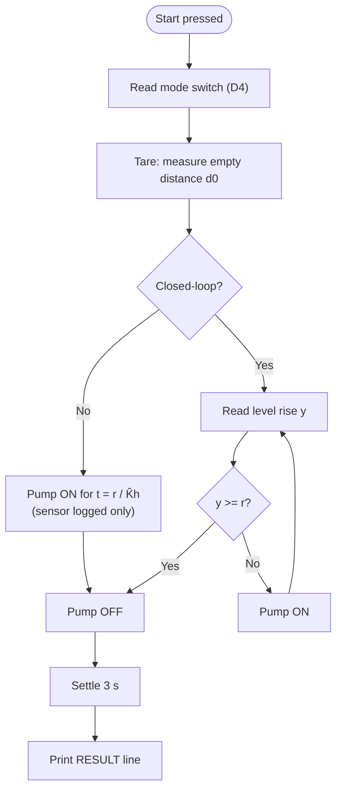

# Chapter 3. Prototype Development and Procedure

Automatic Water-Level Control: Open-Loop versus Closed-Loop Operation
Feedback and Control Systems Performance Task · BS Computer Engineering, Third Year

---

## 3.1 Development Approach

The prototype was built and verified one subsystem at a time, so that any fault could be traced to a single part. The sequence was:

1. Test each component alone (Arduino Nano, inputs, HC-SR04, battery pack, flyback diode, pump).
2. Build the pump driver first and test it with a fixed PWM before adding other parts.
3. Calibrate the HC-SR04 against a ruler.
4. Measure the level rise rate K̂ₕ.
5. Load the main code, run a dry test, then run the open-loop and closed-loop tests.

A software simulation of the controller (Wokwi, `SIMULATE 1`) was also run before using water, to confirm the logic of both modes.

---

## 3.2 Circuit Description

The circuit has a **signal side** (Arduino Nano, sensor, button, switch) and a **load side** (battery pack, driver module, pump). The two sides are separated by the optocoupler on the driver module.

**Table 3.1. Main connections**

| From                     | To                                               | Purpose                                   |
| ------------------------ | ------------------------------------------------ | ----------------------------------------- |
| HC-SR04 VCC / GND        | Nano 5V / GND                                    | Sensor power                              |
| HC-SR04 Trig / Echo      | Nano D5 / D6                                     | Trigger output / echo input               |
| Start button             | Nano D2 and GND                                  | Begin a run (internal pull-up)            |
| Mode switch (middle pin) | Nano D4, outer pin to GND                        | LOW = closed-loop, HIGH = open-loop       |
| Nano D9 (PWM)            | Module PWM pad                                   | Pump command u                            |
| Nano GND                 | Module signal GND pad                            | Signal reference                          |
| Battery pack +           | Module + terminal                                | Pump supply (about 6 V)                   |
| Pump (+) wire            | Module + terminal                                | Same terminal as battery +                |
| Pump (−) wire            | Module LOAD terminal                             | Switched side of the pump                 |
| Battery pack −           | Module − terminal                                | Load-side return                          |
| Flyback diode            | Across the pump (stripe to +, other end to LOAD) | Protects the MOSFET from inductive spikes |

Key design decisions:

- **Isolated driver.** The module is a low-side switch: when the PWM signal is high, it connects the pump's negative side to the battery negative. The battery negative is deliberately **not** joined to the Nano ground, which keeps pump switching noise away from the Nano and the ultrasonic sensor.
- **Separate pump supply.** The pump runs from a 4 × AA pack and never from an Arduino pin or USB power.
- **Mechanical layout.** The HC-SR04 is mounted on a bracket pointing straight down, centered over the glass, 5 to 10 cm above the highest water level. The tube outlet is fixed so the water runs down the inner glass wall, outside the sensor beam, with a splash guard between the stream and the sensor. A ruler taped on the glass (0 at the inside floor) gives the true level.

The complete wiring diagram is in Appendix A.

---

## 3.3 Controller Implementation

The controller is an Arduino Nano program (Appendix B). A run starts when the Start button is pressed, and the mode is read from the switch on D4.

*Figure 3.1. Flow of one filling cycle.*

**Open-loop mode.** After the tare, the pump runs at full drive for the fixed time t_run = r / K̂ₕ. The sensor is read and logged but does not affect the pump.

**Closed-loop mode.** After the tare, the Arduino reads the level rise y = d₀ − d (median of three pings), forms the error e = r − y, and keeps the pump on while e > 0. When e ≤ 0, the pump is switched off. This is the on-off law of Section 2.7.2.

**Common to both modes.** After the pump stops, the program waits 3 s for dripping and ripples to settle, takes the final reading, and prints a `RESULT` line (target, final level, error, percent of target). A 60 s timeout stops the pump if the target is never reached. Every run also logs `time_ms,level_cm` over Serial at 9600 baud.

**Table 3.2. Code settings used**

| Parameter | Value | Meaning |
| --- | --- | --- |
| `TARGET_CM` | 3.0 / 6.0 | Reference r (one upload per target) |
| `RISE_CM_PER_S` | [0.__] | Measured K̂ₕ (open-loop timing) |
| `PWM_FULL` | 255 | Full pump drive |
| `STOP_EARLY_CM`, `SLOW_ZONE_CM` | 0.0, 0.0 | Pure on-off control (no bonus tuning) |
| `TIMEOUT_MS` | 60000 | Safety limit |
| `SETTLE_MS` | 3000 | Wait before the final reading |

---

## 3.4 Component Verification and Calibration

Each part was tested alone before the full system was run.

**Table 3.3. Bench tests**

| Test                   | Method                                   | Pass criterion                                          | Result        |
| ---------------------- | ---------------------------------------- | ------------------------------------------------------- | ------------- |
| Arduino Nano           | Blink and Serial sketch                  | LED blinks, Serial prints at 9600 baud                  | [Pass / Fail] |
| Button and switch      | Serial print of D2 and D4                | Correct PRESSED / released and OPEN / CLOSED readings   | [Pass / Fail] |
| HC-SR04 accuracy       | Ruler at 10, 20, 30 cm                   | Average within ±0.5 cm                                  | [__ cm error] |
| HC-SR04 stability      | 20 readings at one distance              | Spread ≤ 0.3 cm, no missed echoes                       | [__ cm]       |
| HC-SR04 level response | Pour water to 3 cm and 6 cm on the ruler | d₀ − d within ±0.3 cm of the ruler                      | [__ / __ cm]  |
| Battery pack           | Multimeter, no load and under load       | At least about 6 V                                      | [__ V / __ V] |
| Flyback diode          | Multimeter diode mode                    | Conducts in one direction only                          | [Pass / Fail] |
| Pump alone             | Touch to battery, submerged              | Steady water flow                                       | [Pass / Fail] |
| Driver and pump        | Fixed and ramped PWM from D9             | Pump speeds up with PWM and stops at 0                  | [Pass / Fail] |
| Grounds and isolation  | Continuity check                         | Nano-side grounds joined, battery − separate, no shorts | [Pass / Fail] |
| Dry run and noise test | Full code, pump running                  | Both modes complete, no Serial glitches or resets       | [Pass / Fail] |

**Estimating K̂ₕ.** With `TARGET_CM = 3.0` and the placeholder `RISE_CM_PER_S = 0.20`, the open-loop run time is 15 s. After each run the real level rise h_m is read on the ruler and K̂ₕ = h_m / 15 s is computed. Three trials are averaged and the result is entered in the code. The pump time constant τ is estimated from the logged data (time to reach about 63% of the steady rise rate) and stated as an estimate where it cannot be measured reliably.

---

## 3.5 Testing Procedure

**Test conditions.** Both modes were tested at two references, **r = 3 cm and r = 6 cm**, with **three trials per mode and target**. The same pump, tube, battery pack, and glass were used throughout.

**Procedure for each target:**

1. Place the empty glass under the sensor. Check that the pump is submerged, the tube runs down the inner wall, and the ruler is readable.
2. Set `TARGET_CM` (3.0 or 6.0) and upload the code.
3. Record the battery voltage before the run.
4. Set the switch to **open-loop** and press **Start**. Record the Arduino reading and `percent` from the `RESULT` line. After the 3 s settle, read the **real level rise on the ruler at eye level**.
5. Empty and dry the glass, then repeat for three trials.
6. Switch to **closed-loop** and repeat steps 3 to 5.
7. For each trial compute the absolute error and percent error:

$$e_{abs} = \lvert h_{real} - r \rvert, \qquad e_{\%} = \frac{e_{abs}}{r}\times 100\%$$

The average error is then found for each mode and target.

**Change of target.** Moving from 3 cm to 6 cm (changing `TARGET_CM` and re-uploading) shows how each mode responds to a new reference. Open-loop recalculates its run time, while closed-loop stops at the new target.

**Disturbance test.** A disturbance is applied to **both** modes at the 6 cm target by **slightly pinching the silicone tube with a clip** (the same pinch for both modes), which lowers the true level rise rate to K_h,true = α·K̂ₕ. Weak batteries are not used as the disturbance, because a supply below the module's minimum can make the pump switch erratically and would not match the model. Under this disturbance, open-loop is expected to show an error of r(1 − α), while closed-loop is expected to stay near the target.

**Table 3.4. Data recorded for each trial**

| Mode          | Target (cm) | Trial  | Arduino reading (cm) | Real rise, ruler (cm) | Abs. error (cm) |
| ------------- | ----------- | ------ | -------------------- | --------------------- | --------------- |
| Open / Closed | 3 / 6       | 1 to 3 |                      |                       |                 |

The completed data tables are presented in Chapter 4.

**Safety measures.**

- The pump is never powered from an Arduino pin and never run dry.
- The breadboard and HC-SR04 are kept above and away from water, with a tray under the glass and a splash guard in place.
- The battery is disconnected before any wire is changed.
- The system runs at about 6 V only.

---

## 3.6 Summary

The prototype consists of an Arduino Nano, an HC-SR04 sensor, and a submersible pump driven through an optocoupler-isolated MOSFET module from a separate 6 V pack. One program provides both a timed open-loop mode and an on-off closed-loop mode selected by a switch. Each component was verified individually, the sensor was checked against a ruler, and K̂ₕ was measured before testing. Both modes were then tested at 3 cm and 6 cm with three trials each, followed by a pinched-tube disturbance, with the true level always confirmed by the ruler. The results are reported in Chapter 4.