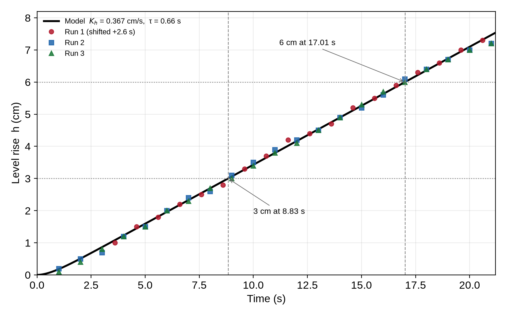
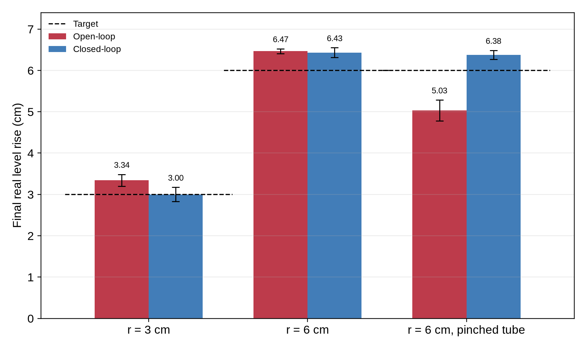

# Chapter 4. Results and Discussion

Automatic Water-Level Control: Open-Loop versus Closed-Loop Operation
Feedback and Control Systems Performance Task · BS Computer Engineering, Third Year

---

## 4.1 Overview

This chapter presents and interprets the measurements taken on the prototype. Section 4.2 identifies the plant parameters from the three full-drive calibration runs. Section 4.3 compares the open-loop step response of the model with the measured data and summarizes the behavior predicted for the two controllers, including the software check in Wokwi. Section 4.4 reports the bench trials at 3 cm and 6 cm and the pinched-tube disturbance test. Section 4.5 compares open-loop and closed-loop operation directly, and Section 4.6 discusses the results against the model and the objectives.

Two conventions are used throughout:

- The **ruler taped on the glass is the ground truth**. Every control error is computed from the real level rise $h_{real}$ read on the ruler, as defined in Section 3.5: $e_{abs} = |h_{real} - r|$.
- The **Arduino (HC-SR04) reading** is reported separately because it is the signal the closed-loop controller actually acts on. Agreement between the two readings is itself a result (Section 4.4.3).

The bench data come from the files in `data/`: the calibration logs `test-1.csv`, `test-2.csv`, and `test-3.csv`; the comparison trials `3-cm-trial-final.csv` and `6-cm-trial-final.csv`; and the disturbance runs `6-cm-trial-disturbance.csv`. The Wokwi `RESULT` lines in Section 4.3.3 come from the simulation described in `04-project-simulation.md`.

---

## 4.2 Model Parameter Identification

The pump was run at full drive ($u = 1$) with an empty, dry glass, and the level was logged once per second for about 18 to 21 s. A straight line $h = m\,t + b$ was fitted to each run by least squares. The fitted slope is $\hat{K}_h$, the zero crossing of the line gives $\tau$, and the scatter about the line shows whether the constant-rate assumption holds.

**Table 4.1. Calibration runs at full pump drive**

| Run      | Samples | Final level (cm) | Slope $m = \hat{K}_h$ (cm/s) | Intercept $b$ (cm) | Zero crossing $t_0$ (s) | $R^2$  | RMS residual (cm) |
| -------- | ------- | ---------------- | ---------------------------- | ------------------ | ----------------------- | ------ | ----------------- |
| 1        | 18      | 7.3              | 0.3708                       | +0.694             | −1.87 (clock started late) | 0.9989 | 0.06              |
| 2        | 21      | 7.2              | 0.3638                       | −0.220             | 0.606                   | 0.9984 | 0.09              |
| 3        | 21      | 7.2              | 0.3660                       | −0.264             | 0.721                   | 0.9991 | 0.07              |
| **Mean** |         |                  | **0.3668 ± 0.0036**          |                    | **0.66**                |        | **0.07 to 0.09**  |

**Level rise rate $\hat{K}_h$.** The three slopes are 0.3708, 0.3638, and 0.3660 cm/s. Their mean is **$\hat{K}_h = 0.367$ cm/s**, and the spread is only 0.0036 cm/s, about 1% of the mean. The fits are highly linear ($R^2 \ge 0.9984$), and the residuals are 0.06 to 0.09 cm, which is at the 0.1 cm resolution of the readings. The constant-rate assumption of Section 2.4 (assumption 4) is therefore supported: for a straight-sided glass, the level rises at a steady rate. For comparison, averaging the per-second level differences gives 0.3585 cm/s, 2.3% below the regression result, because that method weights only the two end points of each run.

**Time constant $\tau$.** For the model $h(t) = K_h\left[t - \tau\left(1 - e^{-t/\tau}\right)\right]$, the ramp asymptote $K_h(t - \tau)$ crosses zero at $t = \tau$. The fitted lines of Runs 2 and 3 cross zero at 0.606 s and 0.721 s, so **$\tau \approx 0.66$ s**. Run 1 is excluded from this average because its stopwatch started after the pump, so its time axis is offset; its line crosses zero at −1.87 s, which shows that the recording began a few seconds after the pump. Its slope is still valid because a time shift does not change the slope. Since the readings are 1 s apart, $\tau$ cannot be resolved more finely and is stated as an **estimate**; it also absorbs the small start-up delay of the pump and tubing.

**Table 4.2. Identified model parameters**

| Parameter | Value               | Source                                                        |
| --------- | ------------------- | ------------------------------------------------------------- |
| $\hat{K}_h$ | 0.367 cm/s        | Mean of the three least-squares slopes                        |
| $\tau$    | 0.66 s (estimate)   | Mean of the zero crossings of Runs 2 and 3                    |
| $T_f$     | about 0.1 to 0.2 s  | Median-of-3 filter and sampling (assumed, Section 2.4)        |
| $d_0$     | each run            | Automatic tare before every run; not needed in $G(s)$         |

The plant transfer function is therefore

$$G(s) = \frac{0.367}{s\,(0.66\,s + 1)}$$

and the open-loop run times programmed into the controller are

$$t_{run} = \frac{r}{\hat{K}_h} = \frac{3}{0.367} = 8.2\ \text{s} \quad (r = 3\ \text{cm}), \qquad \frac{6}{0.367} = 16.4\ \text{s} \quad (r = 6\ \text{cm})$$

> **Data note.** The slopes, intercepts, and $R^2$ values in Table 4.1 were recomputed by least squares from the raw per-second logs. The auxiliary file `summary.csv` reports the per-run average-difference rates alongside the fitted slopes without distinguishing the two, so it is not used directly; every value in this table comes from a least-squares fit of the raw logs.

---

## 4.3 Simulation Results

### 4.3.1 Open-loop step response

Figure 4.1 plots the model step response

$$h(t) = K_h\left[t - \tau\left(1 - e^{-t/\tau}\right)\right]$$

for a full-drive step, with the three measured runs overlaid. Run 1 is shifted by 2.6 s (best-fit alignment) because its clock started late.

*Figure 4.1. Open-loop step response: model with $K_h = 0.367$ cm/s and $\tau = 0.66$ s, compared with the measured calibration data.*

**Interpretation.**

- After a short start-up lag of about $\tau$, the level rises as a ramp with slope $K_h$. The curve has no steady value: the glass integrates the flow, so the level keeps rising for as long as the pump runs. This is the integrator pole at the origin in $G(s)$ seen in the time domain.
- The model follows the measurements closely. The root-mean-square difference between the model and the data is 0.07 cm for Run 1, 0.09 cm for Run 2, and 0.08 cm for Run 3, which is about the 0.1 cm resolution of the readings. The first-order-lag-plus-integrator model is therefore adequate for this plant.
- The model crosses 3 cm at 8.83 s and 6 cm at 17.01 s. The measured crossings are 8.8 to 9.0 s and 16.8 to 17.0 s, so the model predicts both times to within about 0.2 s.

**Table 4.3. Model versus measurement**

| Quantity           | Model (s) | Measured (s)                    |
| ------------------ | --------- | ------------------------------- |
| Time to reach 3 cm | 8.83      | 8.8, 9.0, 8.9 (Runs 2, 3, 1)    |
| Time to reach 6 cm | 17.01     | 16.8, 17.0, 16.8 (Runs 2, 3, 1) |

### 4.3.2 Predicted behavior of the two controllers

A pump that is switched off does not stop the water instantly. The flow decays with the pump time constant, so water continues to arrive after shut-off, and the sensor and median filter add a small detection delay. The total water delivered by an open-loop run is still $K_h$ times the on-time, but the closed-loop stop is late. Two consequences follow from the model:

- **Open-loop:** after the level settles, the final level is $K_{true}\,t_{run}$. It equals $r$ exactly when $K_{true} = \hat{K}_h$, and it equals $\alpha r$ when the real rate is $K_{true} = \alpha \hat{K}_h$.
- **Closed-loop:** the pump is switched off when the measured $y$ reaches $r$, and the lag and filter delay add a final overshoot of about

$$\Delta h_{overshoot} \approx K_h\,(\tau + T_f) = 0.37\,(0.66 + T_f) \approx 0.28\ \text{to}\ 0.32\ \text{cm}$$

**Table 4.4. Model predictions**

| Condition                                      | $r$ (cm) | Open-loop final level (cm) | Closed-loop final level (cm)                |
| ---------------------------------------------- | -------- | -------------------------- | ------------------------------------------- |
| Pump matches calibration ($\alpha = 1$)        | 3        | 3.00 (error about 0)       | about 3.28 to 3.32 (overshoot 0.28 to 0.32) |
|                                                | 6        | 6.00 (error about 0)       | about 6.28 to 6.32                          |
| Pump 20% weaker ($\alpha = 0.8$), pinched tube | 3        | 2.40 (error −0.60)         | about 3.25 (overshoot about 0.25)           |
|                                                | 6        | 4.80 (error −1.20)         | about 6.25                                  |

The table states the central prediction of the study: if the pump matches its calibration, open-loop should be essentially exact, while closed-loop carries a small overshoot of about one-third of a centimetre. If the pump is weaker than estimated, open-loop loses a fraction $(1 - \alpha)$ of the target, and the loss grows with the target, whereas closed-loop remains near the target.

### 4.3.3 Controller simulation (Wokwi)

The controller logic was also checked in Wokwi with `SIMULATE 1`, using the software plant model built into the code with a deliberately weak pump (`SIM_GAIN = 0.8`). This is a logic and software check, not a bench measurement.

**Table 4.5. Wokwi results** (target 6.0 cm; software plant with $\hat{K}_h = 0.20$ cm/s, $\alpha = 0.8$, $\tau = 0.5$ s)

| Mode        | `RESULT` line                                                  | Final (cm) | Error (cm) | Percent |
| ----------- | -------------------------------------------------------------- | ---------- | ---------- | ------- |
| Open-loop   | `RESULT,open,target=6.0,final=4.80,error=-1.20,percent=80.0`   | 4.80       | −1.20      | 80.0    |
| Closed-loop | `RESULT,closed,target=6.0,final=6.08,error=0.08,percent=101.3` | 6.08       | +0.08      | 101.3   |

With the weaker pump, the simulated open-loop run ends at 80% of the target, while the closed-loop run lands almost exactly on it. The small closed-loop overshoot (0.08 cm) comes from the simulated pump lag, $\Delta h \approx Q_{h,stop}\tau = 0.16 \times 0.5$. The simulation therefore confirms that both control laws are implemented correctly before they are tested on water.

---

## 4.4 Experimental Measurements

Both modes were tested at $r = 3$ cm and $r = 6$ cm with three trials each, using the same pump, tube, glass, sensor height, and battery pack. For the comparison trials, the battery voltage was recorded before each run and ranged from 5.40 to 5.78 V (mean 5.60 V), slightly below the 6 V nominal value. After each run the pump was stopped, the water was allowed to settle for 3 s, and the real level rise was read on the ruler at eye level.

> **Data note.** In the raw CSV files the column labelled “Abs. error (cm)” is $|h_{Arduino} - h_{ruler}|$, that is, the disagreement between the sensor and the ruler, not the control error. The control error required by the report is $|h_{real} - r|$ (Section 3.5), so it is recomputed below from the Arduino and ruler columns. Positive errors mean the glass was overfilled.

### 4.4.1 Trials at $r = 3$ cm

**Table 4.6. Measurements at $r = 3$ cm**

| Mode        | Trial | Battery (V) | Arduino reading (cm) | Real rise, ruler (cm) | Error vs target (cm) | $\lvert$Error$\rvert$ (cm) |
| ----------- | ----- | ----------- | -------------------- | --------------------- | -------------------- | -------------------------- |
| Open-loop   | 1     | 5.70        | 3.20                 | 3.50                  | +0.50                | 0.50                       |
| Open-loop   | 2     | 5.40        | 3.19                 | 3.22                  | +0.22                | 0.22                       |
| Open-loop   | 3     | 5.78        | 3.19                 | 3.30                  | +0.30                | 0.30                       |
|             |       | **5.63**    | **3.19**             | **3.34**              | **+0.34**            | **0.34 (11.3%)**           |
| Closed-loop | 1     | 5.69        | 3.15                 | 2.90                  | −0.10                | 0.10                       |
| Closed-loop | 2     | 5.70        | 3.22                 | 3.20                  | +0.20                | 0.20                       |
| Closed-loop | 3     | 5.70        | 3.06                 | 2.90                  | −0.10                | 0.10                       |
|             |       | **5.70**    | **3.14**             | **3.00**              | **0.00**             | **0.13 (4.4%)**            |

At 3 cm, the open-loop runs consistently overfilled the glass. The average real rise was **3.34 cm**, giving a mean absolute error of **0.34 cm (11.3%)**. The three values are tightly grouped (standard deviation 0.14 cm) and all lie above the target, so the error is a systematic bias rather than random scatter. Closed-loop operation averaged **3.00 cm**, with a mean absolute error of **0.13 cm (4.4%)**; its individual errors straddle the target (−0.10, +0.20, −0.10). At this target, feedback reduced the average error by about 61%.

### 4.4.2 Trials at $r = 6$ cm

**Table 4.7. Measurements at $r = 6$ cm**

| Mode        | Trial | Battery (V) | Arduino reading (cm) | Real rise, ruler (cm) | Error vs target (cm) | $\lvert$Error$\rvert$ (cm) |
| ----------- | ----- | ----------- | -------------------- | --------------------- | -------------------- | -------------------------- |
| Open-loop   | 1     | 5.60        | 5.30                 | 6.50                  | +0.50                | 0.50                       |
| Open-loop   | 2     | 5.60        | 5.60                 | 6.40                  | +0.40                | 0.40                       |
| Open-loop   | 3     | 5.50        | 5.60                 | 6.50                  | +0.50                | 0.50                       |
|             |       | **5.57**    | **5.50**             | **6.47**              | **+0.47**            | **0.47 (7.8%)**            |
| Closed-loop | 1     | 5.50        | 6.31                 | 6.50                  | +0.50                | 0.50                       |
| Closed-loop | 2     | 5.40        | 6.29                 | 6.50                  | +0.50                | 0.50                       |
| Closed-loop | 3     | 5.70        | 6.33                 | 6.30                  | +0.30                | 0.30                       |
|             |       | **5.53**    | **6.31**             | **6.43**              | **+0.43**            | **0.43 (7.2%)**            |

At 6 cm, open-loop again overfilled, with an average real rise of **6.47 cm** and a mean absolute error of **0.47 cm (7.8%)**. Closed-loop averaged **6.43 cm** with a mean absolute error of **0.43 cm (7.2%)**. The two modes are therefore **indistinguishable within measurement resolution at 6 cm**: the difference in average error is only 0.03 cm, far below the 0.3 cm sensor resolution and the 0.1 cm ruler resolution. Both modes consistently overfilled, and the closed-loop errors are all positive, which is the signature of the post-shut-off overshoot predicted in Section 4.3.2.

A notable feature of this block is that the Arduino reading during the open-loop runs (5.30 to 5.60 cm) was about 1 cm lower than the ruler (6.40 to 6.50 cm). Yet in the closed-loop runs, at essentially the same real level (6.30 to 6.50 cm), the Arduino read 6.29 to 6.33 cm, only 0.1 to 0.2 cm below the ruler. The large open-loop discrepancy is therefore not a fixed sensor offset; it is most likely a disturbed or mis-detected echo during those particular runs. This is examined in Section 4.4.3.

### 4.4.3 Agreement between the sensor and the ruler

Because closed-loop control stops on the Arduino reading while the report judges accuracy on the ruler, the difference between the two is important. Table 4.8 summarizes it.

**Table 4.8. Sensor reading versus ruler reading**

| Condition             | Mean Arduino (cm) | Mean ruler (cm) | Mean difference, Arduino − ruler (cm) | Largest single difference (cm) |
| --------------------- | ----------------- | --------------- | ------------------------------------- | ------------------------------ |
| 3 cm, open-loop       | 3.19              | 3.34            | −0.15                                 | 0.30                           |
| 3 cm, closed-loop     | 3.14              | 3.00            | +0.14                                 | 0.25                           |
| 6 cm, open-loop       | 5.50              | 6.47            | −0.97                                 | 1.20                           |
| 6 cm, closed-loop     | 6.31              | 6.43            | −0.12                                 | 0.21                           |
| **All twelve trials** |                   |                 | **−0.27 (mean absolute 0.35)**        | **1.20**                       |

Across all trials the sensor read, on average, 0.27 cm lower than the ruler, with a mean absolute discrepancy of 0.35 cm. The three blocks other than the 6 cm open-loop block agree within about 0.15 cm, which is close to the expected HC-SR04 resolution. The 6 cm open-loop block is the clear outlier at −0.97 cm. Since the same sensor reads within about 0.12 cm of the ruler on average in the 6 cm closed-loop block, the most plausible explanation is a disturbed water surface or a missed echo during the longer open-loop runs, not a permanent calibration offset.

This has two consequences for the comparison. First, the ruler values, not the Arduino values, are used for all control errors. Second, closed-loop accuracy at the higher target is limited partly by the sensor: even if the controller stopped exactly at the measured 6.00 cm, the real level could differ from it by the sensor–ruler disagreement of that run.

### 4.4.4 Disturbance test (pinched tube, $r = 6$ cm)

The same clip position was used to pinch the silicone tube in both modes, reducing the true level rise rate. The disturbance was applied at the 6 cm target.

**Table 4.9. Response to a disturbance**

| Mode        | Trial | Real rise, ruler (cm) | Signed error (cm) | $\lvert$Error$\rvert$ (cm) | Percent of target |
| ----------- | ----- | --------------------- | ----------------- | -------------------------- | ----------------- |
| Open-loop   | 1     | 5.00                  | −1.00             | 1.00                       | 83.3              |
| Open-loop   | 2     | 4.80                  | −1.20             | 1.20                       | 80.0              |
| Open-loop   | 3     | 5.30                  | −0.70             | 0.70                       | 88.3              |
|             |       | **5.03**              | **−0.97**         | **0.97 (16.1%)**           | **83.9**          |
| Closed-loop | 1     | 6.30                  | +0.30             | 0.30                       | 105.0             |
| Closed-loop | 2     | 6.50                  | +0.50             | 0.50                       | 108.3             |
| Closed-loop | 3     | 6.33                  | +0.33             | 0.33                       | 105.5             |
|             |       | **6.38**              | **+0.38**         | **0.38 (6.3%)**            | **106.3**         |

The disturbance separated the two modes clearly. Open-loop ended at **5.03 cm**, an average error of **0.97 cm (16.1%)**, and every trial fell short of the target. Closed-loop ended at **6.38 cm**, an average error of **0.38 cm (6.3%)**, and stayed close to the target in every trial. The pinch therefore reduced the open-loop result by about 1 cm but changed the closed-loop result by less than 0.1 cm relative to its undisturbed 6 cm average (6.43 cm).

The open-loop result also gives a direct estimate of the disturbance strength. From the definition $\alpha = h_{real}/r$, the three pinched runs give $\alpha = 0.833$, 0.800, and 0.883, with a mean of **$\alpha \approx 0.84$**. The model prediction for the open-loop error is then

$$e_{ss,open} = r(1 - \alpha) = 6\,(1 - 0.84) = 0.96\ \text{cm}$$

which agrees with the measured average of 0.97 cm to within 0.01 cm. This is the clearest quantitative confirmation of the open-loop error law in the whole data set. Relative to the undisturbed 6 cm trials, the pinch reduced the delivered rise from 6.47 cm to 5.03 cm, a ratio of 0.78, so the effective pump rate fell by about 22%.

---

## 4.5 Open-Loop versus Closed-Loop Comparison

Figure 4.2 compares the mean final levels of the three test conditions, and Table 4.10 collects the required comparison.

*Figure 4.2. Mean final real level rise for open-loop and closed-loop operation. Error bars are one standard deviation of three trials; the dashed lines mark the targets.*

**Table 4.10. Required comparison (averages of three trials)**

| Test condition                                 | Open-loop                                                                                             | Closed-loop                                                                                           |
| ---------------------------------------------- | ----------------------------------------------------------------------------------------------------- | ----------------------------------------------------------------------------------------------------- |
| Reference setting                              | 3 cm and 6 cm                                                                                         | 3 cm and 6 cm                                                                                         |
| Measured output, $r = 3$ cm (cm)               | 3.34                                                                                                  | 3.00                                                                                                  |
| Measured output, $r = 6$ cm (cm)               | 6.47                                                                                                  | 6.43                                                                                                  |
| Absolute steady-state error, $r = 3$ cm (cm)   | 0.34 (11.3%)                                                                                          | 0.13 (4.4%)                                                                                           |
| Absolute steady-state error, $r = 6$ cm (cm)   | 0.47 (7.8%)                                                                                           | 0.43 (7.2%)                                                                                           |
| Response to a change in target (3 → 6 cm)      | Run time changes from 8.2 s to 16.4 s; error grows from 0.34 to 0.47 cm, roughly in proportion to $r$ | Stops on the measured level; error grows from 0.13 to 0.43 cm because the overshoot is a fixed height |
| Response to a disturbance (pinched tube, 6 cm) | 5.03 cm; error 0.97 cm (16.1%); matches $r(1-\alpha)$ with $\alpha \approx 0.84$                      | 6.38 cm; error 0.38 cm (6.3%); remains near the target                                                |

Three observations summarize the comparison:

1. **At 3 cm, feedback is clearly better.** Closed-loop cut the average error from 0.34 cm to 0.13 cm, a 61% reduction, and removed the systematic overfill seen in open-loop.
2. **At 6 cm, the two modes are effectively tied.** The average errors (0.47 cm open-loop, 0.43 cm closed-loop) differ by less than the measurement resolution. Open-loop's error is dominated by the positive rate bias that also produced the 3 cm overfill, while closed-loop's error is dominated by the post-shut-off overshoot and sensor disagreement, which are approximately fixed heights. At 3 cm these fixed effects happened to cancel against the sensor bias, but at 6 cm they added to the overshoot, so the two modes converged.
3. **Under the disturbance, feedback is again clearly better.** Closed-loop reduced the error from 0.97 cm to 0.38 cm, a 61% reduction. This is the condition that best demonstrates the value of feedback, because it is the condition in which the model used by open-loop is no longer valid.

The response to a change in target also differs in character. Open-loop does not measure the result; it simply recomputes $t_{run}$ from the model, so its error scales roughly in proportion to the target because a rate error is multiplicative. Closed-loop does not recompute anything from the model; it stops when the measured level reaches the new target, so its error is set by the overshoot and sensor disagreement rather than by the target. This is why the closed-loop error changed from 0.13 to 0.43 cm when the target doubled, while the open-loop error changed from 0.34 to 0.47 cm.

---

## 4.6 Discussion

**Consistency of the calibration with the model.** The three calibration runs are highly repeatable: the slopes agree within 1.9%, the $R^2$ values are at least 0.9984, and the residuals are at the resolution of the readings. The measured step response follows the first-order-lag-plus-integrator model to within 0.07 to 0.09 cm, and the model predicts the 3 cm and 6 cm crossing times to within about 0.2 s. The model form $G(s) = K_h/[s(\tau s + 1)]$ is therefore supported by the data, and the identified parameters $\hat{K}_h = 0.367$ cm/s and $\tau = 0.66$ s are used consistently in the controller and in the simulations.

**Why open-loop overfilled.** The model predicts that open-loop should be exact when $\alpha = 1$, but the measured open-loop trials overfilled both targets. The effective rate during the trials can be recovered from the data:

$$\alpha_{eff} = \frac{h_{real}}{r} \qquad\Rightarrow\qquad \alpha_{eff} \approx 1.11\ (3\ \text{cm}), \quad 1.08\ (6\ \text{cm})$$

so the pump was delivering about 8 to 11% more level rise per second during the comparison trials than the calibration slope suggests. This corresponds to an effective rate of about 0.40 cm/s, compared with $\hat{K}_h = 0.367$ cm/s. Three effects can contribute:

- The calibration slope is a **global least-squares fit over the full 18 to 21 s run**, but the instantaneous rate is not perfectly constant: the first 11 s of the calibration runs give a mean slope of 0.374 cm/s, while the last 10 s give 0.353 cm/s. An 8.2 s fill uses only the faster early part of the run; a 16.4 s fill uses more of it, but still over-weights the early part relative to the full 21 s fit.
- The trial battery voltages (5.40 to 5.78 V) were not the same as the calibration conditions, and the tube position and reservoir head may have changed slightly between sessions. Open-loop has no way to detect any of these changes.
- The calibration log may have been taken from the HC-SR04 rather than read on the ruler. Its disagreement with the ruler grows with level (Table 4.8), so a logged level that under-reads the true level would make the fitted slope slightly low. This is consistent with the fact that the trials, judged on the ruler, rose faster than the calibration implies.

Evaluating $e = r(1 - \alpha_{eff})$ with these values gives overfills of 0.33 cm at 3 cm and 0.47 cm at 6 cm, which match the measured 0.34 cm and 0.47 cm almost exactly. The open-loop error is therefore fully explained by a multiplicative rate error rather than by random scatter.

The important point is not which of these effects dominates, but that **a single calibrated slope cannot guarantee open-loop accuracy when conditions drift**. The open-loop error formula $e = r(1 - \alpha)$ still describes the result correctly; it is simply evaluated at the actual $\alpha_{eff}$ of the trial rather than at $\alpha = 1$.

**Which configuration tracks the target more accurately.** At 3 cm, closed-loop is clearly more accurate (0.13 cm versus 0.34 cm), and at 6 cm the two modes are tied within resolution (0.43 cm versus 0.47 cm). The reason is visible in the error structure: open-loop errors are systematic and always in the same direction (overfill at both targets), whereas closed-loop errors are smaller at the lower target and are dominated at the higher target by the fixed post-shut-off overshoot. The closed-loop average error at 6 cm, 0.43 cm, is consistent with the predicted overshoot of 0.28 to 0.32 cm plus about 0.1 to 0.15 cm of sensor disagreement. The closed-loop average error at 3 cm, 0.13 cm, is smaller than the predicted overshoot, but the three trials straddle the target, so the difference is within the scatter of three runs.

**Effect of the disturbance.** The disturbance produced the clearest result of the study. Open-loop ended at 5.03 cm, an error of 0.97 cm, and the measured value of $\alpha \approx 0.84$ predicts an error of 0.96 cm from $r(1 - \alpha)$, which matches almost exactly. Closed-loop stayed at 6.38 cm, an error of 0.38 cm, because it stops on the measured level and therefore does not depend on the pump rate. Feedback reduced the disturbance error by about 61%. This is the experimental demonstration of the statement “open-loop trusts the model, closed-loop trusts the measurement.”

**Consistency with the model.** The model's qualitative predictions are all confirmed: open-loop error grows with the target and with the model mismatch; closed-loop error is roughly independent of the pump rate and is set by overshoot and sensing; and the disturbance affects open-loop far more than closed-loop. Quantitatively, the disturbance prediction is excellent (0.96 cm predicted versus 0.97 cm measured). The undisturbed open-loop prediction (zero error at $\alpha = 1$) is not confirmed, but only because the effective rate during the trials was about 9% above the calibrated value; the model itself is not contradicted, because the measured result is exactly what the model gives for $\alpha_{eff} > 1$. The closed-loop overshoot prediction is confirmed at 6 cm and is not resolved at 3 cm given the ±0.3 cm sensor resolution and the three-trial sample.

**Limitations of the data.** Several limitations qualify these conclusions.

- The HC-SR04 resolution is about ±0.3 cm, and the observed sensor–ruler disagreement reached 1.2 cm in the 6 cm open-loop block. The 6 cm comparison therefore cannot resolve differences smaller than a few tenths of a centimetre, which is why the two modes are called a tie there rather than a win for either.
- Only three trials were taken per mode and target, all with the same battery pack and the same physical setup, so the standard deviations in Figure 4.2 (0.06 to 0.25 cm) are themselves uncertain.
- The battery voltage was below the 6 V nominal value in every comparison trial where it was recorded and was not held constant between the calibration and the comparison runs.
- The pinch was applied by hand with a clip; the clip position was repeated but the pinch force was not measured independently, so $\alpha$ is inferred from the result rather than set in advance.
- The calibration was sampled at 1 s, so $\tau = 0.66$ s is an estimate, and the model cannot resolve dynamics faster than about 1 s.
- The controller is on–off only. It cannot slow the pump near the target, so the overshoot is a structural feature of the closed-loop result, not a tuning error.

These limitations do not change the main conclusion, because the disturbance result is much larger than the measurement uncertainty, but they do explain why the 6 cm comparison is inconclusive.

---

## 4.7 Summary of Results

The calibration runs gave $\hat{K}_h = 0.367 \pm 0.004$ cm/s and $\tau \approx 0.66$ s, so $G(s) = 0.367/[s(0.66s + 1)]$. The model step response agrees with the measured calibration data to within 0.07 to 0.09 cm and predicts the 3 cm and 6 cm crossing times to within 0.2 s.

In the comparison trials, open-loop averaged 3.34 cm at the 3 cm target and 6.47 cm at the 6 cm target, with mean absolute errors of 0.34 cm (11.3%) and 0.47 cm (7.8%). Closed-loop averaged 3.00 cm and 6.43 cm, with errors of 0.13 cm (4.4%) and 0.43 cm (7.2%). Feedback therefore cut the error by 61% at 3 cm, but the two modes were indistinguishable within measurement resolution at 6 cm.

Under the pinched-tube disturbance at 6 cm, open-loop ended at 5.03 cm (error 0.97 cm, 16.1%), while closed-loop ended at 6.38 cm (error 0.38 cm, 6.3%). The measured disturbance strength, $\alpha \approx 0.84$, predicts the open-loop error to within 0.01 cm, confirming the theoretical relation $e_{ss,open} = r(1 - \alpha)$. The overall result is that feedback clearly improves robustness to changes in the plant and improves accuracy at the lower target, while absolute closed-loop accuracy at the higher target is limited by post-shut-off overshoot and by the ultrasonic sensor's disagreement with the ruler.
