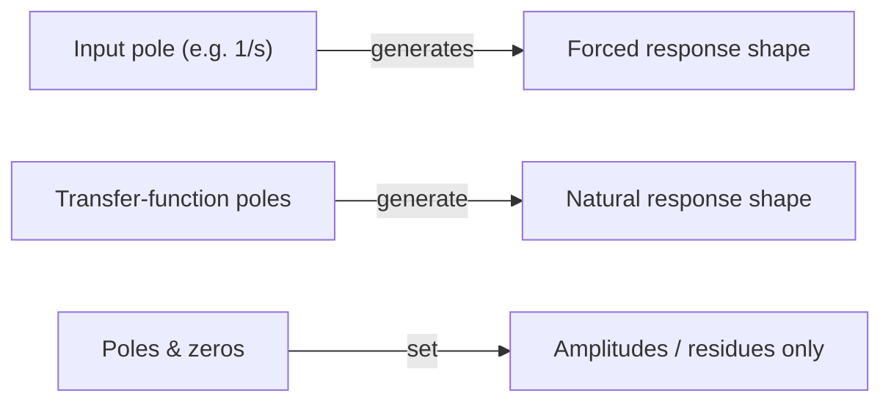
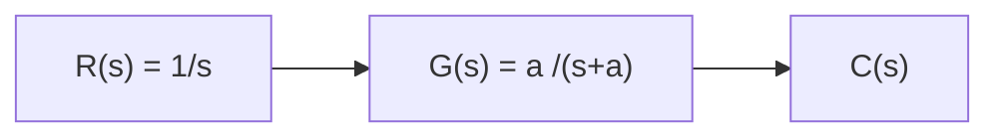
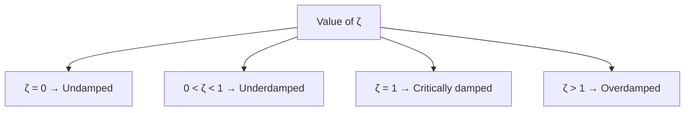
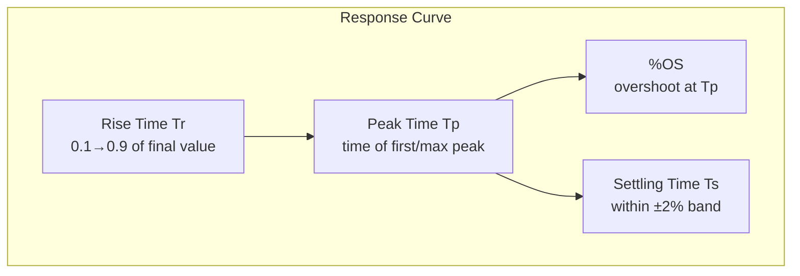
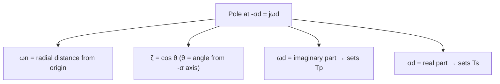
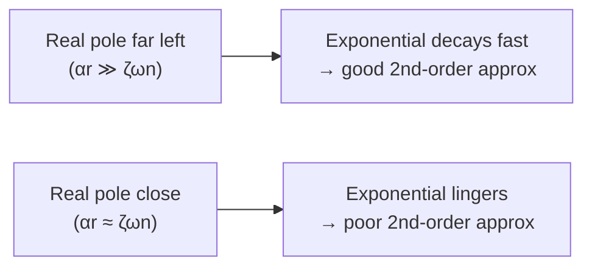
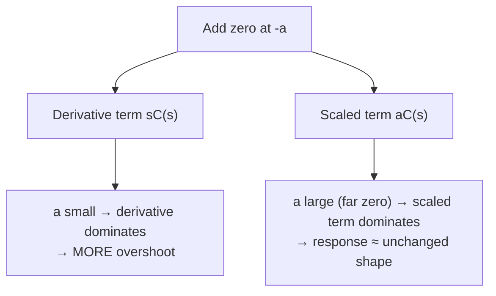
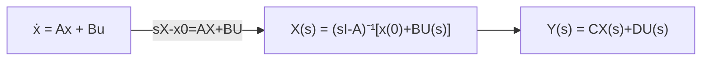
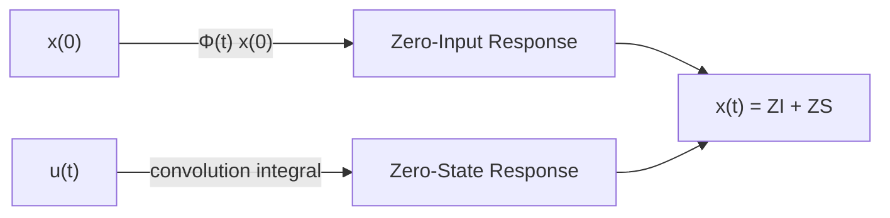

# Chapter 4 — Time Response
### Quick-Reference: Formulas, Definitions, Tables & Reminders

## Table of Contents
- [[#1. Poles, Zeros & System Response]]
- [[#2. First-Order Systems]]
- [[#3. Second-Order Systems — General Form]]
- [[#4. Underdamped Second-Order Systems]]
- [[#5. Effect of Additional Poles]]
- [[#6. Effect of Added Zeros]]
- [[#7. Nonlinearities & Time Response]]
- [[#8. State-Space — Laplace Solution]]
- [[#9. State-Space — Time-Domain Solution]]
- [[#10. Master Formula Table]]
- [[#11. Exam-Day Cheat Sheet]]

---

## 1. Poles, Zeros & System Response

> [!abstract] Core definitions
> **Pole** of $G(s)$: value of $s$ where $G(s)\to\infty$ — i.e., a root of the denominator (after cancelling any common factor with the numerator).
> **Zero** of $G(s)$: value of $s$ where $G(s) = 0$ — i.e., a root of the numerator (after cancelling any common factor with the denominator).

**Why poles/zeros matter — four rules of thumb:**

| #   | Rule                                                                                                                 |
| --- | -------------------------------------------------------------------------------------------------------------------- |
| 1   | A pole of the **input** generates the form of the **forced response**.                                               |
| 2   | A pole of the **transfer function** generates the form of the **natural response**.                                  |
| 3   | A **real-axis pole** at $-a$ generates an exponential response $\propto e^{-at}$ — farther left ⇒ faster decay.      |
| 4   | **Poles and zeros** together set the **amplitudes** (residues) of each response term, but not their functional form. |

**Worked pattern** (unit step input, $G(s)=\dfrac{s+2}{s(s+5)}$):

$$
C(s) = \frac{s+2}{s(s+5)} = \frac{2/5}{s} + \frac{3/5}{s+5}
\quad\Longrightarrow\quad
c(t) = \underbrace{\tfrac{2}{5}}_{\text{forced}} + \underbrace{\tfrac{3}{5}e^{-5t}}_{\text{natural}}
$$



> [!tip] Reminder
> A **canceled** pole/zero (common factor top & bottom) is still *called* a pole/zero by convention, even though it no longer makes $G(s)$ blow up or vanish there.

---

## 2. First-Order Systems

**Standard form** (no zeros):

$$
G(s) = \frac{a}{s+a}, \qquad \text{pole at } s=-a
$$

**Unit step response:**

$$
C(s) = R(s)G(s) = \frac{a}{s(s+a)} \tag{4.5}
$$

$$
c(t) = c_f(t) + c_n(t) = 1 - e^{-at} \tag{4.6}
$$



> [!note] Parameter $a$
> $a$ is the **only** parameter that shapes a first-order transient. It is the *exponential frequency* (units: 1/s); its reciprocal $1/a$ is the **time constant**.

### Time-domain specs (first-order)

| Spec | Meaning | Formula | Value |
|---|---|---|---|
| **Time constant** | time for $e^{-at}$ to decay to 37%, or for $c(t)$ to rise to 63% of final value | $\tau = \dfrac{1}{a}$ | — |
| **Rise time**, $T_r$ | 0.1 → 0.9 of final value | $T_r = \dfrac{2.31}{a} - \dfrac{0.11}{a} \approx \dfrac{2.2}{a}$ | (4.9) |
| **Settling time**, $T_s$ | time to reach & stay within **2%** of final value | $T_s = \dfrac{4}{a}$ | (4.10) |

**Testing-based identification:** for $G(s) = \dfrac{K}{s+a}$,

$$
C(s) = \frac{K}{s(s+a)} = \frac{K/a}{s} - \frac{K/a}{s+a} \tag{4.11}
$$

Measure $\tau$ (63% point) from a lab step-response curve $\Rightarrow a = 1/\tau$. Read steady-state value $= K/a \Rightarrow$ solve for $K$.

> [!example] Skill-Assessment 4.2 pattern
> $G(s)=\dfrac{50}{s+50}$ ⇒ $T_c=0.02\,\text{s}$, $T_s = 4/50 = 0.08\,\text{s}$, $T_r = 2.2/50 = 0.044\,\text{s}$.

---

## 3. Second-Order Systems — General Form

A 2nd-order system's response **changes shape** (not just speed) as parameters vary — it can be overdamped, critically damped, underdamped, or undamped.

**Natural frequency, $\omega_n$:** frequency of oscillation with **zero damping** (resistance/damping term shorted out).

**Damping ratio, $\zeta$:**

$$
\zeta = \frac{\text{Exponential decay frequency}}{\text{Natural frequency (rad/s)}} = \frac{1}{2\pi}\cdot\frac{\text{Natural period (s)}}{\text{Exponential time constant}}
$$

**Deriving the standard form** — start from $G(s)=\dfrac{b}{s^2+as+b}$:

$$
\omega_n = \sqrt{b} \quad(4.18) \qquad b = \omega_n^2 \quad(4.19) \qquad \zeta = \frac{a/2}{\omega_n} \;\Rightarrow\; a = 2\zeta\omega_n \quad(4.21)
$$

> [!important] General second-order transfer function
> $$
> G(s) = \frac{\omega_n^2}{s^2 + 2\zeta\omega_n s + \omega_n^2} \tag{4.22}
> $$

**Poles of the general 2nd-order system:**

$$
s_{1,2} = -\zeta\omega_n \pm \omega_n\sqrt{\zeta^2 - 1} \tag{4.24}
$$

### Damping cases

| Case | Condition | Pole location | Response type |
|---|---|---|---|
| **Overdamped** | $\zeta > 1$ | two distinct real poles | sum of 2 decaying exponentials |
| **Critically damped** | $\zeta = 1$ | one repeated real pole | fastest response w/o overshoot |
| **Underdamped** | $0<\zeta<1$ | complex-conjugate pair | damped sinusoid |
| **Undamped** | $\zeta = 0$ | pure imaginary pair | sustained oscillation |



> [!example] Quick recipe for finding $\zeta$, $\omega_n$ from $G(s)=\dfrac{K}{s^2+as+b}$
> $$\omega_n = \sqrt{b}, \qquad \zeta = \frac{a}{2\sqrt{b}}$$
> e.g. $G(s)=\dfrac{36}{s^2+4.2s+36}$: $\omega_n=6$, $\zeta = 4.2/12 = 0.35$ (underdamped).

<details>
<summary>TikZ — s-plane pole locations by damping case</summary>

```latex
\begin{tikzpicture}[scale=0.9]
  \draw[->] (-3,0) -- (3,0) node[right] {$\sigma$};
  \draw[->] (0,-2.5) -- (0,2.5) node[above] {$j\omega$};
  % underdamped complex pair
  \filldraw (-1,1.5) circle (2pt);
  \filldraw (-1,-1.5) circle (2pt);
  \node[right] at (-1,1.5) {underdamped pole};
  % critically damped repeated pole
  \filldraw (-2,0) circle (2pt);
  \node[below] at (-2,-0.2) {critically damped};
  % overdamped poles
  \filldraw (-2.6,0.15) circle (2pt);
  \filldraw (-1.4,-0.15) circle (2pt);
\end{tikzpicture}
```
</details>

---

## 4. Underdamped Second-Order Systems

This is the **most tested** section — four specifications, all derived from one response equation.

**Step response (partial fractions, then inverse Laplace):**

$$
C(s) = \frac{1}{s} - \frac{(s+\zeta\omega_n) + \dfrac{\zeta}{\sqrt{1-\zeta^2}}\omega_n\sqrt{1-\zeta^2}}{(s+\zeta\omega_n)^2 + \omega_n^2(1-\zeta^2)} \tag{4.27}
$$

$$
c(t) = 1 - \frac{1}{\sqrt{1-\zeta^2}}\,e^{-\zeta\omega_n t}\cos\!\big(\omega_n\sqrt{1-\zeta^2}\,t - \phi\big),
\qquad \phi = \tan^{-1}\!\left(\frac{\zeta}{\sqrt{1-\zeta^2}}\right) \tag{4.28}
$$

> [!note] Reminder
> Lower $\zeta$ ⇒ more oscillatory. $\omega_n$ only rescales the time axis — it doesn't change the *shape* of the normalized response $c(\omega_n t)$.

### The four underdamped specifications



| Spec | Definition | Formula (in $\zeta,\omega_n$) | Formula (in pole coords) |
|---|---|---|---|
| **Peak time**, $T_p$ | time to first/max peak | $T_p = \dfrac{\pi}{\omega_n\sqrt{1-\zeta^2}}$ (4.34) | $T_p = \dfrac{\pi}{\omega_d}$ (4.44) |
| **% Overshoot**, %OS | $\dfrac{c_{max}-c_{final}}{c_{final}}\times100$ | $\%OS = e^{-(\zeta\pi/\sqrt{1-\zeta^2})}\times 100$ (4.38) | function of $\zeta$ only |
| **Settling time**, $T_s$ (2%) | time to stay within ±2% | $T_s = \dfrac{4}{\zeta\omega_n}$ (4.42, approx.) | $T_s = \dfrac{4}{\sigma_d}$ (4.45) |
| **Rise time**, $T_r$ | 0.1 → 0.9 of final value | no closed form — use table/chart (4.16) | — |

**Inverse relation** — find $\zeta$ from a measured %OS:

$$
\zeta = \frac{-\ln(\%OS/100)}{\sqrt{\pi^2 + \ln^2(\%OS/100)}} \tag{4.39}
$$

**Exact settling-time derivation** (before the $4/\zeta\omega_n$ approximation):

$$
T_s = \frac{-\ln\!\big(0.02\sqrt{1-\zeta^2}\big)}{\zeta\omega_n} \tag{4.41}
$$
(numerator ranges 3.91 → 4.74 for $\zeta \in [0,0.9]$ — hence the constant "4" approximation).

### Pole-plot geometry (underdamped)

For pole $s_{1,2} = -\sigma_d \pm j\omega_d$ (with $\sigma_d=\zeta\omega_n$, $\omega_d=\omega_n\sqrt{1-\zeta^2}$, $\theta=\cos^{-1}\zeta$):




```tikz
\begin{document}
\begin{tikzpicture}[scale=1]
\draw[->] (-3,0) -- (1,0) node[right] {$\sigma$};
\draw[->] (0,-2.5) -- (0,2.5) node[above] {$j\omega$};
\filldraw (-1.5,2) circle (2pt) node[above right] {$-\sigma_d+j\omega_d$};
\filldraw (-1.5,-2) circle (2pt) node[below right] {$-\sigma_d-j\omega_d$};
\draw[dashed] (0,0) -- (-1.5,2);
\draw (0,0) ++(150:0.6) arc (150:180:0.6) node[midway, above left] {$\theta$};
\end{tikzpicture}
\end{document}
```

> [!tip] Lines of constant spec on the s-plane
> - **Horizontal lines** (constant $\omega$) ⇒ constant $T_p$
> - **Vertical lines** (constant $\sigma$) ⇒ constant $T_s$
> - **Radial lines** (constant angle, i.e. constant $\zeta$) ⇒ constant %OS

### Normalized rise time table (Fig. 4.16)

| $\zeta$ | $\omega_n T_r$ | $\zeta$ | $\omega_n T_r$ |
|---|---|---|---|
| 0.1 | 1.104 | 0.6 | 1.854 |
| 0.2 | 1.203 | 0.7 | 2.126 |
| 0.3 | 1.321 | 0.8 | 2.467 |
| 0.4 | 1.463 | 0.9 | 2.883 |
| 0.5 | 1.638 | | |

> [!note] Curve-fit polynomials (MATLAB `polyfit`, valid $0<\zeta<0.9$)
> $$\omega_n T_r \approx 1.76\zeta^3 - 0.417\zeta^2 + 1.039\zeta + 1 \quad(\text{err}<12\%)$$
> $$\zeta \approx 0.115(\omega_n T_r)^3 - 0.883(\omega_n T_r)^2 + 2.504(\omega_n T_r) - 1.738 \quad(\text{err}<5\%,\ 0.1<\zeta<0.9)$$

> [!example] Worked example pattern (Ex. 4.5)
> $G(s)=\dfrac{100}{s^2+15s+100}$ ⇒ $\omega_n=10,\ \zeta=0.75$
> $T_p = 0.475\,\text{s}$, $\%OS = 2.838$, $T_s = 0.533\,\text{s}$, $T_r \approx 0.23\,\text{s}$ (via table).

---

## 5. Effect of Additional Poles

The $T_p$/%OS/$T_s$ formulas above are **only exact for a pure 2-pole system**. A 3rd (real-axis) pole changes things — but under the right conditions, the system can still be *approximated* as 2nd-order using its **dominant poles**.

**Three-pole step response** (complex pair at $-\zeta\omega_n \pm j\omega_d$, real pole at $-\alpha_r$):

$$
C(s) = \frac{A}{s} + \frac{B(s+\zeta\omega_n)+C\omega_d}{(s+\zeta\omega_n)^2+\omega_d^2} + \frac{D}{s+\alpha_r} \tag{4.57}
$$

$$
c(t) = A\,u(t) + e^{-\zeta\omega_n t}(B\cos\omega_d t + C\sin\omega_d t) + D e^{-\alpha_r t} \tag{4.58}
$$



> [!important] The "five-times" rule of thumb
> If the real (nondominant) pole is **at least 5×** farther from the imaginary axis than the dominant complex pair (i.e. $\alpha_r \geq 5\zeta\omega_n$), the system may be treated as 2nd-order using only the dominant poles. This is a **necessary but not sufficient** condition — always simulate to confirm.

**Why it works — residue shrinks as the pole moves left:** for

$$
C(s) = \frac{bc}{s(s^2+as+b)(s+c)} = \frac{A}{s} + \frac{Bs+C}{s^2+as+b} + \frac{D}{s+c} \tag{4.59}
$$

as $c\to\infty$, the third-pole residue $D\to 0$ — its contribution to the response vanishes.

| System (3-pole) | 3rd pole location | Behaves like 2nd order? |
|---|---|---|
| Closest to dominant pair | small ratio to $\zeta\omega_n$ | ✗ poor approximation |
| Far from dominant pair (≥5×) | large ratio | ✓ good approximation |

---

## 6. Effect of Added Zeros

**Rule:** a zero **far** from the poles behaves like a pure gain (doesn't change the *shape* of the response); a zero **close** to the poles significantly increases overshoot.

Adding a zero at $-a$ to $T(s)$: the new response is

$$
(s+a)C(s) = sC(s) + aC(s) \tag{4.70}
$$

i.e., the new response = **derivative of old response** + **scaled copy of old response**.



> [!warning] Right-half-plane zero → Nonminimum-phase system
> If $a<0$ (RHP zero), the derivative term opposes the scaled term at $t=0^+$, so the response can **initially move the wrong way** before settling to the correct steady-state sign. Classic example: an airplane/motorcycle that *initially veers left* when commanded to turn right.

**Pole–zero cancellation** (reduces a 3-pole system to an effective 2nd-order one):

$$
T(s) = \frac{K(s+z)}{(s+p_3)(s^2+as+b)} \tag{4.85}
$$

If $z \approx -p_3$ (zero very close to the extra pole), that pole's residue becomes small → a valid 2nd-order approximation exists. Check via partial-fraction residues, e.g.:

$$
C_2(s)=\frac{26.25(s+4)}{s(s+4.01)(s+5)(s+6)} = \frac{0.87}{s} - \frac{5.3}{s+5} + \frac{4.4}{s+6} + \frac{0.033}{s+4.01}
$$

Residue $0.033$ (two orders of magnitude smaller) ⇒ **safe to drop** that term.

| Zero distance from pole pair | Overshoot effect |
|---|---|
| Far away | negligible — looks like pure gain |
| Close (LHP) | increases %OS |
| RHP (negative $a$) | nonminimum-phase — initial undershoot/wrong-direction kick |
| Cancels a nondominant pole | system reduces to 2nd order |

---

## 7. Nonlinearities & Time Response

All formulas above assume **linear, time-invariant (LTI)** systems. Real components introduce nonlinearities that distort the time response — examined **qualitatively** rather than via closed-form specs.

| Nonlinearity | Typical symptom in time response |
|---|---|
| **Saturation** | output clips/flattens once input exceeds a limit — response looks "capped" |
| **Dead zone** | no output change for small input changes near zero |
| **Backlash** (gear play) | output shaft stays stationary while input reverses direction, until slack is taken up — visible flat spot on reversal |

> [!note] Takeaway
> Nonlinearities are analyzed case-by-case (often via simulation, e.g. Simulink) rather than with the analytic $T_p$/%OS/$T_s$ formulas, since superposition no longer holds.

---

## 8. State-Space — Laplace Solution

**State-space model:**

$$
\dot{\mathbf{x}} = A\mathbf{x} + B\mathbf{u} \tag{4.92 — state equation}
$$
$$
\mathbf{y} = C\mathbf{x} + D\mathbf{u} \tag{4.93 — output equation}
$$

**Laplace-transforming the state equation** (with initial condition $\mathbf{x}(0)$):

$$
sX(s) - \mathbf{x}(0) = AX(s) + BU(s) \tag{4.94}
$$
$$
(sI-A)X(s) = \mathbf{x}(0) + BU(s) \tag{4.95}
$$

> [!important] Solving for X(s)
> $$
> X(s) = (sI-A)^{-1}\mathbf{x}(0) + (sI-A)^{-1}BU(s) = \frac{\text{adj}(sI-A)}{\det(sI-A)}\big[\mathbf{x}(0)+BU(s)\big] \tag{4.96}
> $$
> $$
> Y(s) = CX(s) + DU(s) \tag{4.97}
> $$



### Eigenvalues = transfer-function poles

Setting $\mathbf{x}(0)=\mathbf{0}$ and substituting (4.96) into (4.97):

$$
\frac{Y(s)}{U(s)} = \frac{C\,\text{adj}(sI-A)B + D\det(sI-A)}{\det(sI-A)} \tag{4.98}
$$

> [!tip] Key identity
> $$\det(sI-A)=0 \quad\Longleftrightarrow\quad \text{eigenvalues of } A = \text{poles of the transfer function}$$
> Same denominator in (4.96) and (4.98) ⇒ this holds for **any** LTI state-space realization.

| Symbol | Meaning |
|---|---|
| $A$ | system matrix — eigenvalues $=$ poles |
| $B$ | input matrix |
| $C$ | output matrix |
| $D$ | feedthrough matrix |
| $\text{adj}(sI-A)$ | adjugate (classical adjoint) of $(sI-A)$ |
| $\det(sI-A)$ | characteristic polynomial |

> [!example] Recipe
> 1. Form $sI-A$.
> 2. Invert: $(sI-A)^{-1}=\dfrac{\text{adj}(sI-A)}{\det(sI-A)}$.
> 3. Plug into (4.96) with $\mathbf{x}(0)$ and $U(s)$ ⇒ get $X(s)$.
> 4. Apply $C,D$ per (4.97) ⇒ get $Y(s)$.
> 5. Inverse Laplace ⇒ $y(t)$.
> 6. Poles/eigenvalues read directly off $\det(sI-A)=0$.

---

## 9. State-Space — Time-Domain Solution

Solves the same state equation **directly in time** (no Laplace), via the **state-transition matrix** $\Phi(t) = e^{At}$.

> [!important] General time-domain solution
> $$
> \mathbf{x}(t) = e^{At}\mathbf{x}(0) + \int_0^t e^{A(t-\tau)}B\mathbf{u}(\tau)\,d\tau
> = \Phi(t)\mathbf{x}(0) + \int_0^t \Phi(t-\tau)B\mathbf{u}(\tau)\,d\tau \tag{4.109}
> $$



| Term                                                         | Name                                           | Depends on                         | Interpretation                            |
| ------------------------------------------------------------ | ---------------------------------------------- | ---------------------------------- | ----------------------------------------- |
| $\Phi(t)\mathbf{x}(0)$                                       | **Zero-input response**                        | initial state only, $\mathbf{u}=0$ | total response if input were zero         |
| $\displaystyle\int_0^t \Phi(t-\tau)B\mathbf{u}(\tau)\,d\tau$ | **Zero-state response** (convolution integral) | input only, $\mathbf{x}(0)=0$      | total response if initial state were zero |

> [!warning] This is *not* the same split as forced/natural response!
> The classical "natural response" terms (e.g. $Ae^{-2t}$) get **redistributed across both** the zero-input and zero-state pieces — the zero-state response can still contain natural-response-looking exponential terms, just with coefficients independent of $\mathbf{x}(0)$.

**Connecting back to Laplace:** since $\Phi(t)\mathbf{x}(0) \leftrightarrow (sI-A)^{-1}\mathbf{x}(0)$,

$$
\Phi(t) = \mathcal{L}^{-1}\big[(sI-A)^{-1}\big] = \mathcal{L}^{-1}\left[\frac{\text{adj}(sI-A)}{\det(sI-A)}\right] \tag{4.111}
$$

so every entry of $\Phi(t)$ is a sum of exponentials generated by the system poles (eigenvalues) — exactly like the classical natural response.

> [!example] Two equivalent solution paths for the same problem
> **Path A (pure time domain):** assume $\Phi(t)$ has the form $\big[K_ie^{s_1t}+K_je^{s_2t}\big]$ per entry, solve for constants $K_i$ using $\Phi(0)=I$ and $\dot\Phi(0)=A$, then evaluate (4.109) directly.
> **Path B (via Laplace):** compute $(sI-A)^{-1}$, partial-fraction each entry, inverse-transform ⇒ same $\Phi(t)$.
> Both give identical $\Phi(t)$ — Path B is usually less error-prone for hand calculation.

---

## 10. Master Formula Table

| Topic | Formula | Eq. # |
|---|---|---|
| First-order step response | $c(t) = 1-e^{-at}$ | 4.6 |
| First-order time constant | $\tau = 1/a$ | — |
| First-order rise time | $T_r \approx 2.2/a$ | 4.9 |
| First-order settling time | $T_s = 4/a$ | 4.10 |
| General 2nd-order TF | $G(s)=\dfrac{\omega_n^2}{s^2+2\zeta\omega_n s+\omega_n^2}$ | 4.22 |
| 2nd-order pole locations | $s_{1,2}=-\zeta\omega_n\pm\omega_n\sqrt{\zeta^2-1}$ | 4.24 |
| Underdamped step response | $c(t)=1-\dfrac{e^{-\zeta\omega_n t}}{\sqrt{1-\zeta^2}}\cos(\omega_d t-\phi)$ | 4.28 |
| Peak time | $T_p=\dfrac{\pi}{\omega_n\sqrt{1-\zeta^2}}=\dfrac{\pi}{\omega_d}$ | 4.34 / 4.44 |
| Percent overshoot | $\%OS = e^{-\zeta\pi/\sqrt{1-\zeta^2}}\times100$ | 4.38 |
| ζ from %OS | $\zeta = \dfrac{-\ln(\%OS/100)}{\sqrt{\pi^2+\ln^2(\%OS/100)}}$ | 4.39 |
| Settling time (2%) | $T_s=\dfrac{4}{\zeta\omega_n}=\dfrac{4}{\sigma_d}$ | 4.42 / 4.45 |
| Zero's effect on response | $(s+a)C(s) = sC(s)+aC(s)$ | 4.70 |
| Five-times rule | $\alpha_r \geq 5\,\zeta\omega_n$ for 2nd-order approx. | — |
| State equation | $\dot{\mathbf x}=A\mathbf x+B\mathbf u$ | 4.92 |
| Output equation | $\mathbf y = C\mathbf x + D\mathbf u$ | 4.93 |
| Laplace solution | $X(s)=(sI-A)^{-1}[\mathbf x(0)+BU(s)]$ | 4.96 |
| Eigenvalue–pole link | $\det(sI-A)=0$ | — |
| Time-domain solution | $\mathbf x(t)=\Phi(t)\mathbf x(0)+\displaystyle\int_0^t\Phi(t-\tau)B\mathbf u(\tau)\,d\tau$ | 4.109 |
| State-transition matrix | $\Phi(t)=e^{At}=\mathcal L^{-1}[(sI-A)^{-1}]$ | 4.111 |

---

## 11. Exam-Day Cheat Sheet

> [!question]- Click to expand: the 6 things to memorize cold
> 1. **First order:** $\tau=1/a$, $T_s=4/a$, $T_r\approx 2.2/a$
> 2. **Standard 2nd order form:** $G(s)=\dfrac{\omega_n^2}{s^2+2\zeta\omega_n s+\omega_n^2}$
> 3. **Underdamped specs:**
>    $$T_p=\frac{\pi}{\omega_d}, \qquad \%OS=e^{-\zeta\pi/\sqrt{1-\zeta^2}}\times100, \qquad T_s=\frac{4}{\sigma_d}$$
> 4. **Pole geometry:** real part → settling time; imaginary part → peak time; angle from −σ axis → $\zeta$ (and hence %OS).
> 5. **Five-times rule** for 2nd-order approximation of higher-order systems.
> 6. **State-space:** $X(s)=(sI-A)^{-1}[\mathbf x(0)+BU(s)]$; eigenvalues of $A$ = poles.

> [!bug]- Common mistakes to avoid
> - Using the $T_r\approx 2.2/a$ formula for a **second-order** system (it's first-order only — 2nd-order rise time has **no closed form**, use the $\zeta$ vs. $\omega_nT_r$ table).
> - Forgetting the **"4"** in $T_s=4/\zeta\omega_n$ is an **approximation** (exact numerator ranges 3.91–4.74).
> - Assuming *any* extra pole/zero invalidates 2nd-order analysis — check the **five-times rule** and residue size first.
> - Mixing up **zero-input/zero-state** (state-space) with **natural/forced** (classical) — they are *different* partitions of the same total response.
> - Sign errors with $\zeta = a/2\sqrt{b}$ vs. $a=2\zeta\omega_n$ — always confirm which direction you're solving.

---
%% End of Chapter 4 reference — generated from Nise, Control Systems Engineering, Ch. 4 "Time Response" %%

