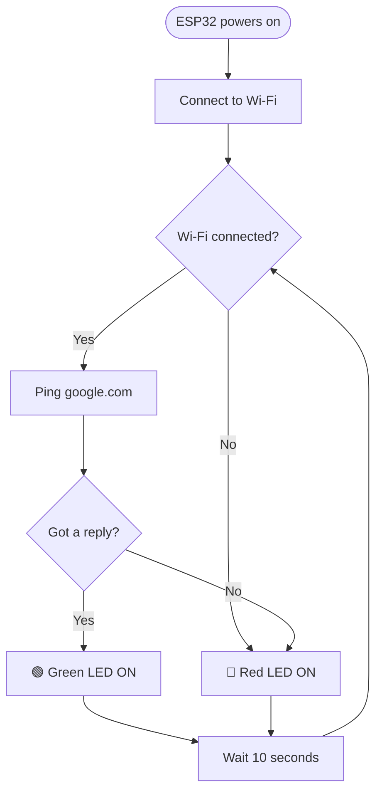
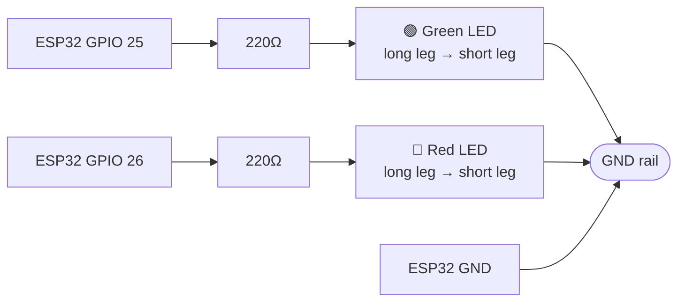

# 🚦 ESP32 "Ping" Indicator

> [!abstract] Project Summary Build a breadboard circuit that checks your internet connection **every 10 seconds** and shows the result with two LEDs.
> 
> |LED|Meaning|
> |:-:|---|
> |🟢 **Green**|Internet is working|
> |🔴 **Red**|Wi-Fi is down, or there is no internet|

---

## 📑 Contents

1. [[#1. How It Works]]
2. [[#2. Materials List]]
3. [[#3. Required Software]]
4. [[#4. Know Your Parts]]
5. [[#5. Build the Circuit]]
6. [[#6. Arduino IDE Setup]]
7. [[#7. The Code]]
8. [[#8. Upload and Run]]
9. [[#9. Testing]]
10. [[#10. Troubleshooting]]
11. [[#11. Final Checklist]]

---

## 1. How It Works

A **ping** is like asking a website, _"Hey, are you there?"_ If it answers, the internet works.



---

## 2. Materials List

|✔|Item|Qty|Notes|
|:-:|---|:-:|---|
|-|ESP32 development board|1|Any common one, e.g. ESP32 DevKit V1|
|-|USB cable (Micro-USB or USB-C)|1|Must be a **data** cable, not charge-only|
|-|Breadboard|1|Half-size or full-size|
|-|Green LED (5mm)|1||
|-|Red LED (5mm)|1||
|-|220Ω resistor|2|Color bands: red, red, brown (330Ω also works)|
|-|Male-to-male jumper wires|3-5||
|-|Computer|1|Windows, Mac, or Linux|
|-|2.4 GHz Wi-Fi network|1|ESP32 does **not** support 5 GHz|

> [!warning] Never skip the resistors Without a resistor, too much current flows and the LED can burn out (or damage your ESP32 pin).

---

## 3. Required Software

### 3.1 Arduino IDE

Download and install from [arduino.cc/en/software](https://www.arduino.cc/en/software).

### 3.2 USB Driver (only if needed)

If your computer does not detect the ESP32, look at the small chip near the USB port:

|Chip label|Driver to install|
|---|---|
|CP2102|"CP210x driver" (Silicon Labs)|
|CH340|"CH340 driver"|

### 3.3 Add ESP32 Support

1. Open **File → Preferences**.
2. In **Additional boards manager URLs**, paste:
    
    ```
    https://espressif.github.io/arduino-esp32/package_esp32_index.json
    ```
    
3. Click **OK**.
4. Open **Tools → Board → Boards Manager**.
5. Search `esp32` and install **esp32 by Espressif Systems** (takes a few minutes).

### 3.4 Install the Ping Library

1. Open **Sketch → Include Library → Manage Libraries**.
2. Search `ESP32Ping`.
3. Install **ESP32Ping** by Marian Craciunescu.

---

## 4. Know Your Parts

### The pins we will use

|ESP32 pin|Connects to|
|:-:|---|
|**GPIO 25**|Green LED (through resistor)|
|**GPIO 26**|Red LED (through resistor)|
|**GND**|Shared ground for both LEDs|

### LED legs

> [!info] LEDs only work one way
> 
> - **Long leg** = Anode (+), goes toward the ESP32 pin
> - **Short leg** = Cathode (−), goes toward GND
> 
> If an LED does not light up, flip it around.

### Breadboard basics

> [!note]- Click to expand: how a breadboard is connected
> 
> - Holes in the same **numbered column** on one side (a-b-c-d-e) are connected together.
> - The other side (f-g-h-i-j) is connected the same way.
> - The two sides are **not** connected to each other (the center gap separates them).
> - The long side rails (+ and −) are connected along their **whole length**. We use the **−** rail as GND.

---

## 5. Build the Circuit

> [!danger] Unplug the USB cable while wiring Only plug the ESP32 in after everything is connected and double-checked.

### Wiring table

|From|→ Through|→ To|
|---|---|---|
|ESP32 **GPIO 25**|220Ω resistor|Green LED **long leg** (+)|
|Green LED **short leg** (−)|jumper wire|**GND rail**|
|ESP32 **GPIO 26**|220Ω resistor|Red LED **long leg** (+)|
|Red LED **short leg** (−)|jumper wire|**GND rail**|
|ESP32 **GND** pin|jumper wire|**GND rail**|

### Circuit diagram



### Step-by-step

- [ ] **1.** Place the ESP32 on the breadboard (or beside it if it does not fit).
- [ ] **2.** Run a jumper wire from an ESP32 **GND** pin to the breadboard **− rail**.
- [ ] **3.** Place the **green LED** on the board, with its legs in two different columns.
- [ ] **4.** Connect the green LED's **short leg** to the **− rail** with a jumper wire.
- [ ] **5.** Put a **220Ω resistor** from the green LED's **long leg column** to an empty column.
- [ ] **6.** Run a jumper wire from that resistor's free end to **GPIO 25**.
- [ ] **7.** Repeat steps 3-6 for the **red LED**, using **GPIO 26**, in different columns from the green one.
- [ ] **8.** Re-check every connection against the wiring table.

> [!tip] Quick sanity check Each LED should have exactly **one** resistor in its path, and the two LED circuits should **not** share any columns except the GND rail.

---

## 6. Arduino IDE Setup

1. Plug the ESP32 into your computer.
2. **Tools → Board → esp32** → choose **ESP32 Dev Module**.
3. **Tools → Port** → choose the new port that appears.

> [!tip]- Not sure which port is yours? Unplug the ESP32 and look at the port list. Plug it back in and see which port **appears**. That one is your ESP32.

---

## 7. The Code

1. **File → New Sketch**.
2. Delete everything inside and paste the code below.
3. Change `YOUR_WIFI_NAME` and `YOUR_WIFI_PASSWORD` to your own (keep the quotation marks).

> [!important] Do not forget Edit the ==Wi-Fi name and password== before uploading.

```cpp
#include <WiFi.h>
#include <ESP32Ping.h>

// ====== CHANGE THESE ======
const char* ssid     = "YOUR_WIFI_NAME";
const char* password = "YOUR_WIFI_PASSWORD";
// ==========================

// Website to ping (you can also use your router IP, like "192.168.1.1")
const char* pingTarget = "google.com";

// LED pins
const int GREEN_LED = 25;
const int RED_LED   = 26;

// Time between checks (in milliseconds). 10000 ms = 10 seconds
const unsigned long CHECK_INTERVAL = 10000;

void setup() {
  Serial.begin(115200);

  pinMode(GREEN_LED, OUTPUT);
  pinMode(RED_LED, OUTPUT);

  // Start with the red LED on until we know the internet works
  digitalWrite(GREEN_LED, LOW);
  digitalWrite(RED_LED, HIGH);

  Serial.println("Connecting to Wi-Fi...");
  WiFi.begin(ssid, password);

  // Wait up to 20 seconds for the first connection
  int tries = 0;
  while (WiFi.status() != WL_CONNECTED && tries < 40) {
    delay(500);
    Serial.print(".");
    tries++;
  }

  if (WiFi.status() == WL_CONNECTED) {
    Serial.println("\nWi-Fi connected!");
    Serial.print("IP address: ");
    Serial.println(WiFi.localIP());
  } else {
    Serial.println("\nCould not connect to Wi-Fi. Will keep trying...");
  }
}

void loop() {
  // 1. Check if Wi-Fi is still connected
  if (WiFi.status() != WL_CONNECTED) {
    Serial.println("Wi-Fi is DOWN. Trying to reconnect...");
    digitalWrite(GREEN_LED, LOW);
    digitalWrite(RED_LED, HIGH);
    WiFi.disconnect();
    WiFi.begin(ssid, password);
    delay(CHECK_INTERVAL);
    return;  // skip the rest and try again next loop
  }

  // 2. Wi-Fi is connected, so ping the target
  Serial.print("Pinging ");
  Serial.print(pingTarget);
  Serial.print("... ");

  bool success = Ping.ping(pingTarget, 3);  // send 3 pings

  if (success) {
    Serial.println("SUCCESS - Internet is working");
    digitalWrite(GREEN_LED, HIGH);
    digitalWrite(RED_LED, LOW);
  } else {
    Serial.println("FAILED - No internet");
    digitalWrite(GREEN_LED, LOW);
    digitalWrite(RED_LED, HIGH);
  }

  // 3. Wait 10 seconds before the next check
  delay(CHECK_INTERVAL);
}
```

### What the code does

|Code|Meaning|
|---|---|
|`#include <WiFi.h>`|Lets the ESP32 use Wi-Fi|
|`#include <ESP32Ping.h>`|Lets the ESP32 send pings|
|`pinMode(pin, OUTPUT)`|Sets a pin to send power out (to an LED)|
|`digitalWrite(pin, HIGH)`|Turns the LED **on**|
|`digitalWrite(pin, LOW)`|Turns the LED **off**|
|`Ping.ping(host, 3)`|Pings the host 3 times. Returns `true` if it replies|
|`delay(10000)`|Waits 10,000 ms (10 seconds)|

---

## 8. Upload and Run

1. Click **Verify** (✔) to check for errors.
2. Click **Upload** (→).
3. When the output shows `Connecting........`, **hold the BOOT button** on the ESP32 until the upload starts (some boards need this).
4. Wait for **Done uploading**.
5. Open **Tools → Serial Monitor** and set the speed to **115200 baud**.

You should see:

```
Connecting to Wi-Fi...
Wi-Fi connected!
Pinging google.com... SUCCESS - Internet is working
```

---

## 9. Testing

|Test|What to do|Expected result|
|---|---|---|
|✅ Normal|Leave it running|🟢 Green on|
|📴 Wi-Fi down|Turn off your router or phone hotspot|🔴 Red within ~10 seconds|
|🔄 Recovery|Turn Wi-Fi back on|🟢 Green returns after reconnecting|
|🌐 No internet, Wi-Fi up|Unplug the cable going into your router (if possible)|🔴 Red (ping fails)|

---

## 10. Troubleshooting

> [!failure]- Port does not show up Try a different USB cable (it must carry data). Install the CP210x or CH340 driver.

> [!failure]- Upload stuck on "Connecting..." Hold the **BOOT** button on the ESP32 while uploading.

> [!failure]- LED does not light up Flip the LED around. The long leg must face the resistor/GPIO side.

> [!failure]- Both LEDs are off Check the GND wire, and check that each resistor is in the correct column.

> [!failure]- Both LEDs are on The two LED circuits are probably touching in the same breadboard column. Move one.

> [!failure]- Wi-Fi never connects Check the name and password (they are case-sensitive). Make sure the network is **2.4 GHz**.

> [!failure]- Wi-Fi connects but ping always fails Change `pingTarget` to `"8.8.8.8"` (Google's DNS server). This skips the website-name lookup.

> [!failure]- Error: `ESP32Ping.h` not found Reinstall the library (see [[#3.4 Install the Ping Library]]).

---

## 11. Final Checklist

- [ ] All materials gathered
- [ ] Arduino IDE installed
- [ ] ESP32 board package installed
- [ ] ESP32Ping library installed
- [ ] Circuit wired on the breadboard
- [ ] Wi-Fi name and password entered in code
- [ ] Correct board and port selected
- [ ] Code uploaded successfully
- [ ] 🟢 Green LED lights up with working internet
- [ ] 🔴 Red LED lights up when Wi-Fi is off

> [!example] Extra ideas (optional)
> 
> - Ping your router's IP (`192.168.1.1` or `192.168.0.1`) to test only your local network.
> - Add a **buzzer** that beeps when the connection drops.
> - Make the red LED **blink** instead of staying solid.

> [!success] Done! Good luck with your project! 🚀