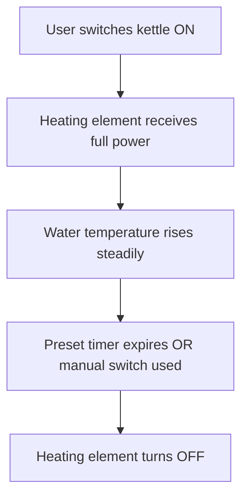
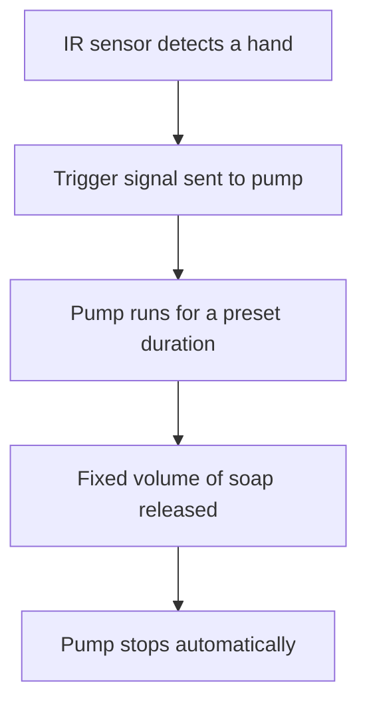
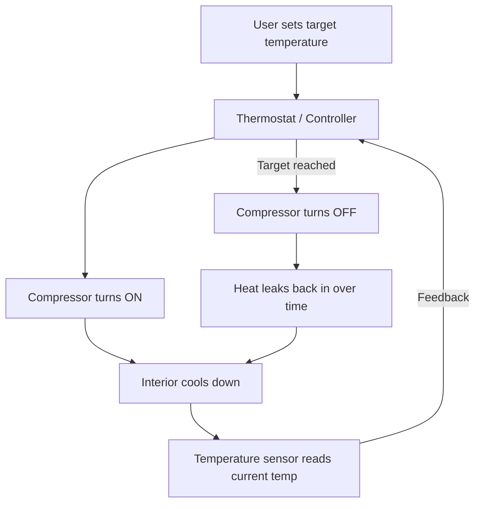
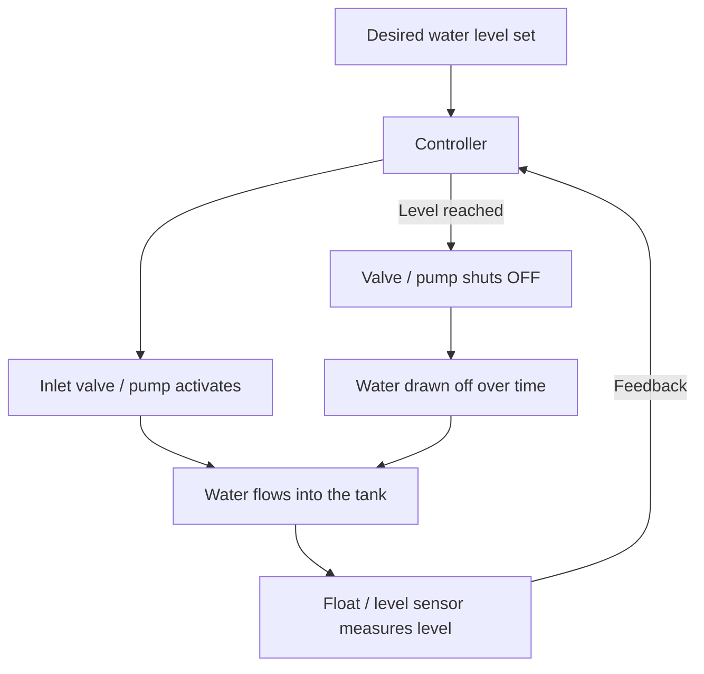

## Q1: Feedback (Closed-Loop) Applications — 8 pts

Three distinct real-world systems that rely on feedback control. For each: the **controlled variable** , the **measured output**, the **sensor**, and the **feedback mechanism** are identified explicitly.

### 1. Automotive Cruise Control
 Cruise control is an electronic tool that locks your car at a steady speed. This lets you take your foot off the gas pedal on long drives. It saves fuel and stops leg cramps.

| Component           | Description                                                                                                                                                    |
| ------------------- | -------------------------------------------------------------------------------------------------------------------------------------------------------------- |
| Controlled variable | Vehicle speed                                                                                                                                                  |
| Measured output     | Actual road speed of the car                                                                                                                                   |
| Sensor              | Wheel-speed sensor (or GPS-derived speed signal)                                                                                                               |
| Feedback mechanism  | The ECU continuously compares measured speed to the driver's set-speed; the resulting error adjusts throttle position (and sometimes braking) to close the gap |

Going uphill increases load and would slow an open-loop system down — cruise control detects the drop in speed and increases throttle automatically to compensate.

### 2. Home HVAC / Thermostat (Heating Mode)
The primary purpose of the heating mode on an HVAC thermostat is to detect when your indoor temperature drops below your target setting and automatically trigger your heating equipment (such as a furnace, heat pump, or electric strips) to warm your home until it reaches the desired comfort level.

| Component           | Description                                                                                                                                                                                                      |
| ------------------- | ---------------------------------------------------------------------------------------------------------------------------------------------------------------------------------------------------------------- |
| Controlled variable | Room air temperature                                                                                                                                                                                             |
| Measured output     | Actual air temperature near the thermostat                                                                                                                                                                       |
| Sensor              | Thermistor (or bimetallic strip in older units) inside the thermostat housing                                                                                                                                    |
| Feedback mechanism  | The thermostat compares measured temperature to the set-point; if the room is colder than the set-point (minus a small deadband), it signals the furnace to run, then shuts it off once the set-point is reached |

### 3. Multirotor Drone — Altitude Hold
Altitude hold is a flight mode on multirotor drones that uses onboard sensors to automatically maintain a steady hover at a fixed height. When you let go of the throttle stick, the drone stays at that exact vertical position, making it much easier to fly and take clear photos or videos.

| Component           | Description                                                                                                                                                                                                                  |
| ------------------- | ---------------------------------------------------------------------------------------------------------------------------------------------------------------------------------------------------------------------------- |
| Controlled variable | Altitude (height above ground or a reference pressure level)                                                                                                                                                                 |
| Measured output     | Actual altitude of the drone                                                                                                                                                                                                 |
| Sensor              | Barometric pressure sensor, and/or ultrasonic/LIDAR rangefinder, and/or GPS altitude                                                                                                                                         |
| Feedback mechanism  | The flight controller compares measured altitude to the commanded altitude and adjusts motor throttle (collective thrust) to counteract wind gusts, payload changes, or battery-voltage sag that would otherwise cause drift |

All three share the same structure: a sensor reports the true state of the world, the controller computes an error against a target, and that error — not a fixed pre-programmed action — is what drives the actuator.

---

## Q2: Open-Loop vs. Closed-Loop Examples — 10 pts

Two open-loop and two closed-loop systems, with internal operation explained and feedback presence/absence contrasted explicitly for each pair.

### Open-Loop Example 1: Electric Kettle

A basic kettle applies full mains power to the heating element the moment it is switched on and keeps it powered for a **fixed duration** (a timer or simple mechanical cutoff), regardless of the water's actual temperature.

**Contrast:** There is no sensor reporting water temperature back to the controller. The kettle cannot tell if the water reached boiling, is still cold, or has boiled dry — it simply completes its programmed action. _(A kettle with a bimetallic strip that clicks off at boiling is technically closed-loop — a "pure" open-loop kettle heats for fixed time only.)_

### Open-Loop Example 2: Soap / Hand-Sanitizer Dispenser

A motion/IR sensor detects a hand and triggers the pump to run for a **preset duration** (e.g., 0.5 s). The dose delivered is a function of _how long the pump ran_, not _how much liquid actually came out_.

**Contrast:** The motion sensor only triggers the sequence — it does not measure the _output_ (volume dispensed). There is no feedback path reporting back whether soap actually came out, so an empty reservoir or a clog goes completely undetected.

### Closed-Loop Example 1: Refrigerator Temperature Control

A thermostat continuously monitors interior air temperature and reports it back to the controller, which runs the compressor until the set-point is reached, then cycles it off as heat leaks back in.

**Contrast:** Unlike the kettle, the fridge never "trusts" a fixed timer — the compressor's on/off state is continuously decided by comparing the _live_ sensor reading to the set-point, which is exactly why it can compensate for a door being opened or a hot kitchen.

### Closed-Loop Example 2: Water-Level Tank Controller

A float or ultrasonic sensor continuously reports the actual water level. The controller opens an inlet valve/pump whenever the level drops below the set-point and shuts it once the target is reached.

**Contrast:** Like the fridge and unlike the soap dispenser, the actuator's runtime is _not_ pre-set — it runs for exactly as long as the sensor says is needed, so variable demand (fast draw-off vs. slow draw-off) is handled automatically without recalibration.

---

## Q3: Functional Differences — 8 pts

### Feedback Loops

Open-loop systems have a one-directional signal path (input → controller → actuator → output) with **no return path**. Closed-loop systems add a sensor and a feedback path from output back to the controller, forming a loop.

### Error Detection

Closed-loop control is built around a single computed quantity, the **error**, defined as the difference between the desired set-point and the actual measured output:

$$ e(t) = r(t) - y(t) = \text{Setpoint} - \text{Output} $$

The controller's entire job is to drive $e(t)$ toward zero. Open-loop systems have **no error signal at all** — there is nothing in the system that even represents "how far off am I," so there is nothing to correct against.

### Accuracy

Because closed-loop systems actively measure and null out $e(t)$, their accuracy depends mainly on sensor precision and controller tuning. Open-loop accuracy depends entirely on how well components were calibrated _before_ the system ever ran — once running, there is no mechanism to catch drift.

### Disturbance Rejection

Closed-loop systems can detect and react to unexpected disturbances in real time (a door opening on a fridge, wind gusting on a drone, extra load on a cruise-controlled car) because the sensor picks up _any_ deviation, regardless of its cause. Open-loop systems cannot distinguish a disturbance from normal operation — they have no way to even notice one occurred.

### Stability & Complexity

Open-loop systems are simple and inherently stable — with no feedback path, there is no mechanism by which the system can oscillate or diverge on its own. Closed-loop systems require sensors, comparison logic, and often more sophisticated actuators, and if the feedback gain is poorly tuned, the correction itself can overshoot the set-point repeatedly, causing oscillation or, in the worst case, instability.

### Summary Table

|Aspect|Open-Loop|Closed-Loop|
|---|---|---|
|Feedback path|None|Continuous, from a sensor|
|Error signal|Not defined|$e(t) = r(t) - y(t)$, actively minimized|
|Self-correcting|No|Yes|
|Accuracy source|Pre-run calibration|Ongoing measurement + control|
|Disturbance rejection|None|Automatic compensation|
|Stability risk|None (no loop to destabilize)|Possible if poorly tuned (overshoot, oscillation)|
|Complexity & cost|Low|Higher (sensors, comparison logic)|

---

## Q4: System Response — 10 pts

The full output of a dynamic system, $y(t)$, is the sum of two distinct parts:

$$ y(t) = y_{tr}(t) + y_{ss}(t) $$

### Transient Response, $y_{tr}(t)$

The transient is the part of the response driven by the system's **own natural dynamics** — how it reacts right after a change is applied, shaped by its physical properties (mass, damping, resistance, capacitance, etc.), not by the shape of the input. For a stable system, the transient **dies out over time**:

$$ \lim_{t \to \infty} y_{tr}(t) = 0 $$

Mathematically, $y_{tr}(t)$ corresponds to the _homogeneous_ (natural) solution of the governing differential equation — it is built from exponential terms whose decay rates are set by the system's own poles/eigenvalues, e.g. $e^{-t/\tau}$ for a first-order system.

### Steady-State Response, $y_{ss}(t)$

The steady-state response is what **remains as $t \to \infty$** — the part of the output that persists indefinitely and matches the shape of the forcing input (constant for a step input, ramping for a ramp input, sinusoidal for a sinusoidal input). Mathematically it is the _particular_ (forced) solution of the differential equation.

### Worked Example — First-Order System (e.g., the fridge/kettle thermal response)

For a first-order system responding to a step input, the total response has the closed form:

$$ y(t) = y_{ss} + \big(y(0) - y_{ss}\big), e^{-t/\tau} $$

so that:

$$ y_{tr}(t) = \big(y(0) - y_{ss}\big), e^{-t/\tau}, \qquad y_{ss}(t) = y_{ss} $$

As $t \to \infty$, $e^{-t/\tau} \to 0$, so $y_{tr}(t)$ vanishes and $y(t) \to y_{ss}$ — the transient is the "settling in" behavior, and the steady-state is where the system ends up and stays.

### Steady-State Error

For closed-loop systems, the practically important quantity is how far the steady-state response sits from the actual set-point, not just its final value in isolation:

$$ e_{ss} = \lim_{t \to \infty} e(t) = \lim_{t \to \infty} \big[r(t) - y(t)\big] $$

A well-tuned clos	e	d-loop system drives $e_{ss}$ toward zero; the transient governs _how it gets there_ (how fast, whether it overshoots or oscillates on the way), while $e_{ss}$ governs _where it ends up_.

| Transient response $y_{tr}(t)$ | Steady-state response $y_{ss}(t)$              |                                  |
| ------------------------------ | ---------------------------------------------- | -------------------------------- |
| Driven by                      | System's natural dynamics (poles/eigenvalues)  | Shape of the forcing input       |
| Time behavior                  | Decays to 0 as $t \to \infty$ (stable systems) | Persists as $t \to \infty$       |
| Math origin                    | Homogeneous solution                           | Particular solution              |
| Physical meaning               | "Settling in" behavior after a change          | Long-term tracking / final value |

---

## Q5: Mathematical Modeling — 14 pts

Three standard ways to represent the same physical system mathematically, illustrated with a mass–spring–damper as a running example: $m\ddot{x}(t) + b\dot{x}(t) + kx(t) = F(t)$.

### 1. Differential Equations (Time Domain)

The most direct model: an equation relating the output and its derivatives to the input and its derivatives, in the time variable $t$. The general linear time-invariant (LTI) form is:

$$ a_n \frac{d^n y(t)}{dt^n} + a_{n-1}\frac{d^{n-1} y(t)}{dt^{n-1}} + \cdots + a_1 \frac{dy(t)}{dt} + a_0, y(t) = b_m \frac{d^m u(t)}{dt^m} + \cdots + b_0, u(t) $$

For the mass–spring–damper:

$$ m\ddot{x}(t) + b\dot{x}(t) + kx(t) = F(t) $$

**Applicability:** Directly reflects the underlying physics (Newton's laws, Kirchhoff's laws, thermodynamics) and requires no transformation to write down. It becomes unwieldy for high-order or coupled multi-variable systems, and solving it analytically (or even simulating it) gets harder as order and nonlinearity increase.

### 2. Transfer Functions (s-Domain)

Applying the **Laplace transform** to the differential equation converts derivatives into powers of $s$, turning calculus into algebra. The transfer function is defined as the ratio of the Laplace-transformed output to the Laplace-transformed input, **under zero initial conditions** (all derivatives of $y$ and $y$ itself are zero at $t = 0^-$):

$$ G(s) = \frac{Y(s)}{U(s)} ; \bigg|_{\text{zero initial conditions}} $$

For the mass–spring–damper:

$$ G(s) = \frac{X(s)}{F(s)} = \frac{1}{ms^2 + bs + k} $$

**Applicability:** Extremely convenient for analyzing stability (pole locations), frequency response, and controller design using algebraic tools (Bode plots, root locus). The zero-initial-conditions assumption means it describes only the system's response to new inputs, not to pre-existing energy in the system, and it's most naturally suited to single-input single-output (SISO) systems.

### 3. State-Space Representation (Matrix/Vector Form)

State-space modeling represents the system using a vector of **internal state variables** $x(t)$ (e.g., position and velocity) rather than a single high-order equation:

$$ \dot{x}(t) = A,x(t) + B,u(t) $$ $$ y(t) = C,x(t) + D,u(t) $$

where $x(t)\in\mathbb{R}^n$ is the state vector, $u(t)$ the input vector, $y(t)$ the output vector, $A$ the system (state) matrix, $B$ the input matrix, $C$ the output matrix, and $D$ the feedforward matrix.

For the mass–spring–damper, letting $x_1 = x$ and $x_2 = \dot{x}$:

$$ \begin{bmatrix}\dot{x}_1 \ \dot{x}_2\end{bmatrix} = \begin{bmatrix} 0 & 1 \ -k/m & -b/m \end{bmatrix} \begin{bmatrix}x_1 \ x_2\end{bmatrix} + \begin{bmatrix}0 \ 1/m\end{bmatrix} F(t), \qquad y = \begin{bmatrix}1 & 0\end{bmatrix}\begin{bmatrix}x_1\ x_2\end{bmatrix} $$

**Applicability:** Because $u$, $x$, and $y$ can all be vectors, state-space naturally handles **multiple-input multiple-output (MIMO)** systems, high-order systems (broken into a set of coupled first-order equations), and extends more gracefully to nonlinear and time-varying systems than the classical transfer function approach. It's the standard representation for modern/optimal control (e.g., LQR, Kalman filtering) and for computer-based simulation.

### Comparison

| Approach               | Domain               | Best suited for                              | Key caveat                               |
| ---------------------- | -------------------- | -------------------------------------------- | ---------------------------------------- |
| Differential Equations | Time ($t$)           | Directly modeling physical laws              | Unwieldy for high-order/coupled systems  |
| Transfer Function      | Frequency ($s$)      | SISO analysis, stability, frequency response | Valid only under zero initial conditions |
| State-Space            | Matrix/vector (time) | High-order, MIMO, modern/optimal control     | Requires choosing a state representation |

---

## Quick Reference — Rubric Mapping

| Section   | Rubric Item                   | Points |
| --------- | ----------------------------- | ------ |
| Q1        | Feedback Applications         | 8      |
| Q2        | Open vs. Closed-Loop Examples | 10     |
| Q3        | Functional Differences        | 8      |
| Q4        | System Response               | 10     |
| Q5        | Mathematical Modeling         | 14     |
| **Total** |                               | **50** |
