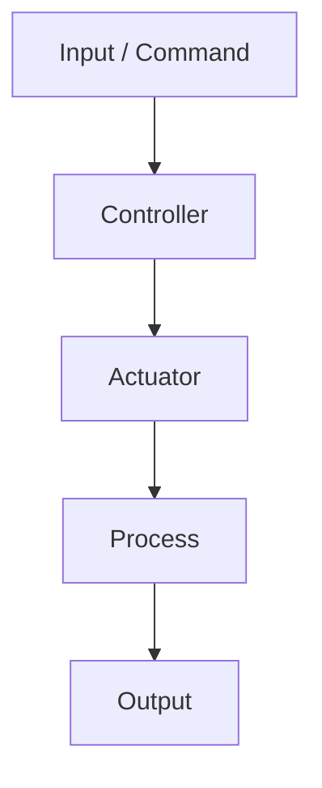
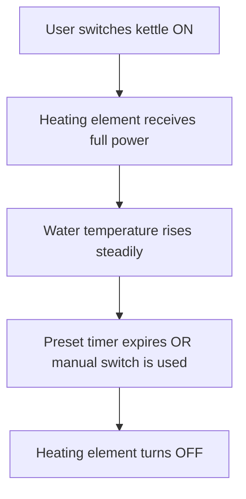
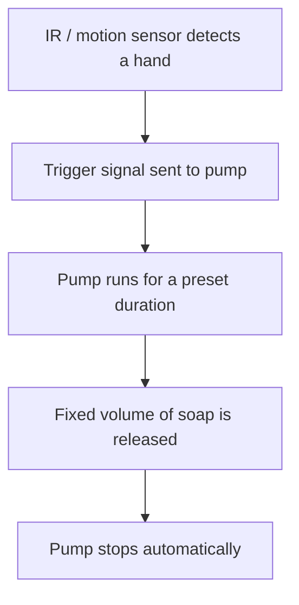
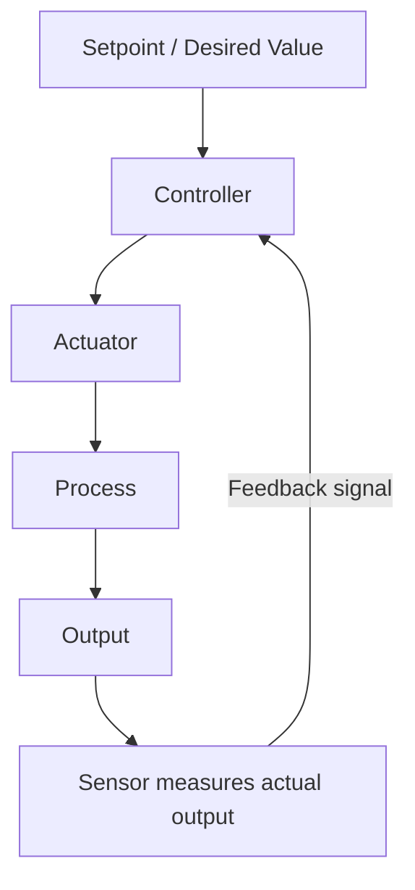
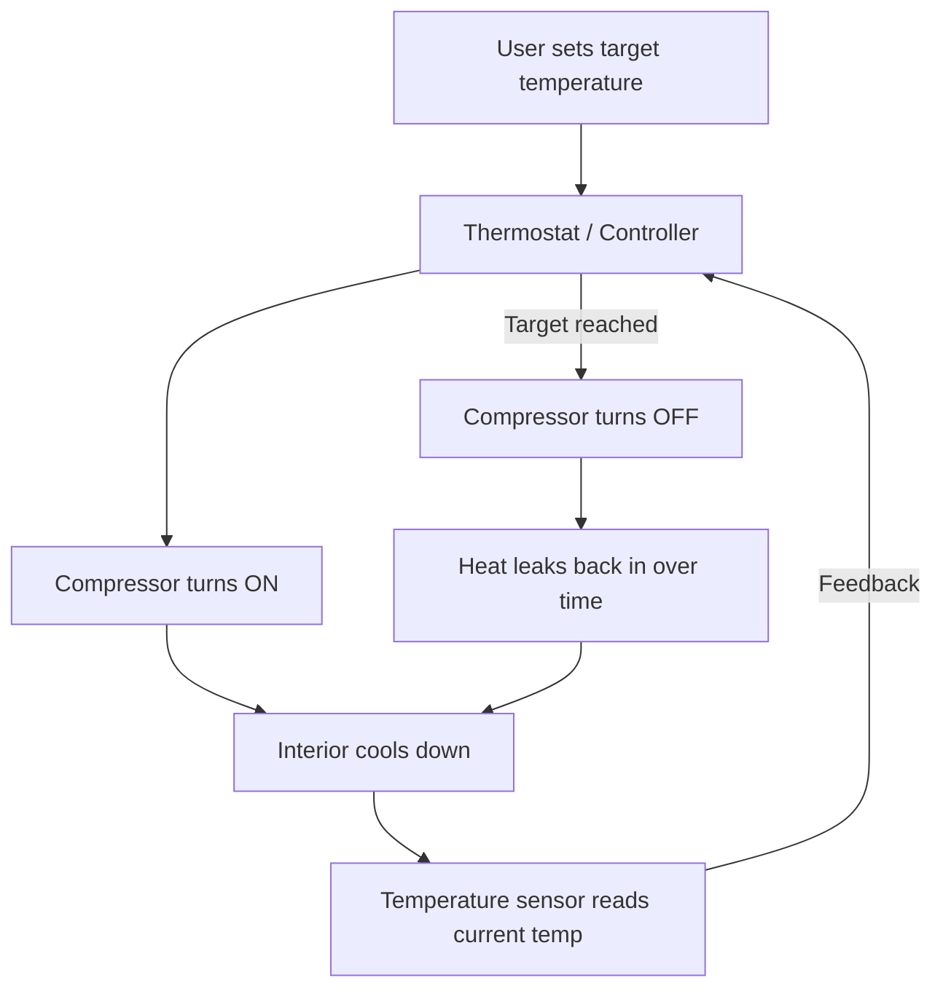
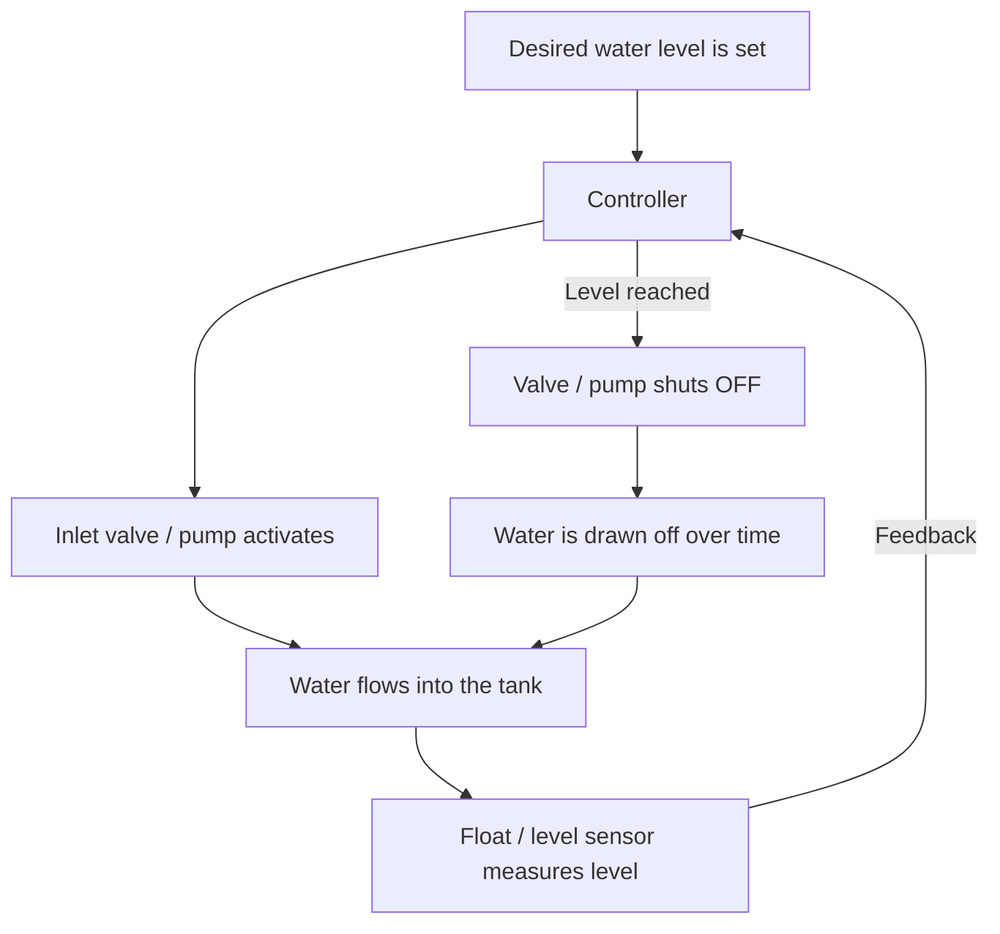

# Open-Loop vs. Closed-Loop Control Systems

## Overview

Every automated system needs some way to decide what action to take and when to stop taking it. Broadly, control systems fall into two families:

- **Open-loop systems** carry out a fixed instruction and never check whether the result actually matches what was intended.
- **Closed-loop systems** (also called feedback control systems) continuously measure their own output and adjust their action to keep that output at a desired target.

The dividing line between the two is a single concept: **feedback**. If a system has a sensor that reports the actual result back to the controller, and the controller uses that information to correct itself, it's closed-loop. If it just runs a pre-programmed sequence and trusts that the outcome will be correct, it's open-loop. This distinction shapes everything about how a system behaves: its cost, its precision, its ability to handle surprises, and how it fails.

---

## 1. Open-Loop Control Systems

### How it works

An open-loop system has four basic parts working in one direction only: an **input** (a command, a timer setting, a preset value), a **controller** that interprets that input, an **actuator** that performs the physical action, and a **process** that produces an **output**. Crucially, there is no path leading back from the output to the controller. Once the system starts, it has no way of knowing whether the actual result is correct — it simply executes the instruction it was given and stops when the instruction says to stop (after a fixed time, a fixed number of cycles, or a manual command), not when the desired result has actually been achieved.

Because there's no self-correction, the accuracy of an open-loop system depends entirely on how well its components are calibrated in advance and on external conditions staying roughly constant. If something changes — voltage fluctuates, ambient temperature shifts, a mechanical part wears down — the system has no way to notice or compensate.

### General Advantages

- **Simple design** — fewer components, easier to build and understand.
- **Low cost** — no sensors or feedback electronics required.
- **Fast and predictable** — the sequence of actions is fixed, so behavior is easy to anticipate.
- **Easy to maintain** — fewer parts means fewer things that can break.

### General Disadvantages / Flaws

- **No error correction** — if the output drifts from the desired result, the system won't notice or fix it.
- **Sensitive to disturbances** — external changes (load, temperature, voltage, wear) directly affect accuracy with nothing to compensate.
- **Requires accurate calibration** — precision depends entirely on the components being correctly set up beforehand; if they drift out of spec, so does the output.
- **Not adaptive** — the same fixed action is taken every time, even if it's no longer the right one for current conditions.

---

### Example: Electric Kettle

A basic electric kettle takes mains power, applies it fully to a heating element the moment it's switched on, and keeps that element powered for a fixed duration or until a simple mechanical/timer cutoff trips. It does not continuously sense the water's actual temperature and modulate power in response — it just executes the "heat for X" instruction blindly. The user's initial input (how long to run, or "boil once") is the only thing driving the process.

> Note: many modern kettles include a bimetallic strip that clicks off automatically once the water reaches boiling point. That small addition is actually a feedback mechanism, which technically nudges the kettle toward closed-loop behavior. A "pure" open-loop kettle is one that heats for a fixed time only, regardless of whether the water has actually reached boiling.

**Advantages**

- Very cheap and mechanically simple to manufacture.
- Reliable for a well-defined task (boil a roughly fixed volume of water from a consistent starting temperature).
- No electronics to fail — just a heating element and a timer or switch.

**Disadvantages / Flaws**

- Can overheat, under-heat, or waste energy if the starting water temperature, volume, or mains voltage differs from what the timer was calibrated for.
- No way to detect a dangerous condition (e.g., boiling dry) unless a separate safety cutoff is added.
- Cannot adjust automatically for altitude, ambient temperature, or partial fills — the same fixed cycle runs regardless.

---

### Example: Automatic Soap / Hand-Sanitizer Dispenser

A motion or IR sensor detects the presence of a hand underneath the nozzle. That detection event triggers the controller to run the pump for a **preset** duration — say, half a second — after which the pump switches off automatically. The dose delivered is a function of "how long the pump ran," not "how much liquid actually came out." The system has no way of confirming that a dose was dispensed, that the dose was the intended volume, or that the reservoir even had liquid left in it.

**Advantages**

- Touchless operation improves hygiene — a key reason these are popular in public restrooms and healthcare settings.
- Simple, inexpensive electronics (one sensor, one pump, one timer).
- Consistent dose size in normal operating conditions.

**Disadvantages / Flaws**

- Dispenses a "dose" even if the reservoir is empty or nearly empty — the pump still runs for its preset time and may just sputter out air.
- Liquid viscosity changes (e.g., switching from thin sanitizer to thicker soap) change the actual volume dispensed, since the system only controls _time_, not _volume_.
- Cannot detect a clogged nozzle or a jammed pump — it will "complete" its cycle even if nothing came out.
- No feedback to alert users or maintenance staff that a refill is needed.

---

## 2. Closed-Loop Control Systems

### How it works

A closed-loop system adds one critical component to the open-loop chain: a **sensor** that measures the actual output, plus a feedback path that carries that measurement back to the controller. The controller continuously compares the measured value against a desired **setpoint** and calculates the difference, called the **error**. Based on that error, it drives the actuator to push the output closer to the setpoint, then measures again, recalculates the error, and repeats — often many times per second. This loop lets the system respond in real time to disturbances that an open-loop system could never react to, such as a door being opened, heat leaking in, or resources being consumed.

Closed-loop systems typically operate around a threshold or "deadband" rather than a single perfect value — for example, a fridge doesn't run the compressor continuously to hold _exactly_ one temperature; it lets the temperature drift slightly within a small range and switches the compressor on and off to keep it there. This on/off (or proportional) cycling is a defining behavior of feedback systems.

### General Advantages

- **Self-correcting** — automatically compensates for disturbances and drift.
- **Higher accuracy** — output is actively kept close to the desired setpoint over time.
- **Adaptive** — responds to changing conditions rather than blindly repeating a fixed action.
- **Safer for critical applications** — can detect abnormal conditions (e.g., overheating) and react.

### General Disadvantages / Flaws

- **More complex and expensive** — requires sensors, comparison logic, and often more sophisticated actuators.
- **Possible instability** — if poorly tuned, feedback loops can overshoot, oscillate, or even become unstable.
- **Slower response in some cases** — the loop has to measure, compare, and correct, which takes time compared to a system that just fires an action instantly.
- **More points of failure** — a faulty sensor can feed the controller bad data, causing incorrect (sometimes dangerous) corrective action.

---

### Example: Refrigerator Temperature Control

The user sets a target temperature (the setpoint) via a dial or digital control. A thermostat or temperature sensor inside the compartment continuously monitors the actual air temperature and reports it back to the controller. As long as the measured temperature is above the target (plus a small tolerance band), the controller keeps the compressor running, circulating refrigerant to pull heat out of the interior. Once the measured temperature drops to the target, the controller switches the compressor off. Because heat constantly leaks back in — through the walls, the door seal, or every time the door is opened — the temperature slowly rises again, the sensor detects that drift, and the controller switches the compressor back on. This on/off cycling repeats indefinitely, which is precisely what allows the fridge to maintain a roughly constant internal temperature despite constantly changing conditions.

**Advantages**

- Automatically maintains a stable internal temperature regardless of how often the door is opened or how much food is loaded in.
- Compensates for external conditions like a warm kitchen or seasonal temperature swings.
- Protects food safety by actively correcting temperature drift rather than letting it accumulate.

**Disadvantages / Flaws**

- More expensive and mechanically complex than a simple always-on cooling system.
- A faulty or dirty sensor can cause the compressor to run too much (wasting energy, wearing out the compressor) or too little (risking food spoilage).
- The on/off cycling itself causes minor temperature swings rather than a perfectly flat line — real closed-loop systems oscillate within a tolerance band, they don't hold one exact value.
- If the feedback loop is poorly tuned, it can short-cycle the compressor (turning on and off too rapidly), reducing its lifespan.

---

### Example: Water-Level Controller in a Tank

A desired water level is set as the target. A float switch, ultrasonic sensor, or similar level sensor continuously monitors the actual water level inside the tank and feeds that reading back to the controller. If the level drops below the setpoint — because water is being drawn off for use — the controller opens an inlet valve or starts a pump to refill the tank. As the water rises, the sensor keeps reporting the updated level, and once it reaches the target, the controller shuts the valve or pump off. If water is drawn off again later, the cycle repeats automatically, with no manual intervention needed.

**Advantages**

- Fully automatic — keeps the tank supplied without anyone having to monitor it manually.
- Prevents both overflow (wasted water, potential flooding) and the tank running dry.
- Adapts to variable demand — refills faster or slower depending on how quickly water is being consumed.

**Disadvantages / Flaws**

- A stuck or fouled float switch can cause the tank to overflow or the pump to run dry, since the controller trusts whatever the sensor reports.
- Requires ongoing maintenance of the sensor and valve/pump mechanism, unlike a simple manual tap.
- Rapid, repeated fluctuations in demand can cause the pump or valve to cycle on and off frequently, adding mechanical wear.
- More expensive to install than a manually operated fill system.

---

## 3. Quick Comparison

| Aspect               | Open-Loop                                                  | Closed-Loop                                           |
| -------------------- | ---------------------------------------------------------- | ----------------------------------------------------- |
| Feedback             | None                                                       | Continuous, from a sensor                             |
| Self-correcting      | No                                                         | Yes                                                   |
| Complexity & cost    | Simple, cheap                                              | More complex, needs sensors                           |
| Handles disturbances | Cannot react to unexpected changes                         | Automatically compensates                             |
| Precision            | Depends entirely on component calibration                  | Depends on sensor accuracy & control tuning           |
| Risk of instability  | None (no feedback to destabilize)                          | Possible if poorly tuned (overshoot, oscillation)     |
| Maintenance          | Minimal — fewer parts to fail                              | Higher — sensors and feedback electronics need upkeep |
| Examples             | Electric kettle (fixed cycle), soap dispenser (fixed dose) | Refrigerator thermostat, water-level controller       |

---

## 4. Takeaway

Open-loop systems are simple, cheap, and perfectly adequate for tasks with a short, predictable action — heat for a fixed time, dispense a fixed dose. Their weakness is that they're blind: they cannot tell whether the result was actually correct, and they cannot adapt if conditions change. Closed-loop systems trade that simplicity for **reliability under changing conditions**, using continuous feedback to actively hold a system at a desired state — a temperature, a level, a speed — over time, at the cost of extra components, complexity, and the risk of instability if the feedback loop isn't well designed. The right choice depends on the task: use open-loop when you just need to _perform_ a one-off action, and closed-loop when you need to _maintain_ a state despite the world constantly trying to push it off target.