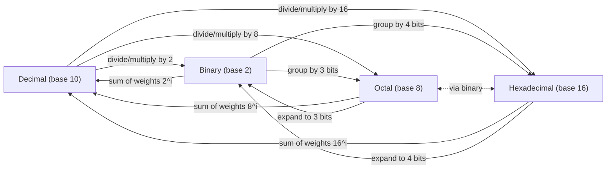

# Digital Electronics Reviewer
## Number Systems, Coding Schemes, and Binary Addition

---

## 1. Number Systems Overview

A number system is defined by its **base (radix)** — the number of unique digits it uses.

| System | Base | Digits Used |
|---|---|---|
| Binary | 2 | 0, 1 |
| Octal | 8 | 0–7 |
| Decimal | 10 | 0–9 |
| Hexadecimal | 16 | 0–9, A–F (A=10, B=11, C=12, D=13, E=14, F=15) |

Any number in a positional number system can be expressed as:

$$
N = \sum_{i=-m}^{n} d_i \times b^{i}
$$

where $d_i$ is the digit at position $i$, $b$ is the base, $n$ is the number of integer digits minus 1, and $m$ is the number of fractional digits.

**Example (decimal expansion of a binary number):**

$$
1011.01_2 = (1\times2^3)+(0\times2^2)+(1\times2^1)+(1\times2^0)+(0\times2^{-1})+(1\times2^{-2})
$$

$$
= 8+0+2+1+0+0.25 = 11.25_{10}
$$

---

## 2. Number System Conversions

### 2.1 Decimal → Binary (or any base)

**Integer part:** Repeated division by the target base; read remainders **bottom to top**.

**Fractional part:** Repeated multiplication by the target base; read carries **top to bottom**.

**Example: Convert $45.625_{10}$ to binary**

Integer part (45 ÷ 2):

```
45 ÷ 2 = 22 remainder 1   (LSB)
22 ÷ 2 = 11 remainder 0
11 ÷ 2 =  5 remainder 1
 5 ÷ 2 =  2 remainder 1
 2 ÷ 2 =  1 remainder 0
 1 ÷ 2 =  0 remainder 1   (MSB)
```
Reading bottom to top: $45_{10} = 101101_2$

Fractional part (0.625 × 2):

```
0.625 × 2 = 1.25  → carry 1  (MSB of fraction)
0.25  × 2 = 0.50  → carry 0
0.50  × 2 = 1.00  → carry 1  (LSB of fraction)
```
Reading top to bottom: $0.625_{10} = 0.101_2$

$$
\boxed{45.625_{10} = 101101.101_2}
$$

### 2.2 Binary → Decimal

Multiply each bit by its positional weight ($2^i$) and sum, as shown in Section 1.

### 2.3 Binary ↔ Octal

Since $8 = 2^3$, group binary digits into **sets of 3** (from the binary point outward), padding with zeros as needed.

**Example:** $101101.101_2$

$$
\underbrace{101}_{5}\ \underbrace{101}_{5}\ .\ \underbrace{101}_{5} \rightarrow 55.5_8
$$

Group: `101 101 . 101` = `5 5 . 5` → $55.5_8$

To convert octal → binary, expand each octal digit into 3 bits.

### 2.4 Binary ↔ Hexadecimal

Since $16 = 2^4$, group binary digits into **sets of 4**.

**Example:** $101101.101_2$

Pad: `0010 1101 . 1010` = `2 D . A` → $2D.A_{16}$

To convert hex → binary, expand each hex digit into 4 bits.

### 2.5 Octal ↔ Hexadecimal

Convert through binary as an intermediate step: Octal → Binary → Hexadecimal (or vice versa).

### 2.6 Quick Reference Table

| Decimal | Binary | Octal | Hex |
|---|---|---|---|
| 0 | 0000 | 0 | 0 |
| 1 | 0001 | 1 | 1 |
| 2 | 0010 | 2 | 2 |
| 3 | 0011 | 3 | 3 |
| 4 | 0100 | 4 | 4 |
| 5 | 0101 | 5 | 5 |
| 6 | 0110 | 6 | 6 |
| 7 | 0111 | 7 | 7 |
| 8 | 1000 | 10 | 8 |
| 9 | 1001 | 11 | 9 |
| 10 | 1010 | 12 | A |
| 11 | 1011 | 13 | B |
| 12 | 1100 | 14 | C |
| 13 | 1101 | 15 | D |
| 14 | 1110 | 16 | E |
| 15 | 1111 | 17 | F |

### 2.7 Conversion Map



---

## 3. Straight Binary Coding

**Straight (pure) binary** is a **weighted, positional code** in which every bit's value is determined solely by its power-of-2 position — there is no gap or reassignment of codes. It is the natural binary representation used directly in arithmetic.

Key properties:
- Each additional bit doubles the range of representable values: $n$ bits represent $2^n$ distinct values, from $0$ to $2^n - 1$.
- It is **weighted**: bit weights are $\ldots, 2^3, 2^2, 2^1, 2^0$ (and $2^{-1}, 2^{-2}, \ldots$ for fractions).
- It is efficient for **arithmetic operations** (addition, subtraction, multiplication) but not ideal for display or mechanical/optical position-sensing applications (see Gray Code, Section 5).

**Example — 4-bit straight binary count:**

| Decimal | Straight Binary |
|---|---|
| 0 | 0000 |
| 1 | 0001 |
| 2 | 0010 |
| 3 | 0011 |
| 4 | 0100 |
| 5 | 0101 |
| 6 | 0110 |
| 7 | 0111 |
| 8 | 1000 |
| 9 | 1001 |
| 10 | 1010 |
| 11 | 1011 |
| 12 | 1100 |
| 13 | 1101 |
| 14 | 1110 |
| 15 | 1111 |

Notice that from one count to the next, **multiple bits can change simultaneously** (e.g., $0111 \to 1000$, all 4 bits flip). This is the key weakness that Gray code solves.

---

## 4. Binary Coded Decimal (BCD)

**BCD** encodes **each decimal digit separately** using its own 4-bit straight binary code (0000–1001). It is *not* the same as converting the whole decimal number to binary.

$$
\text{BCD}(N) = \text{concatenation of } \text{binary}_4(d_i) \text{ for each decimal digit } d_i
$$

**Example: Convert $945_{10}$ to BCD**

| Digit | 9 | 4 | 5 |
|---|---|---|---|
| BCD | 1001 | 0100 | 0101 |

$$
945_{10} = 1001\ 0100\ 0101_{\text{BCD}}
$$

Compare with straight binary: $945_{10} = 1110110001_2$ — a completely different (and shorter) bit pattern. **BCD always uses 4 bits per digit**, so it is less efficient in storage than pure binary, but it is easy to convert to/from human-readable decimal, which is why it's used in digital clocks, calculators, and seven-segment displays.

**Invalid BCD codes:** 1010, 1011, 1100, 1101, 1110, 1111 (i.e., 10–15) are **not used** in BCD since decimal digits only go up to 9.

### 4.1 BCD Addition

Add the 4-bit groups like normal binary, then apply a **correction**: if a group's result is greater than 9 (1001) or a carry-out of that group occurred, **add 6 (0110)** to that group to skip over the 6 invalid codes.

**Example: $8_{BCD} + 7_{BCD}$**

$$
1000 + 0111 = 1111 \; (15_{10}\text{, invalid BCD, } >1001)
$$

Add correction factor $0110$:

$$
1111 + 0110 = 1\ 0101
$$

Result: carry 1, digit 5 → $15_{10} = 0001\ 0101_{\text{BCD}}$ ✓ correct.

---

## 5. Gray Code

**Gray code** (reflected binary code) is a **non-weighted** binary code in which **only one bit changes between any two consecutive values**. It eliminates the ambiguity/glitches of straight binary during transitions, making it ideal for rotary encoders, Karnaugh maps, and error-reduction in mechanical/analog-to-digital systems.

### 5.1 Binary → Gray Code Conversion

$$
G_{n-1} = B_{n-1}
$$
$$
G_i = B_i \oplus B_{i+1} \quad \text{for } i = n-2, \ldots, 0
$$

(i.e., XOR each bit with the bit to its left; the MSB stays the same)

**Example: Convert $1011_2$ to Gray code**

```
Binary:      1   0   1   1
              \  X   X   X
Gray:  1   (1⊕0)  (0⊕1)  (1⊕1)
     =  1      1       1      0
```

$$
1011_2 \rightarrow 1110_{\text{Gray}}
$$

### 5.2 Gray Code → Binary Conversion

$$
B_{n-1} = G_{n-1}
$$
$$
B_i = G_i \oplus B_{i+1} \quad \text{for } i = n-2, \ldots, 0
$$

(i.e., XOR each Gray bit with the **previously computed binary bit**, propagating left to right)

**Example: Convert $1110_{\text{Gray}}$ back to binary**

$$
B_3 = 1
$$
$$
B_2 = G_2 \oplus B_3 = 1 \oplus 1 = 0
$$
$$
B_1 = G_1 \oplus B_2 = 1 \oplus 0 = 1
$$
$$
B_0 = G_0 \oplus B_1 = 0 \oplus 1 = 1
$$

Result: $1011_2$ ✓ matches the original.

### 5.3 4-bit Straight Binary vs. Gray Code Table

| Decimal | Straight Binary | Gray Code | Bits Changed (Gray) |
|---|---|---|---|
| 0 | 0000 | 0000 | — |
| 1 | 0001 | 0001 | 1 |
| 2 | 0010 | 0011 | 1 |
| 3 | 0011 | 0010 | 1 |
| 4 | 0100 | 0110 | 1 |
| 5 | 0101 | 0111 | 1 |
| 6 | 0110 | 0101 | 1 |
| 7 | 0111 | 0100 | 1 |
| 8 | 1000 | 1100 | 1 |
| 9 | 1001 | 1101 | 1 |
| 10 | 1010 | 1111 | 1 |
| 11 | 1011 | 1110 | 1 |
| 12 | 1100 | 1010 | 1 |
| 13 | 1101 | 1011 | 1 |
| 14 | 1110 | 1001 | 1 |
| 15 | 1111 | 1000 | 1 |

Notice that Gray code changes **exactly one bit** at every step — including the wraparound from 15 back to 0 — which is why it's also called a "cyclic" code.

---

## 6. Binary Addition

Binary addition follows the same place-value logic as decimal addition, using these four basic rules:

$$
0+0=0 \qquad 0+1=1 \qquad 1+0=1 \qquad 1+1=10\ (\text{write } 0,\ \text{carry } 1)
$$

And for three bits (when adding a carry-in):

$$
1+1+1 = 11\ (\text{write } 1,\ \text{carry } 1)
$$

### 6.1 Example: Add $1011_2 + 1101_2$

```
   Carry:   1 1 1
            1 0 1 1
        +   1 1 0 1
        -----------
          1 1 0 0 0
```

Step-by-step (right to left):
- Bit 0: $1+1 = 0$, carry 1
- Bit 1: $1+0+1(\text{carry}) = 0$, carry 1
- Bit 2: $0+1+1(\text{carry}) = 0$, carry 1
- Bit 3: $1+1+1(\text{carry}) = 1$, carry 1
- Final carry out becomes the new MSB: $1$

$$
1011_2 + 1101_2 = 11000_2
$$

**Verification in decimal:** $11 + 13 = 24$, and $11000_2 = 16+8 = 24_{10}$ ✓

### 6.2 Example with a Fraction: $101.11_2 + 011.01_2$

```
       1 1        (carries)
      1 0 1 . 1 1
    + 0 1 1 . 0 1
    -------------
      1 0 0 1 . 0 0
```

$$
101.11_2 + 011.01_2 = 1001.00_2
$$

**Verification:** $5.75 + 3.25 = 9.00$ ✓

### 6.3 Binary Addition Using 2's Complement (for Subtraction Context)

Binary subtraction is often performed as addition of the 2's complement:

$$
A - B = A + (\overline{B} + 1)
$$

**Example: $1010_2 - 0011_2$**

1. Complement $0011$: $\overline{0011} = 1100$
2. Add 1: $1100 + 1 = 1101$ (this is $-3$ in 2's complement)
3. Add to $A$: $1010 + 1101 = 1\ 0111$
4. Discard the overflow carry bit (since both operands are 4-bit): result = $0111_2 = 7_{10}$

**Verification:** $10 - 3 = 7$ ✓

---

## 7. Summary Cheat Sheet

| Concept | Key Idea |
|---|---|
| **Positional conversion** | $N = \sum d_i \cdot b^i$; divide/multiply for decimal↔other base; group bits (3 for octal, 4 for hex) for binary↔octal/hex |
| **Straight binary** | Weighted code, powers of 2, standard for arithmetic |
| **BCD** | Each decimal digit → its own 4-bit binary (0000–1001); add 6 to correct invalid/carry results |
| **Gray code** | Non-weighted, only 1 bit changes per step; $G_i = B_i \oplus B_{i+1}$; used in encoders to avoid transition errors |
| **Binary addition** | Same as decimal addition with base 2 rules; $1+1=10$; carry propagates left |

---

## 8. Practice Problems

1. Convert $173_{10}$ to binary, octal, and hexadecimal.
2. Convert $10110.101_2$ to decimal.
3. Convert $3A.C_{16}$ to binary and decimal.
4. Express $607_{10}$ in BCD.
5. Convert $1101_2$ to Gray code, then convert the result back to binary to verify.
6. Add $11011_2 + 10110_2$ and verify in decimal.
7. Perform $1000_2 - 0101_2$ using 2's complement addition.

*(Answers can be verified using the conversion methods and formulas above.)*
